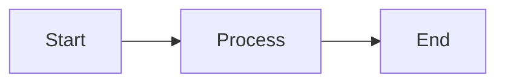
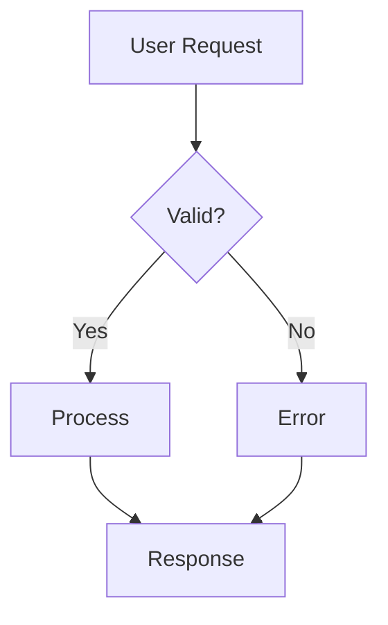
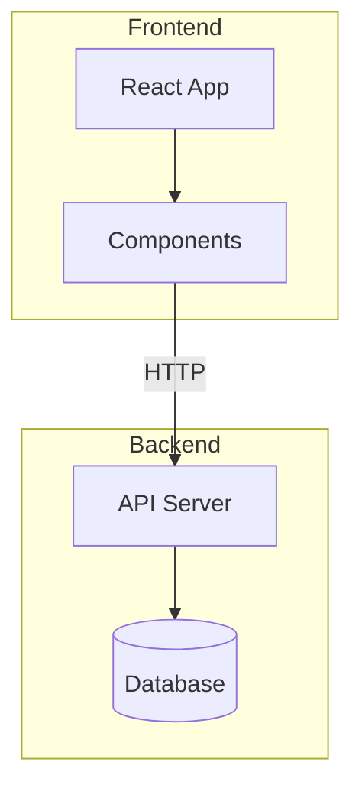
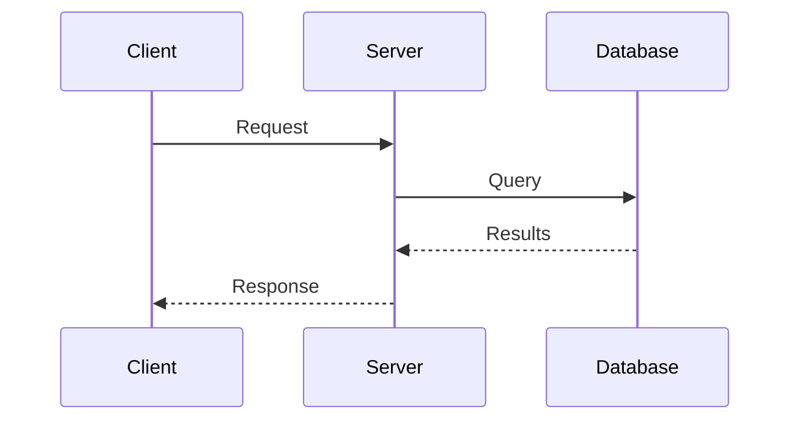
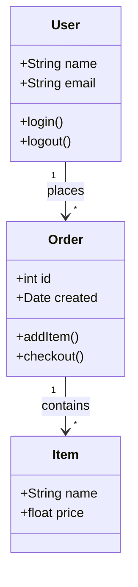
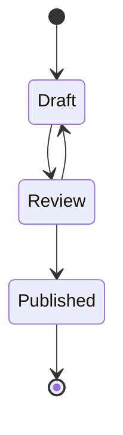
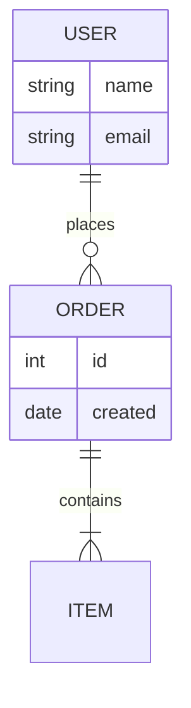
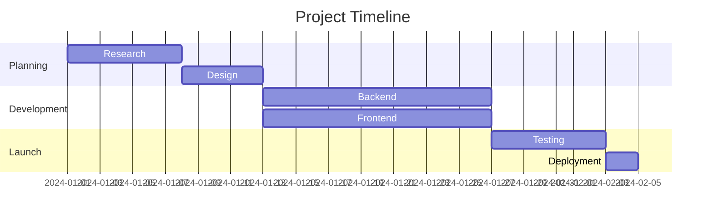
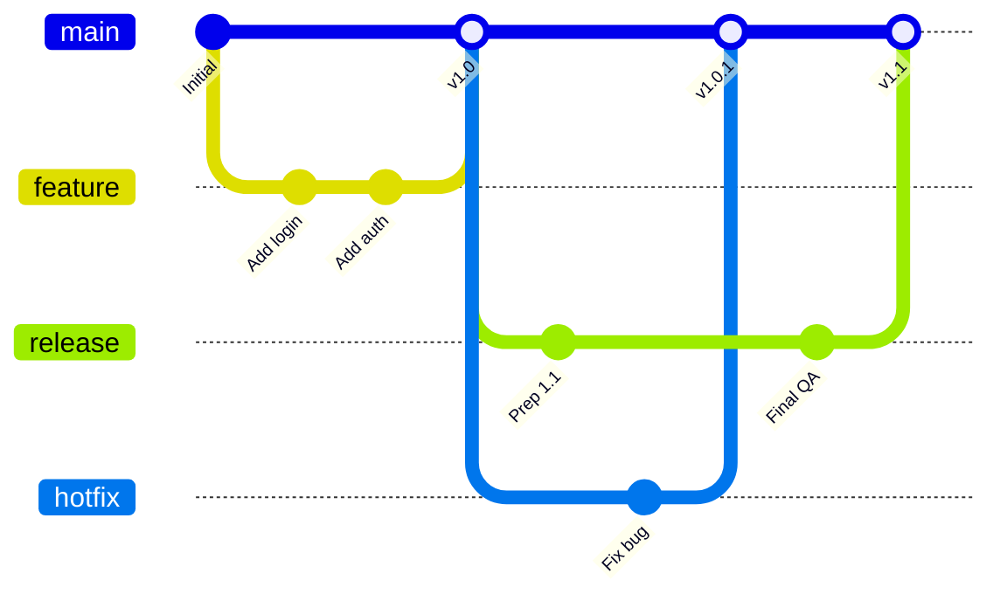
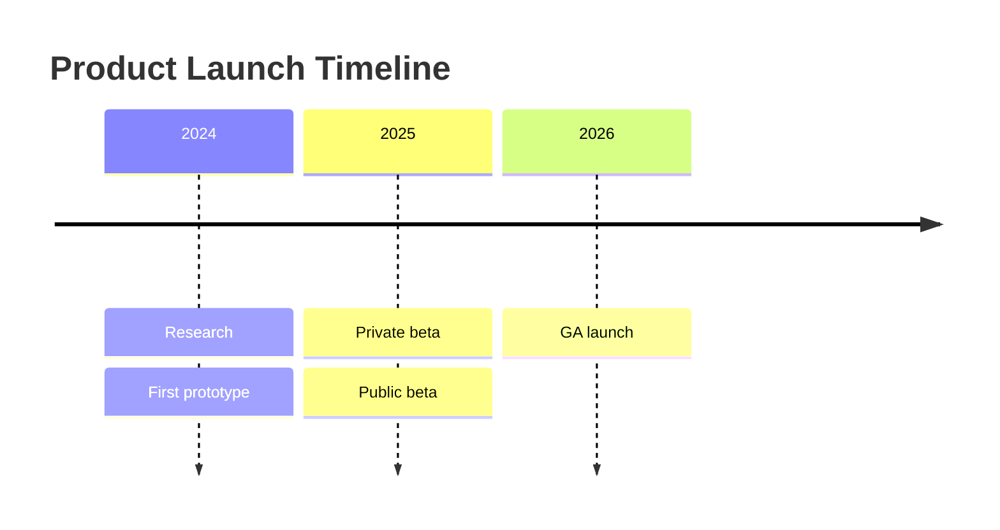

以文本形式在围栏代码块中编写图表。Jamdesk 会在构建时将其渲染为 SVG。

<Tip>
  在 [Jamdesk Mermaid 编辑器](https://jamdesk.com/utilities/mermaid-editor)中草拟并预览你的图表。
  这是一个开源编辑器，在浏览器中运行，边输入边渲染。
  将结果粘贴到 `mermaid` 围栏代码块中。
</Tip>

<Tip>
  Jamdesk 还会在 `d2` 围栏代码块中渲染 [D2 图表](/cn/components/d2)。
  当图表需要嵌套容器、带主键和外键的 SQL 架构，或者你希望切换布局引擎时，请使用 D2。
  本页的 Mermaid 示例在 [D2 页面](/cn/components/d2)上都有对应的 D2 版本。
</Tip>

## 基本用法

使用带有 `mermaid` 语言标识符的围栏代码块：

````mdx

````


## 图表类型

### 流程图

方向可以是从上到下（`TD`）、从左到右（`LR`）、从下到上（`BT`）或从右到左（`RL`）。



````mdx

````

#### 子图

使用子图对相关节点进行分组。可以用它将大型流程图拆分为"前端"和"后端"等部分，或拆分为流水线阶段。



````mdx

````

### 时序图

时序图展示组件之间随时间的交互过程。用它来描述 API 调用流程和身份验证握手。参与者显示为垂直生命线，消息在它们之间传递。



````mdx

````

### 类图

类图展示面向对象系统的结构，例如数据模型或服务的核心类型。它展示类及其属性、方法和关系。



````mdx

````

### 状态图

状态图描述对象或流程的生命周期。它展示每个状态以及状态之间的转换。订单状态和文档审批流程是典型示例。



````mdx

````

### 实体关系图

ER 图用于记录数据库架构和数据模型。它展示实体（表）、其属性（列）以及它们之间的关系。符号标注基数：一对一、一对多或多对多。



````mdx

````

### 甘特图

甘特图展示项目进度。任务显示为时间线上的水平条，包含持续时间、依赖关系和并行工作。可用于项目计划或路线图。



````mdx

````

### Git 图

Git 图展示分支策略和版本控制工作流：提交、分支、合并和仓库历史。每个分支有各自的颜色。



````mdx

````

### 时间线图

时间线展示跨时段的事件。以 `timeline` 关键字开头，可选 `title`，然后每个时段一行，事件之间用冒号分隔：



````mdx

````

### 饼图

饼图以圆形切片展示比例。当各部分组成一个整体时使用，例如市场份额或调查结果。切片建议不超过 6 个。

```mermaid
pie title Browser Market Share
    "Chrome" : 65
    "Safari" : 19
    "Firefox" : 10
    "Edge" : 4
    "Other" : 2
```

````mdx
```mermaid
pie title Browser Market Share
    "Chrome" : 65
    "Safari" : 19
    "Firefox" : 10
    "Edge" : 4
    "Other" : 2
```
````

## 流程图形状

每种形状在流程图中都有约定的含义：

| 语法       | 形状     | 用途 |
| ---------- | -------- | ---- |
| `[text]`   | 矩形     | 处理步骤、操作 |
| `(text)`   | 圆角矩形 | 起点/终点 |
| `{text}`   | 菱形     | 决策、条件 |
| `([text])` | 体育场形 | 事件、触发器 |
| `[[text]]` | 子程序   | 预定义流程 |
| `[(text)]` | 圆柱体   | 数据库、存储 |

## 箭头类型

箭头表示流向和关系类型：

| 语法        | 描述     | 用途 |
| ----------- | -------- | ---- |
| `-->`       | 实线箭头 | 常规流程 |
| `---`       | 实线     | 关联关系 |
| `-.->`      | 虚线箭头 | 可选或异步流程 |
| `==>`       | 粗箭头   | 重要路径 |
| `--text-->` | 带标签箭头 | 描述转换 |

## 调整宽图表的尺寸

使用带 `minWidth` 属性的 `Mermaid` 组件，防止宽图表（例如甘特图或大型 Git 图）被压缩：

```mdx
<Mermaid minWidth="700px">
gantt
    title Wide Project Timeline
    ...
</Mermaid>
```

## 点击展开

在宽度为 768px 及以上的屏幕上，点击图表即可全屏打开。使用键盘时，聚焦图表后按 Enter。按 Escape、点击关闭按钮或点击图表外部即可关闭。

使用组件形式和 `noZoom` 可关闭单个图表的此功能：

```mdx
<Mermaid noZoom>
graph LR
    A[Request] --> B[Response]
</Mermaid>
```

以 ```` ```mermaid ```` 代码围栏编写的图表始终全屏打开。

## 样式提示

<Tip>
  Mermaid 图表会随站点切换深色模式。
</Tip>

- 将大型流程拆分为较小的图表。
- 为箭头添加标签以说明转换。
- 选择一个方向：`TD`（从上到下）适用于高图表，`LR`（从左到右）适用于宽图表。
- 每个图表的节点数控制在 10-15 个以内。

要为节点上色，可对单个节点使用 `style`，对一组节点使用 `classDef`：

```mermaid
graph LR
    A[Start] --> B[Review] --> C[Done]
    classDef good fill:#d1fae5,stroke:#059669
    style B fill:#fef3c7,stroke:#d97706
    class C good
```

Jamdesk 会在深色模式下保留你的颜色。如果填充色未指定文字颜色，Jamdesk 会为标签挑选一种与填充色相配、便于阅读的颜色。

## 了解更多

完整语法（包括样式、主题和更多图表类型）请参阅 [Mermaid 官方文档](https://mermaid.js.org/intro/)。

## 接下来

<Columns cols={2}>
  <Card title="D2 图表" icon="diagram-project" href="/cn/components/d2">
    使用 D2 绘制架构、容器和 SQL 架构
  </Card>
  <Card title="组件概览" icon="puzzle-piece" href="/cn/components/overview">
    浏览所有可用组件
  </Card>
  <Card title="MDX 基础" icon="file-code" href="/cn/content/mdx-basics">
    了解如何在 MDX 中使用组件
  </Card>
</Columns>