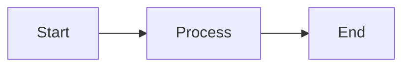
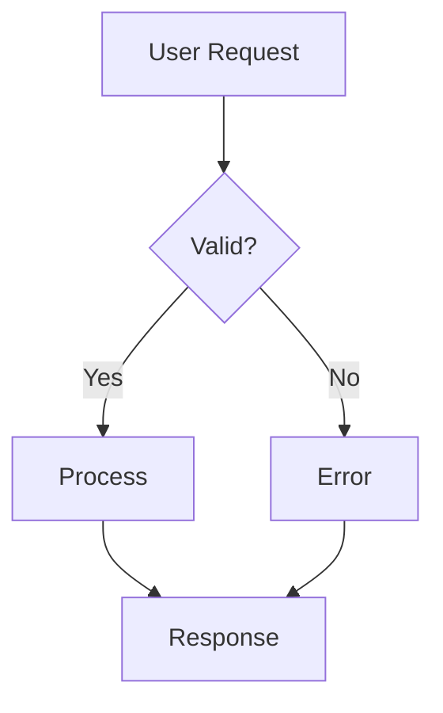
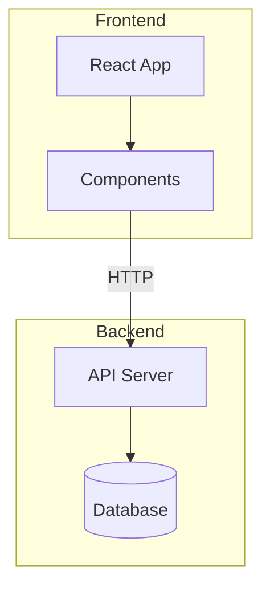
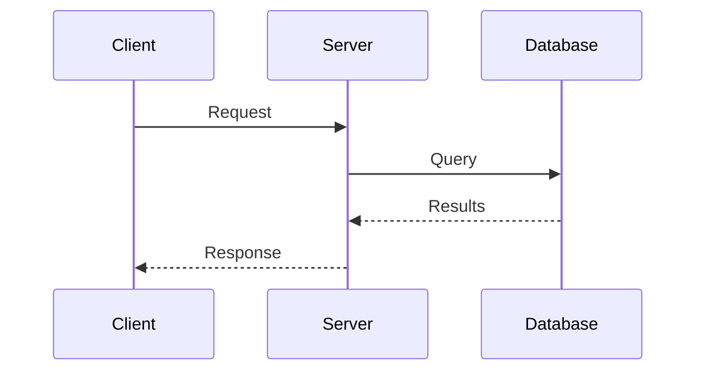
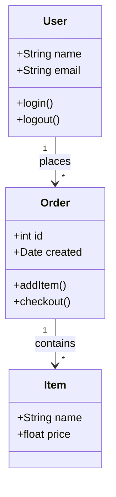
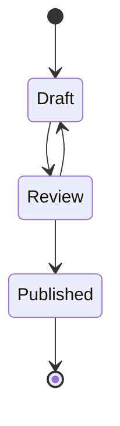
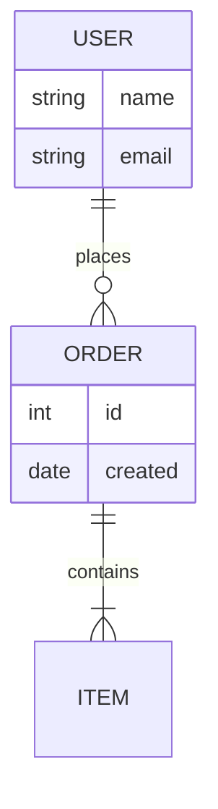
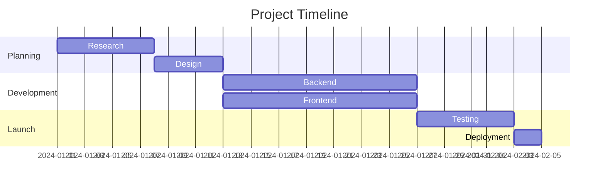
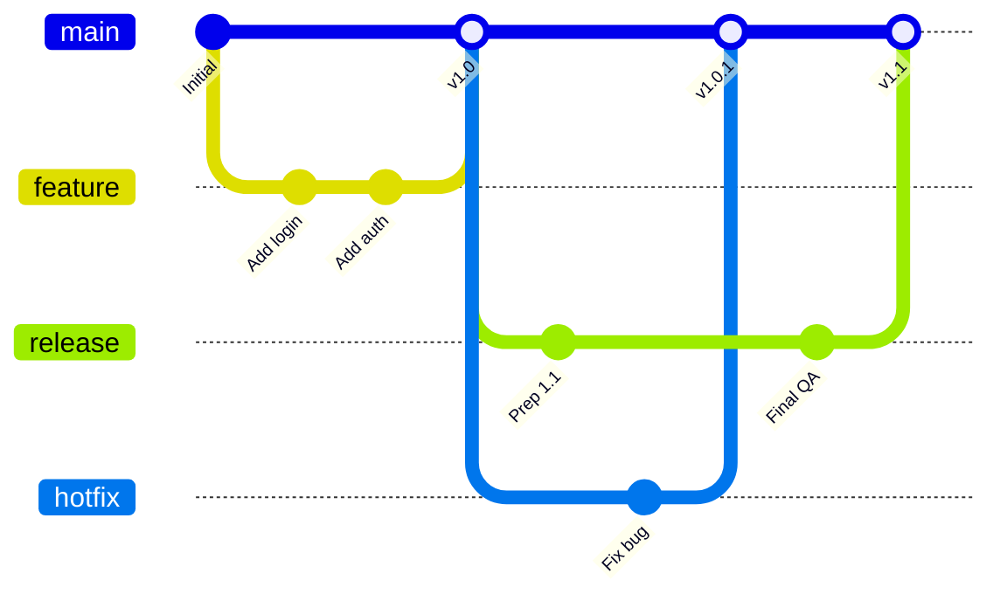
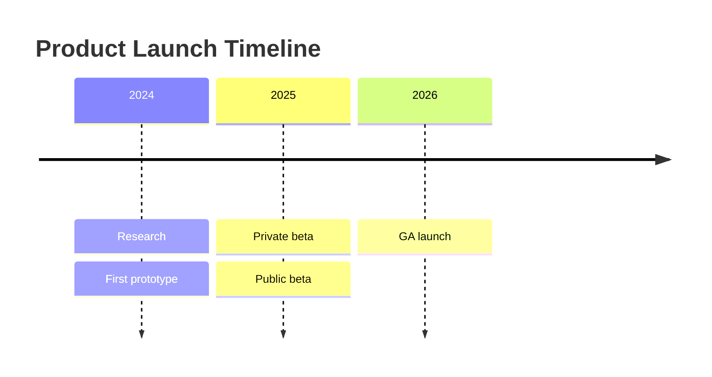

在围栏代码块中以文本形式编写图表。Jamdesk 会在构建时将其渲染为 SVG。

<Tip>
  可在 [Jamdesk Mermaid 编辑器](https://jamdesk.com/utilities/mermaid-editor)中起草并预览图表。这个开源的浏览器编辑器和查看器支持编写 Mermaid 语法并实时查看渲染效果，然后将内容粘贴到此处的 `mermaid` 围栏代码块中。
</Tip>

<Tip>
  Jamdesk 还支持在 `d2` 围栏代码块中编写 [D2 图表](/cn/components/d2)。
  如果图表需要嵌套容器、包含主键和外键的 SQL 架构，或者你想更换布局引擎，可以使用 D2。本页中的 Mermaid 示例也可以在 [D2 页面](/cn/components/d2)中找到对应的 D2 示例。
</Tip>

## 基本用法

使用带有 `mermaid` 语言标识符的围栏代码块：

````mdx

````


## 图表类型

### 流程图

方向可以是从上到下（`TD`）、从左到右（`LR`）、从下到上（`BT`）或从右到左（`RL`）。



````mdx

````

#### 子图

使用子图将相关节点分组。这有助于将复杂的流程图整理为逻辑分明的部分，例如“Frontend”和“Backend”，或管道中的不同阶段。



````mdx

````

### 时序图

时序图展示组件随时间的交互方式。API 调用流程和身份验证握手都适合使用时序图。参与者以垂直生命线表示，消息在参与者之间传递。



````mdx

````

### 类图

类图表示面向对象系统的结构，例如数据模型或服务的核心类型。图中会显示类及其属性、方法，以及类之间的关系。



````mdx

````

### 状态图

状态图用于建模对象或流程的生命周期，展示所有可能的状态及其转换。订单状态和文档审批流程就是典型示例。



````mdx

````

### 实体关系图

ER 图用于记录数据库架构和数据模型，展示实体（表）、实体的属性（列）以及实体之间的关系。符号表示基数：一对一、一对多或多对多。



````mdx

````

### 甘特图

甘特图用于展示项目计划和时间线。任务以横跨时间线的横条显示，可呈现持续时间、依赖关系和并行工作。项目计划或路线图都很适合用甘特图表示。



````mdx

````

### Git 图

Git 图用于展示分支策略和版本控制流程，包括提交、分支、合并以及仓库的整体历史记录。每个分支都以不同颜色标示，便于识别。



````mdx

````

### 时间线图

时间线用于展示一段时期内发生的事件。以 `timeline` 关键字开头，可选添加 `title`，然后每个时期占一行，事件之间用冒号分隔：



````mdx

````

### 饼图

饼图将比例数据显示为圆形切片。适合用于展示组成整体的各个部分，例如市场份额或调查结果。为便于阅读，切片数量不要超过 6 个。

```mermaid
pie title Browser Market Share
    "Chrome" : 65
    "Safari" : 19
    "Firefox" : 10
    "Edge" : 4
    "Other" : 2
```

````mdx
```mermaid
pie title Browser Market Share
    "Chrome" : 65
    "Safari" : 19
    "Firefox" : 10
    "Edge" : 4
    "Other" : 2
```
````

## 流程图形状

不同形状在流程图中代表不同含义：

| 语法 | 形状 | 用途 |
| ---------- | ------------------- | ------- |
| `[text]` | 矩形 | 流程步骤、操作 |
| `(text)` | 圆角矩形 | 起点/终点 |
| `{text}` | 菱形 | 决策、条件 |
| `([text])` | 体育场形 | 事件、触发器 |
| `[[text]]` | 子程序 | 预定义流程 |
| `[(text)]` | 圆柱体 | 数据库、存储 |

## 箭头类型

箭头表示流程方向和关系类型：

| 语法 | 描述 | 用途 |
| ----------- | ---------------- | ------- |
| `-->` | 实线箭头 | 常规流程 |
| `---` | 实线 | 关联 |
| `-.->` | 虚线箭头 | 可选或异步流程 |
| `==>` | 粗箭头 | 重要路径 |
| `--text-->` | 带标签的箭头 | 描述转换 |

## 调整宽图表的尺寸

对于甘特图或复杂 Git 图等宽图表，可以直接使用带有 `minWidth` 属性的 `Mermaid` 组件，避免图表被压缩：

```mdx
<Mermaid minWidth="700px">
gantt
    title Wide Project Timeline
    ...
</Mermaid>
```

## 点击展开

在宽度为 768px 或更大的屏幕上，点击图表即可全屏打开。使用键盘时，将焦点移到图表上并按 Enter。按 Escape、点击关闭按钮或图表外部，即可关闭图表。

若要对单个图表关闭此功能，请使用带有 `noZoom` 的组件形式：

```mdx
<Mermaid noZoom>
graph LR
    A[Request] --> B[Response]
</Mermaid>
```

使用 ```` ```mermaid ```` 围栏代码块编写的图表始终会全屏打开。

## 样式提示

<Tip>
  Mermaid 图表会自动适配浅色和深色模式。在两种主题下，颜色都经过优化，易于阅读。
</Tip>

制作有效图表的建议：

- 保持简洁：将复杂流程拆分为多个较小的图表。
- 为箭头添加标签，说明转换过程。
- 选择一个方向：高而窄的图表使用 `TD`（从上到下），宽图表使用 `LR`（从左到右）。
- 每个图表最多包含 10-15 个节点，以保持清晰易读。

若要为节点添加颜色，可使用 `style` 设置单个节点的样式，或使用 `classDef` 设置一组节点的样式：

```mermaid
graph LR
    A[Start] --> B[Review] --> C[Done]
    classDef good fill:#d1fae5,stroke:#059669
    style B fill:#fef3c7,stroke:#d97706
    class C good
```

在浅色和深色模式下，设置的颜色都会保留。如果设置了填充色但没有设置文字颜色，Jamdesk 会选择与填充色对比明显、易于阅读的标签颜色。

## 了解更多

如需查看完整的 Mermaid 语法参考，包括样式、主题和其他图表类型等高级功能，请参阅 [Mermaid 官方文档](https://mermaid.js.org/intro/)。

## 接下来

<Columns cols={2}>
  <Card title="D2 图表" icon="diagram-project" href="/cn/components/d2">
    使用 D2 绘制架构图、容器图和 SQL 架构
  </Card>
  <Card title="组件概览" icon="puzzle-piece" href="/cn/components/overview">
    浏览所有可用组件
  </Card>
  <Card title="MDX 基础" icon="file-code" href="/cn/content/mdx-basics">
    了解如何在 MDX 中使用组件
  </Card>
</Columns>