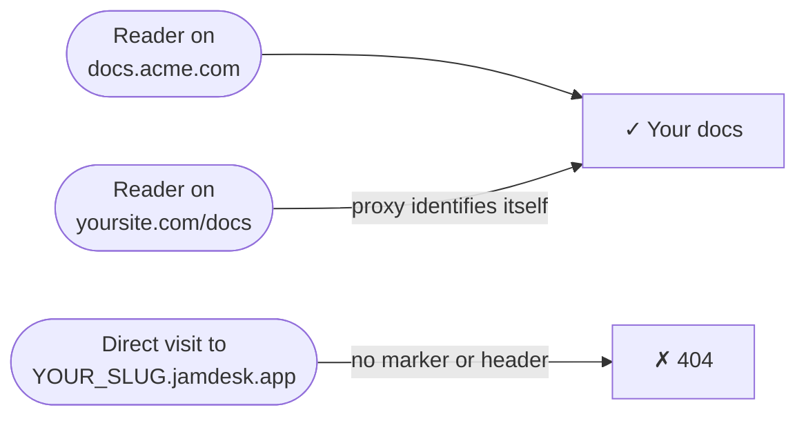

你的文档托管在 `YOUR_SLUG.jamdesk.app`。连接自定义域名后，子域名仍会响应请求。它提供的每个页面都包含指向你域名的 `<link rel="canonical">` 标签。搜索引擎只会收录你的域名，不会收录子域名。

屏幕截图显示的是英文界面。

**仅限自定义域名**会关闭子域名对直接访客的访问。直接访问 `YOUR_SLUG.jamdesk.app` 会返回 404。只有通过你自己的域名才能访问文档。



<Warning>
这会隐藏你的子域名，但不提供密码保护。任何人仍可通过你的域名查看文档。使用[密码保护](/cn/setup/password-protection)控制哪些人可以阅读文档。你可以同时启用这两项功能。
</Warning>

## 启用此功能

<Steps>
  <Step title="验证自定义域名">
    在仪表板中添加并验证你的域名。请参阅[自定义域名](/cn/deploy/custom-domains)。只有状态为 **Active** 的域名才能启用此开关。
  </Step>
  <Step title="检查代理（仅适用于反向代理设置）">
    如果你的域名是直接指向 Jamdesk 的普通 CNAME（例如 `docs.acme.com`），请跳过此步骤。如果你通过代理在 `yoursite.com/docs` 提供文档，代理必须在转发的每个请求中标识自身。请参阅下文的[代理设置](#代理设置)。
  </Step>
  <Step title="开启开关">
    在仪表板中打开项目的 **Settings**。展开 **Custom Domain** 卡片，然后开启 **Custom domain only**。Jamdesk 会先检查你的线上域名。在设置检查通过之前，此开关会保持关闭。如果检查失败，提示信息会告诉你需要修复什么。

    <Frame>
      
    </Frame>
  </Step>
</Steps>

更改会在一分钟内同步到所有边缘服务器。

## 代理设置

只有当请求标识自身来自你的代理时，Jamdesk 才会向 `YOUR_SLUG.jamdesk.app` 提供响应。请求需要包含 `X-Jamdesk-Forwarded-Host` 标头或 `?jd_proxy=1` 查询标记。以下设置指南会添加相应标记或标头：

- **[Vercel](/cn/deploy/vercel)**：`vercel.json` 重写规则会添加 `?jd_proxy=1`。Edge Middleware 会设置标头。
- **[Cloudflare Workers](/cn/deploy/cloudflare)**：Worker 会设置标头。
- **[AWS CloudFront](/cn/deploy/aws)**：通过源站自定义标头设置。
- **[反向代理](/cn/deploy/reverse-proxy)**：nginx、Apache、Caddy 和 HAProxy 会设置标头。

通过反向代理使用 [MCP](/cn/ai/mcp-server) 或[聊天小组件](/cn/ai/chat)？请像转发 `/docs` 一样转发 `/api/mcp/:path*` 和 `/api/chat/:path*`。在 Vercel 上：

```json vercel.json
{
  "rewrites": [
    { "source": "/api/mcp/:path*", "destination": "https://YOUR_SLUG.jamdesk.app/api/mcp/:path*?jd_proxy=1" },
    { "source": "/api/chat/:path*", "destination": "https://YOUR_SLUG.jamdesk.app/api/chat/:path*?jd_proxy=1" }
  ]
}
```

对于 CNAME 直接指向 Jamdesk 的域名，MCP 和聊天功能无需更改。将 MCP 客户端指向 `https://docs.acme.com/_mcp`。

## 需要了解的信息

- **直接访问子域名时，所有内容都会返回 404**：包括页面、`sitemap.xml`、`robots.txt`、`llms.txt` 和 Markdown 导出。浏览器会显示 Jamdesk 的未找到页面。
- **图片仍可访问。**图片、视频和社交分享预览（OG）图片不受影响。仪表板中的网站预览会直接从子域名加载这些内容。
- **你不会被锁在外面。**如果你的域名 DNS 出现故障，Jamdesk 会停止强制执行拦截。域名恢复前，子域名会重新提供内容。如果你自己的代理配置出错（例如，从重写规则中移除了标记），请在修复期间关闭此开关。
- [搜索 API](/cn/jamdesk-api/docs-search-api)不受影响。它通过 API 密钥进行身份验证。

## 下一步

<Columns cols={3}>
  <Card title="Vercel" icon="cloud-arrow-up" href="/cn/deploy/vercel">
    添加 jd_proxy 标记或 Edge Middleware
  </Card>
  <Card title="自定义域名" icon="globe" href="/cn/deploy/custom-domains">
    注册并验证你的域名
  </Card>
  <Card title="密码保护" icon="lock" href="/cn/setup/password-protection">
    控制哪些人可以阅读文档
  </Card>
</Columns>