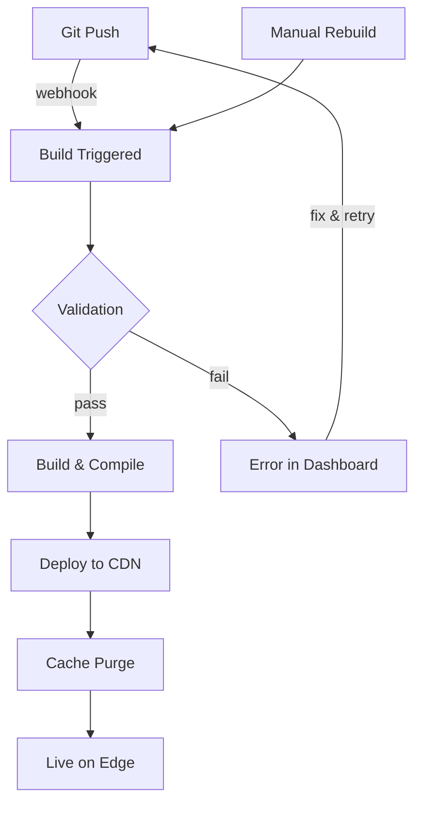

推送到 GitHub 后，Jamdesk 会在几分钟内构建并部署你的文档。

屏幕截图显示的是英文界面。

## 构建生命周期

## 构建触发方式

| 触发方式 | 工作原理 | 使用场景 |
|---------|--------------|----------|
| **Git Push** | 推送到已连接的分支时触发 Webhook | 日常开发 |
| **Dashboard** | 在项目设置中点击“Rebuild” | 配置更改后强制刷新 |

<Note>
构建会进行防抖处理。间隔不超过 10 秒的提交会合并为一次构建。
</Note>

## 构建期间会发生什么

Jamdesk 会克隆你的代码仓库，并验证 `docs.json` 和 MDX 语法。随后，它会将页面编译为 HTML，并生成搜索索引，最后将结果部署到 Cloudflare R2。大多数网站的构建时间为 30 到 90 秒。

如需了解完整流程和架构图，请参阅[Jamdesk 的工作原理](/cn/how-jamdesk-works)。

## 部署状态

仪表板会显示每次构建的以下状态之一：

| 状态 | 含义 |
|--------|---------|
| **Building** | 正在构建 |
| **Deployed** | 已在你的域名上线 |
| **Failed** | 构建出错，请检查日志 |
| **Queued** | 正在等待上一次构建完成 |

“Build History”部分会列出近期部署及其状态。你也可以从这里手动触发构建：

<SizedImage src="/images/dashboard/build-history.webp" alt="Build History 显示近期部署、Successful 状态徽标、提交信息和 Rebuild 按钮" />

## 手动重新构建

无需推送更改即可触发重新构建：

1. 在仪表板中进入你的项目
2. 打开 **Settings**
3. 点击 **Rebuild**

适用于以下情况：
- 修复卡住的构建
- 平台更新后刷新

## 构建日志

1. 在项目中进入 **Deployments**
2. 点击某次部署
3. 查看完整的构建日志

日志中的常见错误：
- MDX 语法无效
- 缺少图片或资源
- 内部链接失效
- 配置错误

## 回滚

1. 进入 **Deployments**
2. 找到要恢复的部署
3. 点击 **Rollback**

之前的版本会立即上线，同时开始一次新的构建。

## 分支部署

<Note>
分支部署适用于 Pro 方案。
</Note>

合并前预览更改：

1. 推送到功能分支
2. Jamdesk 会在 `branch-name.your-project.jamdesk.app` 创建预览
3. 检查并在准备就绪后合并

## 接下来做什么？

<Columns cols={2}>
  <Card title="部署概览" icon="cloud-arrow-up" href="/cn/deploy/overview">
    选择子域名、自定义域名或子路径托管
  </Card>
  <Card title="子路径托管" icon="route" href="/cn/deploy/subpath-hosting">
    在 example.com/docs 托管文档
  </Card>
</Columns>