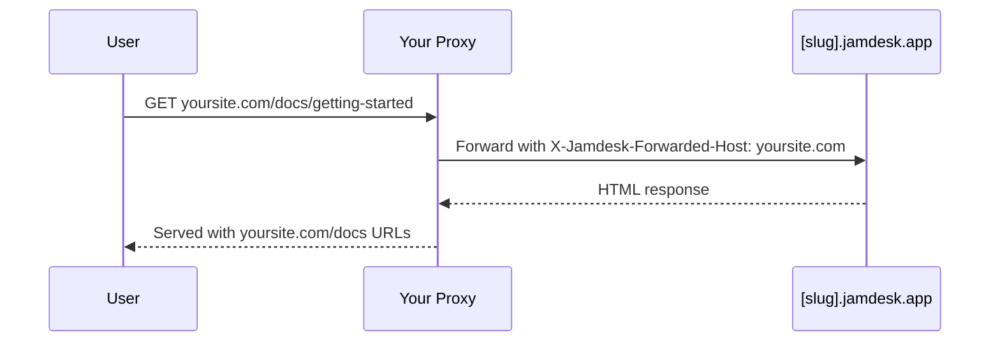

无需使用单独的子域名，即可在域名的子路径托管文档。默认路径为 `yoursite.com/docs`，也可以选择自定义路径，例如 `yoursite.com/help`。如需了解所有部署选项，请参阅[部署概览](/cn/deploy/overview)。

屏幕截图显示的是英文界面。

## 为什么使用子路径？

子路径可以让读者留在您的主域名下。文档页面会为该域名积累搜索权重。使用 `docs.yoursite.com` 这样的子域名，则会将排名信号分散到两个主机上。

## 工作原理

您的 Web 服务器或 CDN 会将来自 `/docs/*` 的请求代理到您的 Jamdesk 网站。浏览器会保留原始 URL：

代理会将包含您域名的 `X-Jamdesk-Forwarded-Host` 标头传递给 Jamdesk。Jamdesk 会使用该标头来：

1. **验证您的域名**是否获准提供这些内容
2. **应用您的配置**，该配置来自仪表板

代理配置只需设置一次。更改仪表板设置无需更新代理。

## 按提供商设置

<Columns cols={2}>
  <Card title="Cloudflare" icon="cloud" href="/cn/deploy/cloudflare">
    使用 Cloudflare Workers 代理 /docs 流量
  </Card>
  <Card title="AWS" icon="aws" href="/cn/deploy/aws">
    使用 Route 53 配置 CloudFront
  </Card>
  <Card title="Vercel" icon="triangle" href="/cn/deploy/vercel">
    在 vercel.json 中添加重写规则
  </Card>
  <Card title="反向代理" icon="server" href="/cn/deploy/reverse-proxy">
    使用 nginx、Apache 或其他代理服务器
  </Card>
</Columns>

## 前提条件

配置代理前，请先完成以下步骤：

1. 在 [Jamdesk 仪表板](https://dashboard.jamdesk.com)的 Settings → Custom Domain 下**添加您的域名**
2. 开启 **"Host at a subpath"**
3. **选择子路径**（可选；请参阅下方的[选择子路径](#选择子路径)），然后点击 **Save**

仪表板会显示您的 Jamdesk 子域名（例如 `acme.jamdesk.app`）。配置代理时需要用到它。

<Note>
保存对子路径托管设置的更改会触发文档的完整重新构建，包括开启或关闭该功能以及更改子路径。URL 结构也会随之变化（例如，从 `/introduction` 变为 `/docs/introduction`）。
</Note>

## 选择子路径

默认情况下，您的文档通过 `/docs` 提供。在开关旁边的子路径字段中输入其他值，例如 `/help` 或 `/support`。字段为空时，开关标签会显示为 `Host at a subpath (e.g. /docs)`。输入路径后，标签会变为即将启用的路径（例如 `Host at /help`）。

<Frame>
  
</Frame>

该字段只接受一个小写路径段：仅限字母、数字和中间的连字符，开头和结尾不能是连字符，最多 63 个字符。Jamdesk 会拒绝保留路径段，包括 `api`、`jd`、`wp-admin` 等常见管理路径，以及文档可能使用的任何语言代码（`fr`、`es`、`de` 等）。您的子路径不会与 Jamdesk 已提供的路由冲突。

将字段留空即可使用默认路径 `/docs`。

## 重命名或移除子路径

更改或清空子路径不会导致已被索引或加入书签的链接失效：

- **`/docs` 始终可用。** 切换到 `/help` 这样的自定义子路径后，原有的 `/docs/*` 路径仍会继续响应。这些路径可通过您的 `[slug].jamdesk.app` 子域名访问，也可通过仍指向这些路径的代理访问。规范链接会立即改为指向新的子路径。搜索引擎会在新路径重新编入索引。您可以按自己的节奏更新代理配置。
- **自定义子路径重命名后，旧路径会转发一次。** 将 `/help` 重命名为 `/guide` 后，对 `/help/*` 的请求会通过 308 重定向到对应的 `/guide/*` 路径。重定向历史只保留一层。再次将 `/guide` 重命名为 `/support` 后，`/guide/*` 会重定向到 `/support/*`。Jamdesk 不再跟踪 `/help/*`（即两次重命名前的路径段）。这些链接会进入“未找到”页面，有时会先重定向到一个看起来异常的组合路径。如果您依赖重定向来延续旧链接，请勿连续重命名。请改为更新外部链接，使其指向当前子路径。
- **恢复为 `/docs`** 会将上一个自定义子路径（保留一层历史记录）重定向到 `/docs/*`。

<Warning>
`/docs` **不会**重定向到您选择的子路径。`/docs` 会永久保持可用。单层重定向仅适用于您正在弃用的*自定义*子路径。
</Warning>

访问 `https://yoursite.com/docs`（或您配置的子路径）测试代理。检查资源和链接是否能正常加载。

## 是否需要隐藏 jamdesk.app 子域名？

不需要。您的 `[slug].jamdesk.app` 子域名仍可访问。它是代理转发请求的上游源站。这不会让它与您的网站在搜索结果中竞争：

- **已注册域名**：通过子域名提供的页面会包含一个规范链接，指向您域名下的同一页面。搜索引擎会将排名信号归于您的域名。
- **尚未注册域名**：子路径模式下的子域名页面会标记为 `noindex`，不会进入索引。

如需同时屏蔽子域名上的内容（而不仅仅是将其移出索引），请启用[密码保护](/cn/setup/password-protection)。之后，子域名会显示解锁页面，而不是您的文档。

## 接下来做什么？

<Columns cols={2}>
  <Card title="部署概览" icon="cloud-arrow-up" href="/cn/deploy/overview">
    比较子域名、自定义域名和子路径托管
  </Card>
  <Card title="自定义域名" icon="globe" href="/cn/deploy/custom-domains">
    验证 DNS 并排查域名设置问题
  </Card>
</Columns>