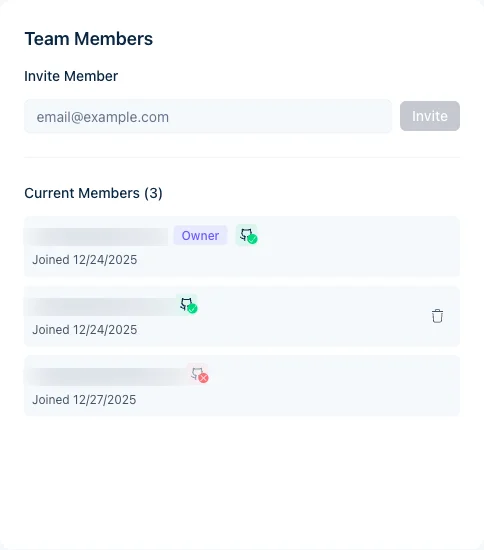

邀请同事监控构建、查看分析数据并触发重新构建。角色分为所有者和成员。

屏幕截图显示的是英文界面。

<Note>
成员身份也决定哪些人的 GitHub 推送会触发构建。Jamdesk 通过推送者已关联的 GitHub 账户或电子邮件来匹配推送者。非成员的推送会导致构建失败。项目所有者会收到一封电子邮件。请使用推送者的提交邮箱邀请他们。他们必须使用该邮箱登录 Jamdesk 才能接受邀请。如果他们已经是成员，可以改为[关联其 GitHub 账户](/cn/integrations/github#个人-github-账户用户级)。
</Note>

## 邀请成员

<Steps>
  <Step title="打开项目设置">
    进入您的项目并点击 **Settings**。
  </Step>
  <Step title="选择 Members">
    导航到 **Members** 标签页。
  </Step>
  <Step title="输入其邮箱">
    在 **Invite Member** 字段中输入电子邮件地址。
  </Step>
  <Step title="发送邀请">
    点击 **Invite**。他们会收到一封包含加入链接的电子邮件。
  </Step>
</Steps>

<Note>
受邀者需要拥有 Jamdesk 账户。如果没有账户，邀请流程会提示他们创建一个。
</Note>

<Tip>
如果您的账户已设置[单点登录](/cn/setup/sso)，邮箱与您已验证域名匹配的团队成员将通过您的身份提供商登录，而无需创建密码。邀请表单会标明哪些地址将使用 SSO。
</Tip>

<Frame>
  
</Frame>

## 成员角色

| 角色 | 权限 |
|------|-------------|
| **Owner** | 完全访问权限，可移除成员、转让所有权、删除项目 |
| **Member** | 查看构建和分析数据，触发重新构建 |

点击成员姓名旁的 **Transfer Ownership**，即可将其设为所有者。详情请参阅[所有权转让](/cn/help/projects/ownership-transfer)。

<Tip>
如需让某人控制账单及您拥有的所有项目，请将其设为[账户管理员](/cn/help/projects/account-admins)。账户管理员会在成员列表中显示 **Account admin** 标签，您需在 **User Settings** 中移除他们，而非在此处操作。
</Tip>

<Note>
**团队成员与文档站点读者不同。** 团队成员在 Jamdesk 控制面板中查看构建和分析数据。[访问控制](/cn/setup/access-control)用于设置谁可以*阅读*您已发布的文档站点：公开、密码保护、混合或 SSO。在密码保护的站点上，您还可以[允许团队使用 Jamdesk 登录](/cn/setup/password-protection#让团队成员使用-jamdesk-登录)，使成员无需使用共享密码。
</Note>

## 移除成员

只有项目所有者可以移除团队成员：

1. 进入 **Settings** → **Members**
2. 找到该成员
3. 点击 **Remove**
4. 确认移除

被移除的成员将立即失去访问权限。您之后可以重新邀请他们。

## 待处理的邀请

尚未被接受的邀请会显示在 **Members** 列表中，并标记为待处理。点击其旁边的垃圾桶图标即可取消。

待处理的邀请不会过期。在对方接受或您取消之前，它们始终有效。

## 团队规模

每个项目的团队成员数量不限，且无需额外付费。

## 相关文章

<Columns cols={2}>
  <Card title="Ownership Transfer" icon="arrow-right-arrow-left" href="/cn/help/projects/ownership-transfer">
    转让项目所有权
  </Card>
  <Card title="Project Settings" icon="gear" href="/cn/help/projects/settings">
    配置项目选项
  </Card>
</Columns>