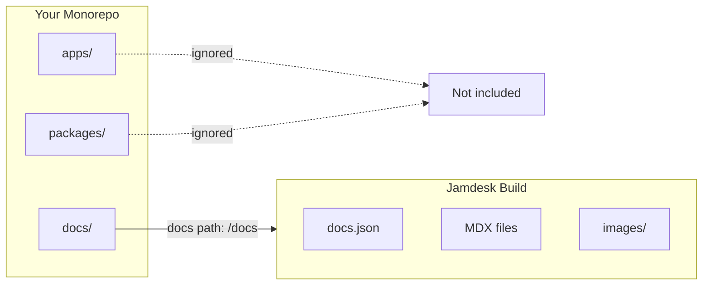

如果你的 `docs.json` 位于子目录中（`docs/`、`packages/docs/` 或其他任意位置），请在项目设置中开启单体仓库模式并输入路径。Jamdesk 只会构建该目录。

<Note>
**前提条件：** 在配置单体仓库支持之前，你需要先将 [Jamdesk 项目](/cn/setup/creating-projects) 连接到 [GitHub 仓库](/cn/setup/connecting-github)。
</Note>

## Jamdesk 如何限定构建范围



## 快速设置

<Steps>
  <Step title="打开项目设置">
    在 [Jamdesk 控制台](https://dashboard.jamdesk.com) 中打开你的项目，然后进入 **Settings**。
  </Step>

  <Step title="启用单体仓库模式">
    在 **Git Repository** 部分下，开启 **Set up as monorepo**。

    <Frame>
      
    </Frame>
  </Step>

  <Step title="输入文档路径">
    输入包含 `docs.json` 文件的目录路径。

    <Frame>
      
    </Frame>

    预览会显示 Jamdesk 查找配置文件的位置。
  </Step>

  <Step title="保存并重新构建">
    点击 **Save Changes**。下一次构建将使用新路径。
  </Step>
</Steps>

## 了解文档路径

<Warning>
只输入目录路径，不要输入文件名。使用 `docs`，而不是 `docs/docs.json`。
</Warning>

### 路径示例

| 仓库结构 | 文档路径值 |
|---------------------|-----------------|
| `my-repo/docs/docs.json` | `docs` |
| `my-repo/packages/docs/docs.json` | `packages/docs` |
| `my-repo/apps/website/docs/docs.json` | `apps/website/docs` |
| `my-repo/documentation/docs.json` | `documentation` |

### 包含的内容

Jamdesk 只处理文档路径内的文件：

- **内容文件**（`.mdx`、`.md`）会被编译为页面
- **子目录中的资源**（如 `images/`）会被包含
- **配置文件**（`docs.json`）定义你的站点

文档路径之外的文件在构建时会被忽略。

## 常见 monorepo 结构

<Tabs>
  <Tab title="专用 /docs">
    文档位于顶层目录。

    ```bash
    monorepo/
    ├── packages/
    ├── apps/
    └── docs/                    # Docs path: docs
        ├── docs.json
        ├── introduction.mdx
        └── guides/
    ```

    **文档路径：** `docs`
  </Tab>

  <Tab title="/packages 中的包">
    文档作为工作区包。

    ```bash
    monorepo/
    ├── packages/
    │   ├── core/
    │   ├── cli/
    │   └── docs/                # Docs path: packages/docs
    │       ├── docs.json
    │       └── pages/
    └── apps/
    ```

    **文档路径：** `packages/docs`
  </Tab>

  <Tab title="应用内部">
    文档嵌套在应用程序内部。

    ```bash
    monorepo/
    ├── apps/
    │   └── website/
    │       ├── src/
    │       └── docs/            # Docs path: apps/website/docs
    │           ├── docs.json
    │           └── introduction.mdx
    └── packages/
    ```

    **文档路径：** `apps/website/docs`
  </Tab>

  <Tab title="自定义目录">
    任意自定义目录名称。

    ```bash
    monorepo/
    ├── src/
    ├── tests/
    └── documentation/           # Docs path: documentation
        ├── docs.json
        └── getting-started.mdx
    ```

    **文档路径：** `documentation`
  </Tab>
</Tabs>

## 使用资源

`docs.json` 中的资源路径始终相对于你的文档目录，而不是仓库根目录。

### 示例

对于位于 `packages/docs/` 的文档：

```json packages/docs/docs.json
{
  "logo": {
    "light": "/images/logo.svg"
  },
  "favicon": "/images/favicon.svg"
}
```

这些路径引用：
- `packages/docs/images/logo.svg`
- `packages/docs/images/favicon.svg`

<Warning>
不要使用从仓库根目录开始的绝对路径。以下写法会失败：

```json
"favicon": "/packages/docs/images/favicon.svg"
```
</Warning>

### 在 MDX 文件中

MDX 中的图片遵循相同规则：

```mdx

```

这引用的是 `[docs-path]/images/tabs-preview.png` 处的图片。

## 内部链接

内部链接不依赖于仓库结构。请使用相对于文档根目录的路径：

```mdx
[See the quickstart guide](/quickstart)
[Installation steps](/quickstart#installation)
```

这些路径与你的导航结构一致，而不是文件系统结构。

## 构建行为

只有文档路径内的更改才会触发构建：

- 对 `packages/docs/**` 的更改会触发构建
- 对 `packages/core/**` 的更改不会触发构建

<Tip>
**需要在其他代码变更时重新构建？**

对于从源代码生成的文档（如来自代码注释的 API 文档），请从控制台手动触发重新构建，或在 CI 流水线中设置 webhook。
</Tip>

## 工作区工具兼容性

设置文档路径即可。这些单体仓库工具无需其他配置。

| 工具 | 支持 |
|------|-----------|
| npm workspaces | 是 |
| Yarn workspaces | 是 |
| pnpm workspaces | 是 |
| Turborepo | 是 |
| Nx | 是 |
| Lerna | 是 |

## 故障排除

<AccordionGroup>
  <Accordion title="docs.json not found error" icon="circle-exclamation">
    1. 确认仓库中的确切路径与你输入的一致
    2. 确保 `docs.json` 存在于该位置
    3. 检查拼写错误。路径区分大小写
    4. 记住：使用 `docs`，而不是 `docs/docs.json`

    **快速检查：** 在你的仓库中，该文件应位于 `[your-docs-path]/docs.json`
  </Accordion>

  <Accordion title="Assets not loading" icon="image">
    资源路径必须相对于你的文档目录。

    **正确**（相对于文档目录）：
    ```json
    "favicon": "/images/favicon.svg"
    ```

    **错误**（从仓库根目录的绝对路径）：
    ```json
    "favicon": "/packages/docs/images/favicon.svg"
    ```

    请检查你的图片是否存在于 `[docs-path]/images/` 中。
  </Accordion>

  <Accordion title="Changes not triggering builds" icon="rotate">
    只有文档路径内的更改才会触发自动构建。

    1. 确认你修改的是文档路径内的文件
    2. 检查你推送到的分支是否正确
    3. 在 GitHub 仓库设置中查看 webhook 投递状态

    如需在文档路径之外的更改后构建，请使用手动重新构建或 CI webhook。
  </Accordion>
</AccordionGroup>

## 下一步

<Columns cols={2}>
  <Card title="连接 GitHub" icon="github" href="/cn/setup/connecting-github">
    关联你的仓库以实现自动构建
  </Card>
  <Card title="目录结构" icon="folder-tree" href="/cn/setup/directory-structure">
    组织你的文档以便扩展
  </Card>
</Columns>

> 注：本页包含图片，屏幕截图显示的是英文界面。