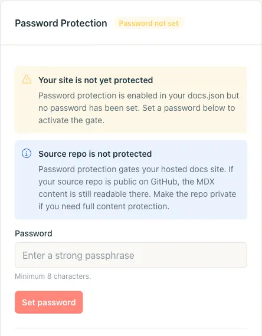
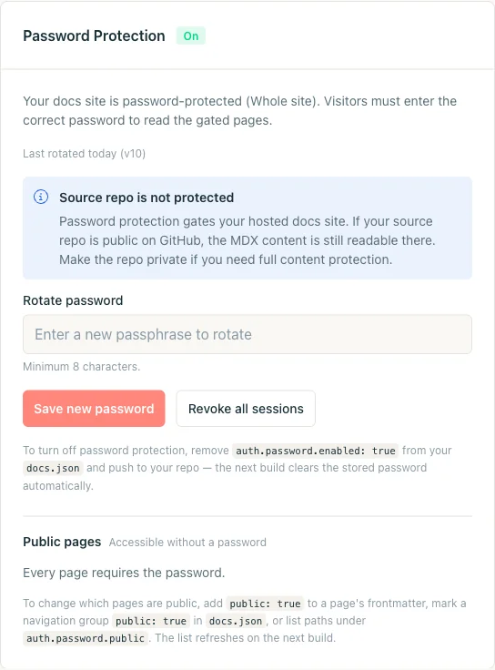
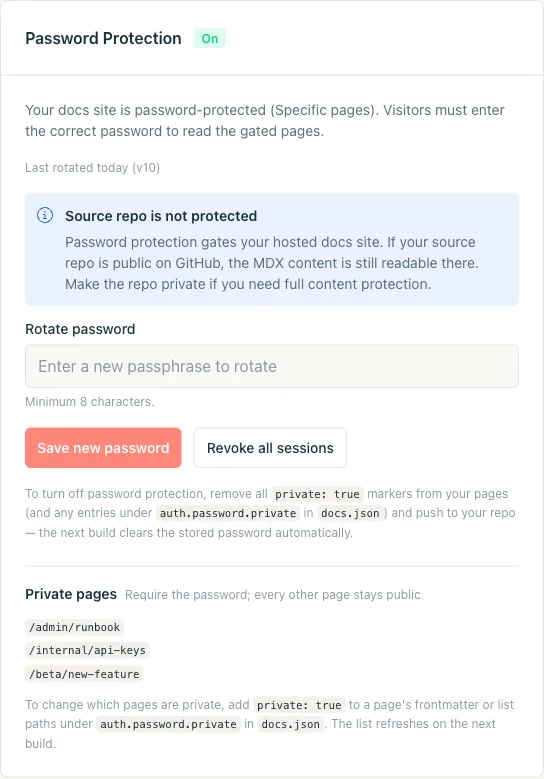
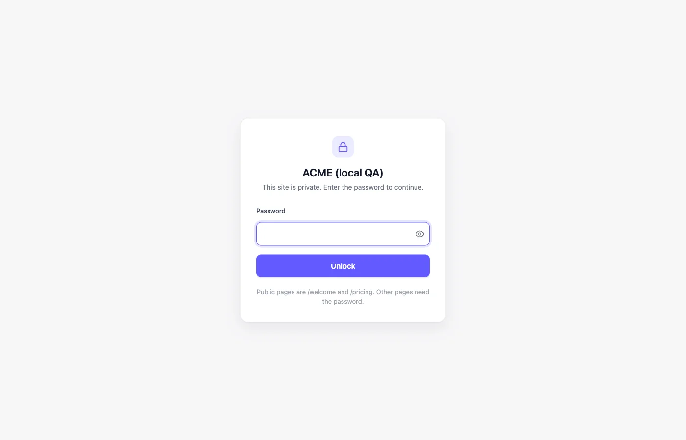
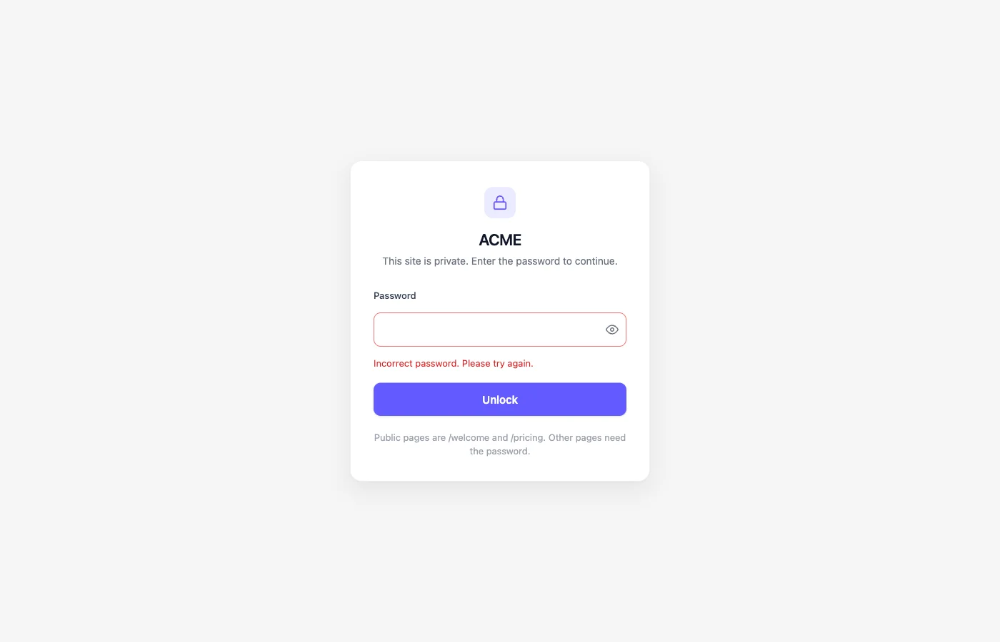

密码保护用于限制那些保存在 Git 中但不应公开的文档：运维手册、发布前指南、仅限合作伙伴的文档、抢先体验功能等。一个共享口令即可限制整个站点或一组页面的访问。您的仓库内容不会被移出。

屏幕截图显示的是英文界面。

<Tip>
  如需按用户身份验证，请使用 [JWT 身份验证](/cn/setup/jwt-authentication)。它将您的文档置于您自有登录系统之后，支持按用户的会话管理以及基于分组的页面访问控制。
</Tip>

<Note>
  密码保护要求 Jamdesk 项目[已连接到 Git 仓库](/cn/setup/connecting-github)。配置存放在 `docs.json` 中，并随常规构建一起发布。
</Note>

## 应选择哪种模式？

根据哪些内容是公开的来选择模式。

| | **整站模式** | **指定页面模式** |
|---|---|---|
| **适用场景** | 所有内容都是私有的：内部工程文档、公开站点的预发布副本、未发布的产品。 | 大部分文档是公开的。您需要隐藏少数页面（如运维手册、测试版功能、内部 API 参考）。 |
| **如何启用** | 在 `docs.json` 中设置 `auth.password.enabled: true`。 | 在前言中使用 `private: true` 标记页面为私有，或在 `auth.password.private[]` 下列出路径。 |
| **公开例外** | 支持：可将单个页面、导航分组或通配符模式标记为公开。 | 不适用。除非标记为私有，否则所有页面均公开。 |

两种模式下，仪表板卡片、解锁界面以及轮换和撤销控件完全相同。通过编辑 `docs.json` 并推送即可切换模式。

## 保护整个站点

<Steps>
  <Step title="在 docs.json 中添加 auth.password.enabled">
    在 `docs.json` 中声明整站保护。`hint` 字段是可选的，它是读者能看到的关于如何获取口令的唯一提示。

    ```json docs.json
    {
      "$schema": "https://jamdesk.com/docs.json",
      "name": "Acme Docs",
      "theme": "jam",
      "auth": {
        "password": {
          "enabled": true,
          "hint": "Ask #docs-access on Slack"
        }
      }
    }
    ```

    提示为纯文本，最多 200 个字符，不支持 HTML。

    <Tip>
      不要将口令写入 `docs.json`。请在构建完成后于仪表板中设置。您的仓库中只保存启用标志和可选的提示。
    </Tip>
  </Step>

  <Step title="提交并推送">
    将更改推送到您配置的分支。构建会在整站模式下激活密码保护。

    ```bash
    git add docs.json
    git commit -m "Turn on password protection"
    git push
    ```

    仪表板卡片会从 **Off** 变为 **Password not set**。站点被锁定。每个页面都返回 `401` 并显示密码界面。在您设置口令之前，任何口令都无法通过。您标记为公开的页面仍保持开放。项目 API 密钥仍可用于搜索 API、MCP 服务器、`.md` URL 以及 llms 文件。如需将整个站点重新设为公开，请将 `auth.password.enabled` 设为 `false` 并推送。

    
  </Step>

  <Step title="在仪表板中设置口令">
    打开仪表板中的 **Project Settings**，滚动到 **Password Protection** 卡片。输入口令（至少 8 个字符）。点击 **Set password**。

    卡片会切换为 **On**。没有口令的访问者会看到解锁界面。

    

    <Warning>
      Jamdesk 从不存储您的明文口令。它使用 scrypt 进行哈希处理并保存在仪表板数据库中，绝不会写入您的仓库或 `docs.json`。如果您忘记口令，Jamdesk 无法通过邮件发送给您。请改为轮换口令。
    </Warning>
  </Step>

  <Step title="验证访问限制">
    在隐私浏览器窗口中打开您的文档站点（或使用 `curl`），确认您会看到解锁界面。尝试输入错误口令以检查错误状态。然后输入正确口令。

    ```bash
    # Should respond with HTTP/1.1 401 and the unlock HTML
    curl -I https://acme.jamdesk.app/

    # Submit the password. On success, sets the jd_auth_<slug> cookie.
    curl -i -X POST https://acme.jamdesk.app/jd/unlock \
      -d "password=your-passphrase&from=/"
    ```

    成功解锁会返回 `303` 重定向以及 `Set-Cookie: jd_auth_acme=...; HttpOnly; Secure; SameSite=Lax; Max-Age=2592000` 头。在下一次请求中发送该 Cookie。
  </Step>
</Steps>

### 公开例外

在其余站点受限的同时，保持特定页面公开，例如营销落地页或注册表单。

有三种方式可将页面标记为公开。构建会将它们合并为一个允许列表。

**前言**是粒度最细的选项。在 `.mdx` 文件中添加 `public: true`，即可将该页面设为公开：

```yaml
---
title: Get started
public: true
---
```

**导航分组**可覆盖整个章节。在 `docs.json` 导航中为 `group` 或 `tab` 设置 `public: true`，即可使其下的所有页面公开。例如，在私有工程文档旁设置一个"Marketing"标签页：

```json docs.json
{
  "navigation": {
    "tabs": [
      {
        "tab": "Marketing",
        "public": true,
        "groups": [
          {
            "group": "Overview",
            "pages": ["landing", "pricing", "changelog"]
          }
        ]
      },
      {
        "tab": "Internal",
        "groups": [
          { "group": "Runbooks", "pages": ["deploys", "oncall"] }
        ]
      }
    ]
  }
}
```

`auth.password.public[]` 下的**显式通配符**可覆盖前言和导航无法处理的情况：顶层落地页、动态生成的路由，或您不想重写的子树。

```json docs.json
{
  "auth": {
    "password": {
      "enabled": true,
      "hint": "Ask #docs-access on Slack",
      "public": [
        "/landing",
        "/pricing",
        "/marketing/**",
        "/blog/*"
      ]
    }
  }
}
```

通配符支持 `*`（一个路径段）和 `**`（任意深度）。校验会拒绝裸 `/`，因为它会解锁整个站点。仪表板卡片会显示上次构建解析出的允许列表。

## 仅保护少数页面

在指定页面模式下，所有页面默认公开。您可以逐个页面选择加入访问限制。

<Steps>
  <Step title="将页面标记为私有">
    在页面前言中添加 `private: true`。

    ```yaml
    ---
    title: Incident Runbook
    description: What to do when the deploys dashboard is on fire.
    private: true
    ---
    ```

    如需将受限路径列表集中在一个文件中，可在 `docs.json` 的 `auth.password.private[]` 下添加。两种方式可以叠加使用。

    ```json docs.json
    {
      "auth": {
        "password": {
          "hint": "Ask the on-call engineer",
          "private": ["/admin/runbook", "/internal/api-keys"]
        }
      }
    }
    ```

    这里不需要 `enabled: true`。只设置 `auth.password.private[]` 而不设置 `enabled`，即可激活指定页面模式。
  </Step>

  <Step title="提交并推送">
    推送您的更改。下一次构建会在指定页面模式下启用保护。仪表板会提示您设置口令。

    ```bash
    git add content/runbook.mdx docs.json
    git commit -m "Gate the incident runbook"
    git push
    ```
  </Step>

  <Step title="设置口令">
    打开 **Project Settings**，找到 **Password Protection** 卡片并设置口令。卡片标题显示 **On**，并带有 **Specific pages**（而非 **Whole site**）。它会列出构建解析出的私有页面。

    
  </Step>

  <Step title="验证访问限制">
    浏览您的文档站点。公开页面照常加载。私有页面会重定向到解锁界面。输入口令后，该设备在 30 天内保持登录。
  </Step>
</Steps>

## 访客会看到什么

受限页面会显示一个居中的解锁卡片，包含站点名称以及可选的提示。没有侧边栏或导航。



卡片会使用 `docs.json` 中设置的站点 Logo 和主色调进行品牌化。密码输入框带有显示/隐藏切换，并自动获得焦点。

输入错误口令时，会显示同样的卡片，并附带错误信息、清空的输入框，以及两次尝试之间的短暂延迟。页面上不会区分"口令错误"与"尚未输入口令"。



正确的口令会设置一个签名 Cookie。它在会话过期或您撤销之前一直有效。

## AI 工具和 API 密钥

无法输入口令的工具（如 MCP 客户端，或抓取 `llms.txt` 的脚本）可以改用项目 API 密钥。该密钥可用于 [MCP 服务器](/cn/ai/mcp-server#受登录保护的网站)、`.md` 页面 URL 以及 [llms 文件](/cn/ai/llms-txt#受登录保护的站点)。它无法打开 HTML 页面或 AI 聊天。

## 让团队成员使用 Jamdesk 登录

您的团队成员已经拥有 Jamdesk 账号，因此无需再使用共享口令。添加 `allowMembers` 后，解锁界面会在口令输入框旁显示 **Sign in with Jamdesk** 按钮。外部读者仍使用口令。

```json docs.json
{
  "auth": {
    "password": {
      "enabled": true,
      "allowMembers": true
    }
  }
}
```

该功能默认关闭。推送更改后，按钮会在下一次构建后出现。

团队成员点击 **Sign in with Jamdesk** 后，会打开 Jamdesk 仪表板。如果他们已在那里登录，会直接带他们回到刚才阅读的页面。如果尚未登录，则需先登录，然后再返回您的文档。

### 谁可以登录

项目所有者可以登录，在仪表板 **Settings → Members** 中添加为成员的人也可以。您邀请的人在接受邀请后即可阅读文档。

<Warning>
  成员在仪表板中还将获得项目的完整编辑权限。请只添加您信任的人。
</Warning>

### 团队会话如何运作

团队登录有效期为 14 天。之后，团队成员需要再次点击该按钮。

如需切断某人的访问，请将其移出项目。其文档访问会在约一分钟内停止。

更改共享口令不会让团队成员退出登录，**Revoke all sessions** 也不会。团队登录同样不影响口令会话。

登录后，团队成员可以像输入口令后一样使用 AI 聊天、MCP 服务器、`.md` URL 和 `llms.txt`。

### 仅供团队查看文档

启用 `enabled` 和 `allowMembers`，然后不在仪表板中设置口令。解锁界面只会显示登录按钮，因此您的团队可以进入，其他人则无法进入。

### 域名与套餐

团队登录适用于您的 `<slug>.jamdesk.app` 子域名以及连接到该项目的自定义域名。这包括通过 Cloudflare Worker 或子路径设置从自定义域名提供文档的情况。其他别名（例如您域名的 `www.` 副本）不受支持。每个主机各自拥有独立的会话，因此在一个主机上登录不会使您在另一个主机上也处于登录状态。

与密码保护一样，团队登录需要付费套餐。如果所有者的套餐到期，新的团队登录将停止。已开始的会话在过期前（最长 14 天）仍可继续使用。

`allowMembers` 仅适用于密码保护。使用 [JWT 身份验证](/cn/setup/jwt-authentication) 的站点不受影响。

## 轮换和撤销会话

打开 **Password Protection** 卡片，在 **Rotate password** 字段中输入新口令，然后点击 **Save new password**。旧口令会在下一次请求时失效。轮换立即生效，无需重新构建。

如需让所有活跃会话退出登录而不更改口令（例如笔记本电脑丢失），请点击 **Revoke all sessions**。它会递增服务器端的版本计数器。在该计数器递增之前签发的所有 Cookie 都将失效。访问者需要重新输入当前口令。

## 停用保护

通过编辑 `docs.json` 并推送来关闭保护。

- **整站模式：**删除 `auth.password.enabled`（或将其设为 `false`）。
- **指定页面模式：**删除所有 `private: true` 标记，并清空 `auth.password.private`。

下一次构建会删除已存储的口令哈希，并将卡片切回 **Off**。之后重新启用保护需要设置新口令。

<Warning>
  您的源仓库不受密码保护。密码保护只限制托管在 `*.jamdesk.app`（或您的自定义域名）上的文档站点。如果 GitHub 仓库是公开的，MDX 内容仍然可见。如需完整的内容保护，请将仓库设为私有。
</Warning>

## 优先级规则

一个页面可能同时匹配多个信号。解析顺序从最具体到最不具体：

- `auth.password.enabled: true` 限制整个站点。单个页面上的 `private: true` 变得多余。
- 同时标记为 `public: true` 和 `private: true` 的页面是公开的。**公开优先**。
- 前言中的 `public: true`、导航分组中的 `public: true`，以及 `auth.password.public[]` 通配符会合并为一个允许列表。只要有一个信号表明页面为公开，它就是公开的。
- 只设置 `auth.password.private[]` 而不设置 `auth.password.enabled`，会激活指定页面模式。

## 会话和速率限制的工作方式

**会话 Cookie。** 成功解锁后，Jamdesk 会设置名为 `jd_auth_<slug>` 的 Cookie（例如 `jd_auth_acme`）。它带有 `HttpOnly`、`Secure`、`SameSite=Lax` 属性，作用域为主机，并使用 HMAC-SHA256 签名。载荷包括项目 slug、当前版本计数器以及过期时间戳。篡改会导致校验失败。默认有效期为 **30 天**，每次成功解锁时刷新。

**速率限制。** 解锁端点每小时应用两个计数器：**每个 IP 10 次尝试**，**每个项目 100 次尝试**。它们在 scrypt 哈希校验之前运行，因此暴力破解尝试无法消耗 CPU 或泄露计时信息。触发任一限制会返回 `429 Too Many Requests` 以及 `Retry-After` 头。

**存储。** 您的口令使用 scrypt 进行哈希处理，并存储在仪表板的 Firestore 中。它从不进入您的仓库、`docs.json` 或构建产物。如果您丢失了口令，请轮换。不存在恢复途径。

## 本地开发期间测试

`jamdesk dev` 使用实时 R2 内容和实时配置运行您的文档。本地开发服务器**不执行**密码保护。您可以在无口令的情况下预览受限页面。

如需测试访问限制，请在没有 Cookie 的浏览器窗口中打开已部署的站点 `<slug>.jamdesk.app`（或您的自定义域名）。

## 故障排除

<Accordion title="构建已完成，但解锁界面从未出现">
  仪表板卡片可能显示 **Password not set**。保护需要 (1) 在 `docs.json` 中推送了配置，以及 (2) 在 **Project Settings** 中设置了口令。在设置口令之前，每个请求都会返回 `401`，并以解锁界面作为响应体。
</Accordion>

<Accordion title="我设置了口令，但团队成员仍看到解锁界面">
  他们的浏览器中仍保留着您轮换口令之前的旧 `jd_auth_<slug>` Cookie。请等待 30 天让 Cookie 过期，在仪表板中点击 **Revoke all sessions**，或让他们清除文档域名的 Cookie。下次访问时会提示输入当前口令。
</Accordion>

<Accordion title="能否为不同群体设置不同的口令？">
  不能直接设置。Jamdesk 每个站点使用一个共享口令。如需按群体控制访问，可以将文档拆分为多个项目（每个项目有自己的口令），或使用指定页面模式，为不同受众设置不同的公开/私有边界。
</Accordion>

<Accordion title="密码保护是否适用于自定义域名和子路径代理？">
  适用。解锁 Cookie 与主机绑定。`*.jamdesk.app` 子域名和您的自定义域名各自独立认证。解锁其中一个不会解锁另一个。

  子路径设置（文档位于您自有代理之后的 `yoursite.com/docs`）开箱即用。解锁表单在 `/_jd/` 路径前缀下提交。所有已记录的代理配置都已转发该路径。开启或关闭密码保护无需更改代理。

  对于在设置指南添加 `/_jd/` 转发之前配置的代理，请将 `/_jd/*` 添加到其转发路径中。
</Accordion>

<Accordion title="受保护的站点是否仍会出现在搜索引擎中？">
  不会。受保护的站点会在解锁界面上设置 `noindex, nofollow`，并对每个受限页面返回 `401`。爬虫无法索引限制之后的任何内容。受保护站点内的公开页面仍会被索引。
</Accordion>

## 接下来

<Columns cols={2}>
  <Card title="访问控制概览" icon="shield" href="/cn/setup/access-control">
    比较密码保护与 SSO 以及多项目模式。
  </Card>
  <Card title="JWT 身份验证" icon="lock" href="/cn/setup/jwt-authentication">
    用您自有登录系统提供的按用户会话，取代共享口令。
  </Card>
  <Card title="SSO（企业版）" icon="key" href="/cn/setup/sso">
    通过您的身份提供商进行按用户登录，取代共享口令。
  </Card>
  <Card title="自定义域名" icon="globe" href="/cn/deploy/custom-domains">
    在分享链接之前，将您的文档部署到自有域名。
  </Card>
  <Card title="auth.password 架构" icon="book" href="/cn/config/docs-json-reference#authpassword">
    `enabled`、`hint`、`public`、`private` 和 `allowMembers` 的完整字段参考。
  </Card>
</Columns>