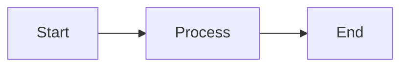
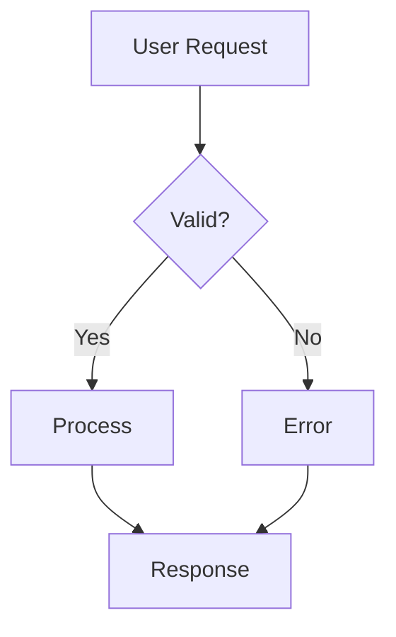
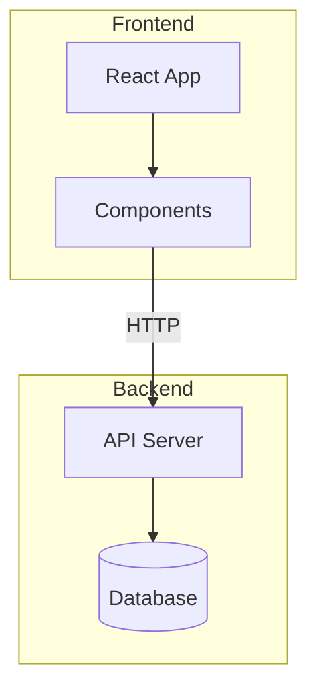
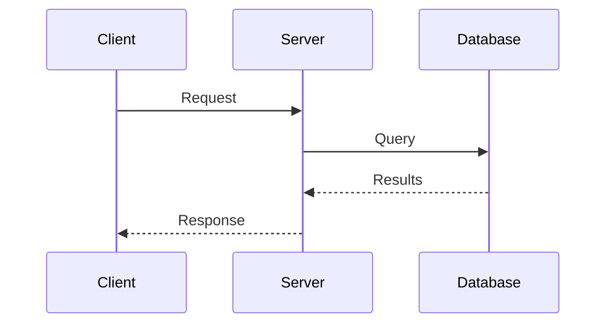
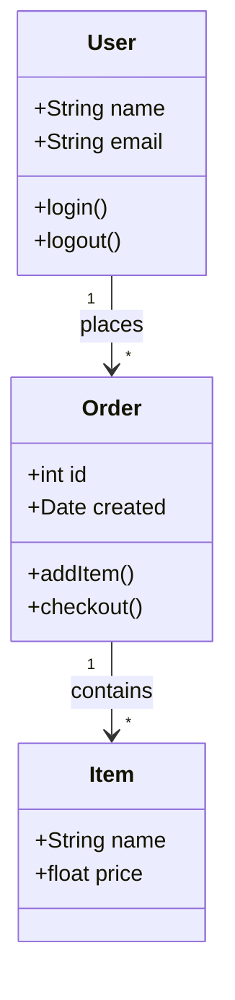
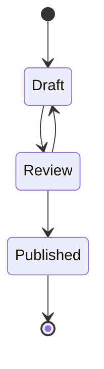
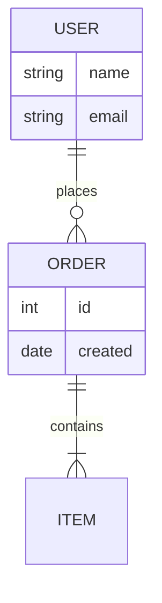
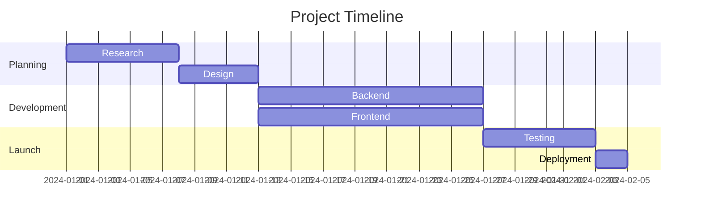
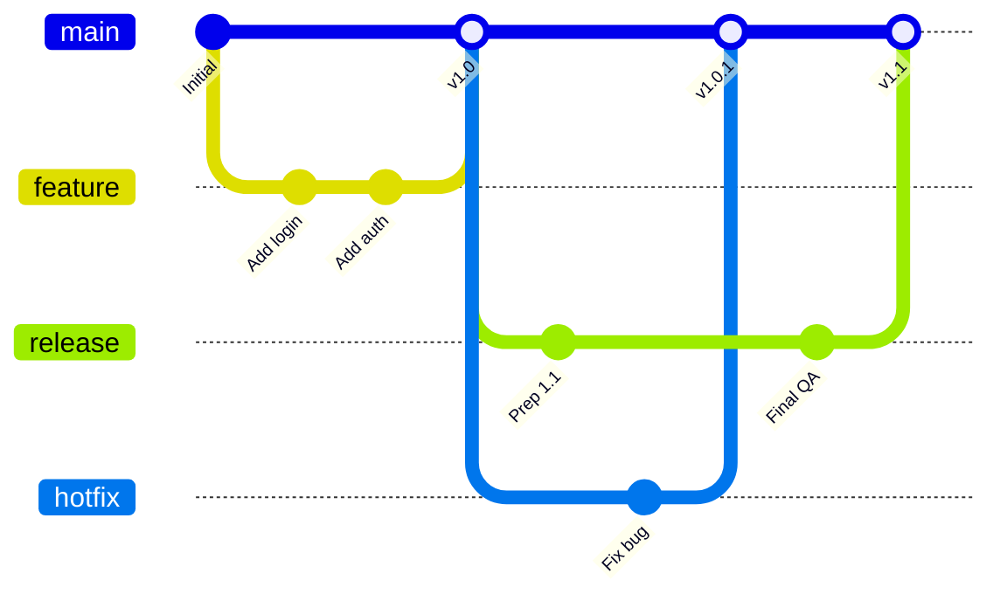
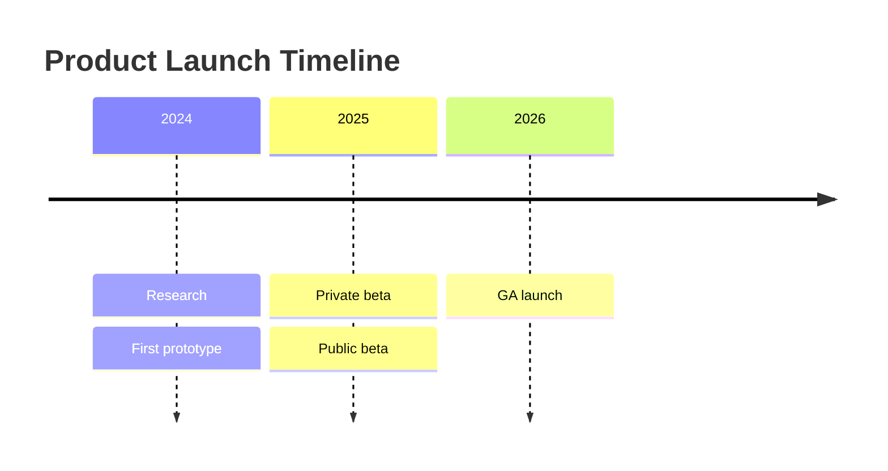

Write diagrams as text in fenced code blocks. Jamdesk renders them as SVG at build time.

<Tip>
  Draft and preview your diagram in the [Jamdesk Mermaid editor](https://jamdesk.com/utilities/mermaid-editor).
  It's an open-source editor that runs in the browser and renders as you type.
  Paste the result into a `mermaid` fenced block.
</Tip>

<Tip>
  Jamdesk also renders [D2 diagrams](/components/d2) in `d2` fenced blocks.
  Use D2 when a diagram needs nested containers, an SQL schema with
  primary and foreign keys, or you want to swap layout engines. The Mermaid
  examples on this page have D2 equivalents on the [D2 page](/components/d2).
</Tip>

## Basic Usage

Use a fenced code block with the `mermaid` language identifier:

````mdx

````


## Diagram Types

### Flowcharts

Direction can be top-down (`TD`), left-right (`LR`), bottom-up (`BT`), or right-left (`RL`).



````mdx

````

#### Subgraphs

Group related nodes with subgraphs. Use them to split a large flowchart into sections like "Frontend" and "Backend", or into pipeline stages.



````mdx

````

### Sequence Diagrams

Sequence diagrams show how components interact over time. Use a sequence diagram for API call flows and authentication handshakes. Participants appear as vertical lifelines. Messages run between them.



````mdx

````

### Class Diagrams

Class diagrams show the structure of object-oriented systems, such as a data model or a service's core types. They show classes with their attributes, methods, and relationships.



````mdx

````

### State Diagrams

State diagrams model the lifecycle of an object or process. They show every state and the transitions between them. Order statuses and document approval workflows are typical examples.



````mdx

````

### Entity Relationship Diagrams

ER diagrams document database schemas and data models. They show entities (tables), their attributes (columns), and the relationships between them. The symbols mark cardinality: one-to-one, one-to-many, or many-to-many.



````mdx

````

### Gantt Charts

Gantt charts show project schedules. Tasks appear as horizontal bars on a timeline, with duration, dependencies, and parallel work. Use one for a project plan or roadmap.



````mdx

````

### Git Graphs

Git graphs show branching strategies and version control workflows: commits, branches, merges, and repository history. Each branch gets its own color.



````mdx

````

### Timeline Diagrams

Timelines show events across periods. Start with the `timeline` keyword, an
optional `title`, then one line per period with events separated by colons:



````mdx

````

### Pie Charts

Pie charts show proportions as slices of a circle. Use one when parts make up a whole, like market share or survey results. Keep to 6 slices or fewer.

```mermaid
pie title Browser Market Share
    "Chrome" : 65
    "Safari" : 19
    "Firefox" : 10
    "Edge" : 4
    "Other" : 2
```

````mdx
```mermaid
pie title Browser Market Share
    "Chrome" : 65
    "Safari" : 19
    "Firefox" : 10
    "Edge" : 4
    "Other" : 2
```
````

## Flowchart Shapes

Each shape has a conventional meaning in flowcharts:

| Syntax     | Shape               | Use For |
| ---------- | ------------------- | ------- |
| `[text]`   | Rectangle           | Process steps, actions |
| `(text)`   | Rounded rectangle   | Start/end points |
| `{text}`   | Diamond             | Decisions, conditions |
| `([text])` | Stadium             | Events, triggers |
| `[[text]]` | Subroutine          | Predefined processes |
| `[(text)]` | Cylinder            | Databases, storage |

## Arrow Types

Arrows indicate flow direction and relationship types:

| Syntax      | Description      | Use For |
| ----------- | ---------------- | ------- |
| `-->`       | Solid arrow      | Normal flow |
| `---`       | Solid line       | Associations |
| `-.->`      | Dotted arrow     | Optional or async flow |
| `==>`       | Thick arrow      | Important paths |
| `--text-->` | Arrow with label | Describe the transition |

## Sizing Wide Diagrams

Use the `Mermaid` component with a `minWidth` prop to keep a wide diagram, like a Gantt chart or a large Git graph, from being squeezed:

```mdx
<Mermaid minWidth="700px">
gantt
    title Wide Project Timeline
    ...
</Mermaid>
```

## Click to Expand

Click a diagram to open it full screen on screens 768px and wider. With the keyboard, focus the diagram and press Enter. Close it with Escape, the close button, or a click outside the diagram.

Turn this off for one diagram with the component form and `noZoom`:

```mdx
<Mermaid noZoom>
graph LR
    A[Request] --> B[Response]
</Mermaid>
```

Diagrams written as ```` ```mermaid ```` code fences always open full screen.

## Styling Tips

<Tip>
  Mermaid diagrams switch to dark mode with the site.
</Tip>

- Break a large flow into smaller diagrams.
- Label your arrows to explain transitions.
- Pick one direction: `TD` (top-down) for tall diagrams, `LR` (left-right) for wide ones.
- Cap each diagram at 10-15 nodes.

To color a node, use `style` for one node or `classDef` for a group:

```mermaid
graph LR
    A[Start] --> B[Review] --> C[Done]
    classDef good fill:#d1fae5,stroke:#059669
    style B fill:#fef3c7,stroke:#d97706
    class C good
```

Jamdesk keeps your colors in dark mode. A fill with no text color gets a label color that Jamdesk picks to read against the fill.

## Learn More

See the [official Mermaid documentation](https://mermaid.js.org/intro/) for the full syntax, including styling, theming, and more diagram types.

## What's Next?

<Columns cols={2}>
  <Card title="D2 Diagrams" icon="diagram-project" href="/components/d2">
    Architecture, containers, and SQL schemas with D2
  </Card>
  <Card title="Components Overview" icon="puzzle-piece" href="/components/overview">
    Browse all available components
  </Card>
  <Card title="MDX Basics" icon="file-code" href="/content/mdx-basics">
    Learn how to use components in MDX
  </Card>
</Columns>
