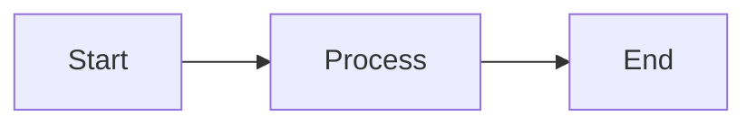
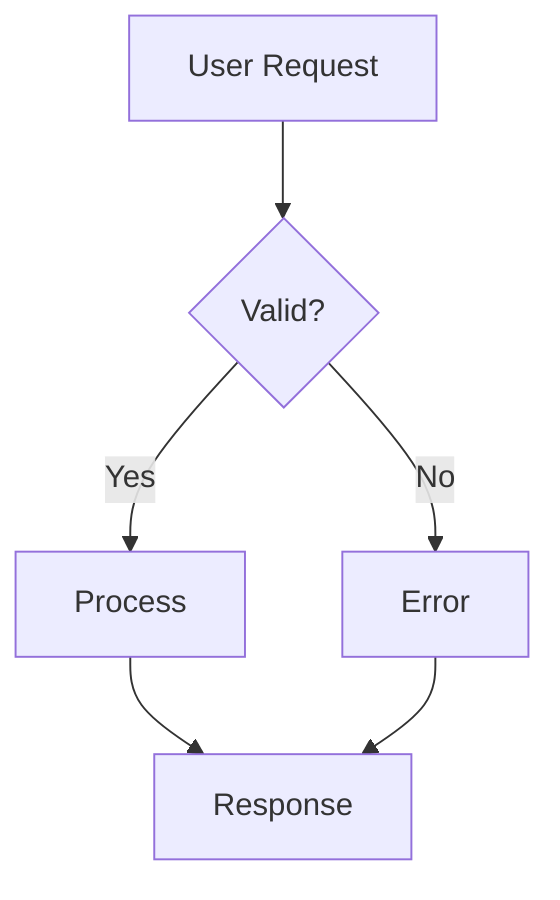
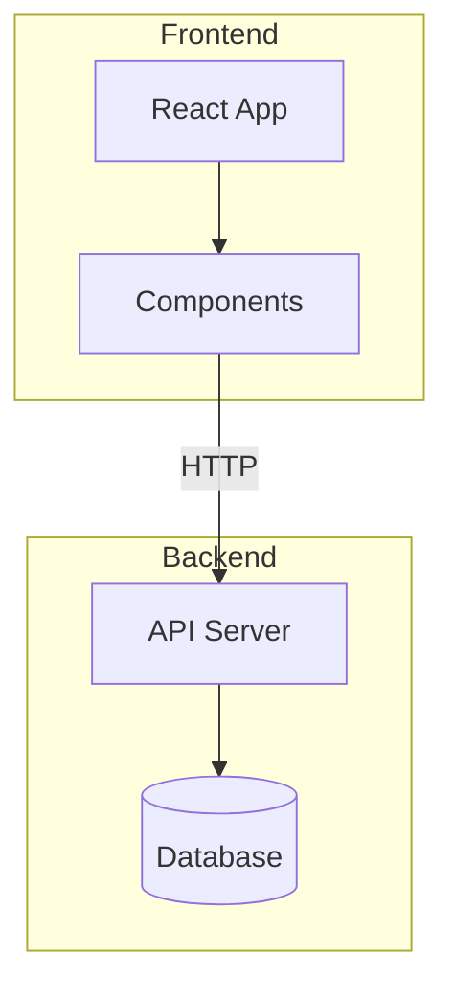
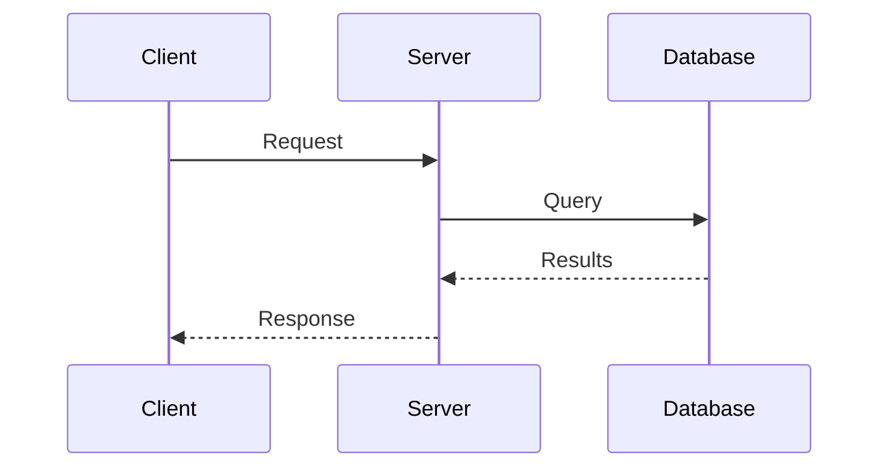
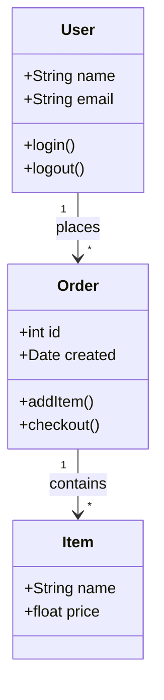
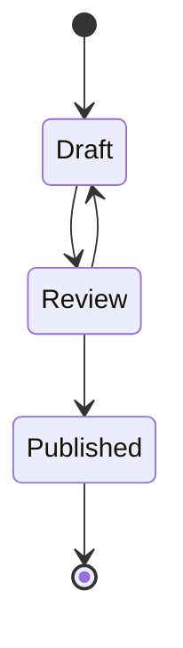
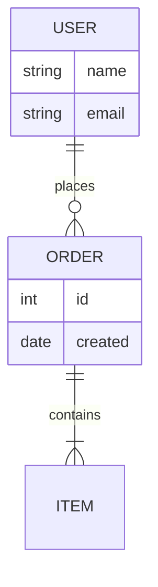
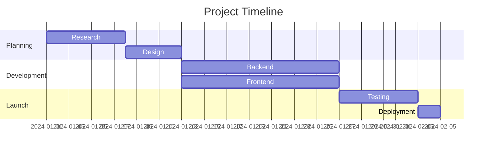
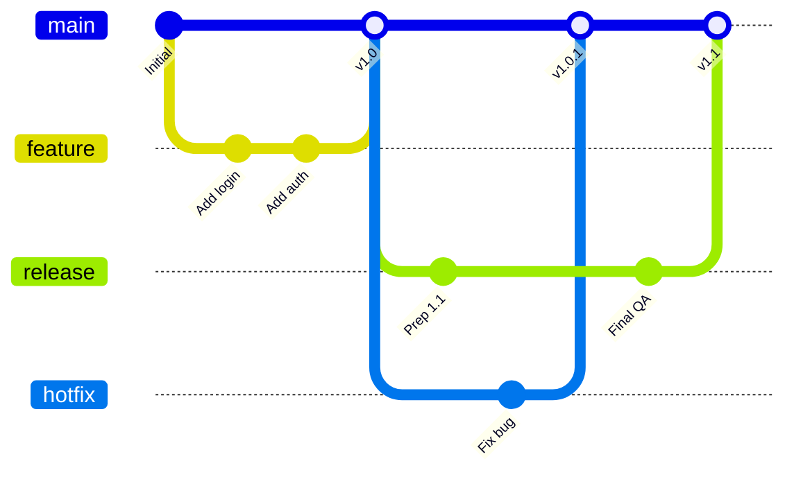
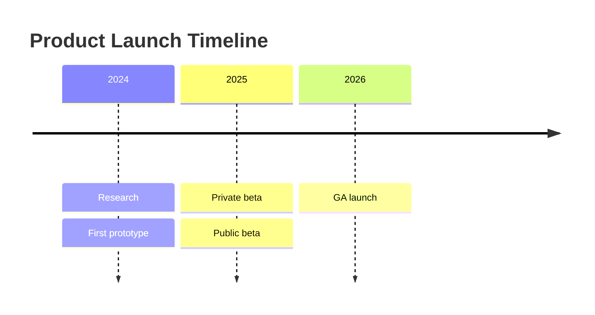

Schreiben Sie Diagramme als Text in eingezäunten Codeblöcken. Jamdesk rendert sie zur Build-Zeit als SVG.

<Tip>
  Entwerfen und zeigen Sie Ihr Diagramm im [Jamdesk Mermaid-Editor](https://jamdesk.com/utilities/mermaid-editor) als Vorschau an.
  Es ist ein Open-Source-Editor, der im Browser läuft und während der Eingabe rendert.
  Fügen Sie das Ergebnis in einen `mermaid`-Codeblock ein.
</Tip>

<Tip>
  Jamdesk rendert außerdem [D2-Diagramme](/de/components/d2) in `d2`-Codeblöcken.
  Verwenden Sie D2, wenn ein Diagramm verschachtelte Container, ein SQL-Schema mit
  Primär- und Fremdschlüsseln benötigt oder Sie die Layout-Engine wechseln möchten. Die Mermaid-Beispiele auf dieser Seite
  haben D2-Entsprechungen auf der [D2-Seite](/de/components/d2).
</Tip>

## Grundlegende Verwendung

Verwenden Sie einen eingezäunten Codeblock mit dem Sprachbezeichner `mermaid`:

````mdx

````


## Diagrammtypen

### Flussdiagramme

Die Richtung kann von oben nach unten (`TD`), von links nach rechts (`LR`), von unten nach oben (`BT`) oder von rechts nach links (`RL`) sein.



````mdx

````

#### Untergraphen

Gruppieren Sie zusammengehörige Knoten mit Teilgraphen. Damit können Sie ein großes Flussdiagramm in Abschnitte wie „Frontend“ und „Backend“ oder in Pipeline-Stufen unterteilen.



````mdx

````

### Sequenzdiagramme

Sequenzdiagramme zeigen, wie Komponenten über die Zeit miteinander interagieren. Verwenden Sie ein Sequenzdiagramm für API-Aufrufabläufe und Authentifizierungs-Handshakes. Teilnehmer erscheinen als vertikale Lebenslinien. Nachrichten verlaufen zwischen ihnen.



````mdx

````

### Klassendiagramme

Klassendiagramme zeigen die Struktur objektorientierter Systeme, etwa ein Datenmodell oder die Kerntypen eines Dienstes. Sie zeigen Klassen mit ihren Attributen, Methoden und Beziehungen.



````mdx

````

### Zustandsdiagramme

Zustandsdiagramme modellieren den Lebenszyklus eines Objekts oder Prozesses. Sie zeigen jeden Zustand und die Übergänge zwischen ihnen. Bestellstatus und Freigabe-Workflows für Dokumente sind typische Beispiele.



````mdx

````

### Entity-Relationship-Diagramme

ER-Diagramme dokumentieren Datenbankschemata und Datenmodelle. Sie zeigen Entitäten (Tabellen), ihre Attribute (Spalten) und die Beziehungen zwischen ihnen. Die Symbole markieren die Kardinalität: eins-zu-eins, eins-zu-viele oder viele-zu-viele.



````mdx

````

### Gantt-Diagramme

Gantt-Diagramme zeigen Projektpläne. Aufgaben erscheinen als horizontale Balken auf einer Zeitachse, mit Dauer, Abhängigkeiten und parallel laufender Arbeit. Verwenden Sie eines für einen Projektplan oder eine Roadmap.



````mdx

````

### Git-Graphen

Git-Graphen zeigen Verzweigungsstrategien und Versionskontroll-Workflows: Commits, Branches, Merges und die Repository-Historie. Jeder Branch erhält eine eigene Farbe.



````mdx

````

### Zeitachsendiagramme

Zeitleisten zeigen Ereignisse über Zeiträume hinweg. Beginnen Sie mit dem Schlüsselwort `timeline`, optional einem `title`, und dann einer Zeile pro Zeitraum, wobei Ereignisse durch Doppelpunkte getrennt werden:



````mdx

````

### Kreisdiagramme

Kreisdiagramme zeigen Anteile als Segmente eines Kreises. Verwenden Sie eines, wenn Teile ein Ganzes ergeben, etwa Marktanteile oder Umfrageergebnisse. Halten Sie sich an höchstens 6 Segmente.

```mermaid
pie title Browser Market Share
    "Chrome" : 65
    "Safari" : 19
    "Firefox" : 10
    "Edge" : 4
    "Other" : 2
```

````mdx
```mermaid
pie title Browser Market Share
    "Chrome" : 65
    "Safari" : 19
    "Firefox" : 10
    "Edge" : 4
    "Other" : 2
```
````

## Formen in Flussdiagrammen

Jede Form hat in Flussdiagrammen eine übliche Bedeutung:

| Syntax     | Form              | Verwendung |
| ---------- | ----------------- | ---------- |
| `[text]`   | Rechteck          | Prozessschritte, Aktionen |
| `(text)`   | Abgerundetes Rechteck | Start- und Endpunkte |
| `{text}`   | Raute             | Entscheidungen, Bedingungen |
| `([text])` | Stadion           | Ereignisse, Auslöser |
| `[[text]]` | Subroutine        | Vordefinierte Prozesse |
| `[(text)]` | Zylinder          | Datenbanken, Speicher |

## Pfeiltypen

Pfeile zeigen die Flussrichtung und Beziehungstypen an:

| Syntax      | Beschreibung      | Verwendung |
| ----------- | ----------------- | ---------- |
| `-->`       | Durchgezogener Pfeil | Normaler Fluss |
| `---`       | Durchgezogene Linie | Zuordnungen |
| `-.->`      | Gepunkteter Pfeil | Optionaler oder asynchroner Fluss |
| `==>`       | Dicker Pfeil      | Wichtige Pfade |
| `--text-->` | Pfeil mit Beschriftung | Beschreibt den Übergang |

## Breite Diagramme skalieren

Verwenden Sie die Komponente `Mermaid` mit der Prop `minWidth`, damit ein breites Diagramm, etwa ein Gantt-Diagramm oder ein großer Git-Graph, nicht zusammengedrückt wird:

```mdx
<Mermaid minWidth="700px">
gantt
    title Wide Project Timeline
    ...
</Mermaid>
```

## Zum Vergrößern anklicken

Klicken Sie auf ein Diagramm, um es ab einer Bildschirmbreite von 768px im Vollbild zu öffnen. Mit der Tastatur fokussieren Sie das Diagramm und drücken Enter. Schließen Sie es mit Escape, der Schaltfläche zum Schließen oder einem Klick außerhalb des Diagramms.

Deaktivieren Sie dies für ein einzelnes Diagramm mit der Komponentenform und `noZoom`:

```mdx
<Mermaid noZoom>
graph LR
    A[Request] --> B[Response]
</Mermaid>
```

Diagramme, die als ```` ```mermaid ````-Codeblöcke geschrieben sind, öffnen sich immer im Vollbild.

## Tipps zur Gestaltung

<Tip>
  Mermaid-Diagramme wechseln zusammen mit der Website in den Dunkelmodus.
</Tip>

- Teilen Sie einen großen Ablauf in kleinere Diagramme auf.
- Beschriften Sie Ihre Pfeile, um Übergänge zu erklären.
- Wählen Sie eine Richtung: `TD` (von oben nach unten) für hohe Diagramme, `LR` (von links nach rechts) für breite.
- Begrenzen Sie jedes Diagramm auf 10–15 Knoten.

Um einen Knoten einzufärben, verwenden Sie `style` für einen einzelnen Knoten oder `classDef` für eine Gruppe:

```mermaid
graph LR
    A[Start] --> B[Review] --> C[Done]
    classDef good fill:#d1fae5,stroke:#059669
    style B fill:#fef3c7,stroke:#d97706
    class C good
```

Jamdesk behält Ihre Farben im Dunkelmodus bei. Eine Füllung ohne Textfarbe erhält eine Beschriftungsfarbe, die Jamdesk so wählt, dass sie auf der Füllung gut lesbar ist.

## Weitere Informationen

Die vollständige Syntax, einschließlich Gestaltung, Theming und weiterer Diagrammtypen, finden Sie in der [offiziellen Mermaid-Dokumentation](https://mermaid.js.org/intro/).

## Wie geht es weiter?

<Columns cols={2}>
  <Card title="D2-Diagramme" icon="diagram-project" href="/de/components/d2">
    Architektur, Container und SQL-Schemata mit D2
  </Card>
  <Card title="Komponentenübersicht" icon="puzzle-piece" href="/de/components/overview">
    Alle verfügbaren Komponenten durchsuchen
  </Card>
  <Card title="MDX-Grundlagen" icon="file-code" href="/de/content/mdx-basics">
    Erfahren Sie, wie Sie Komponenten in MDX verwenden
  </Card>
</Columns>