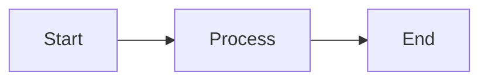
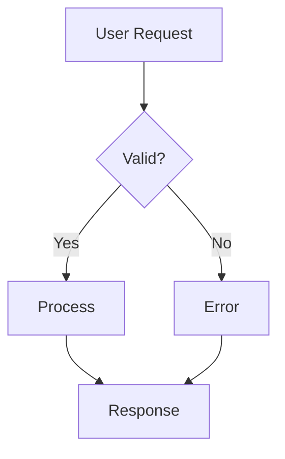
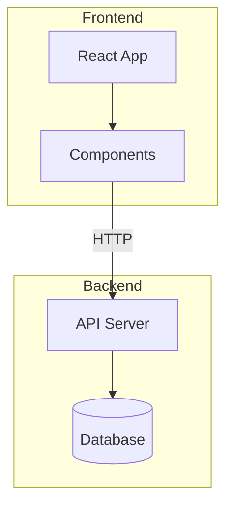
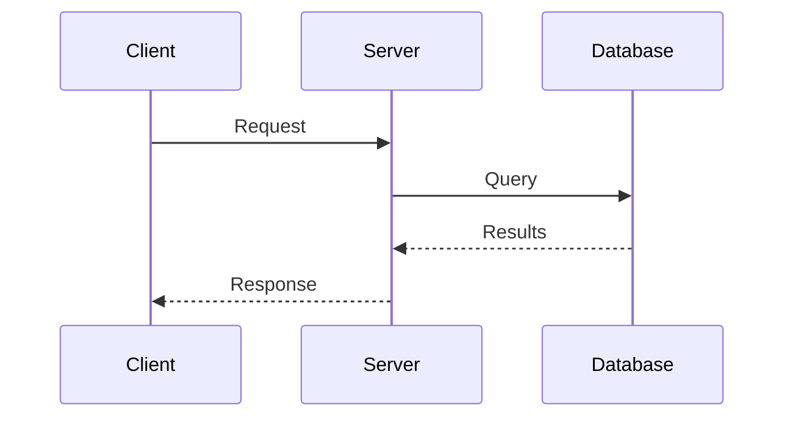
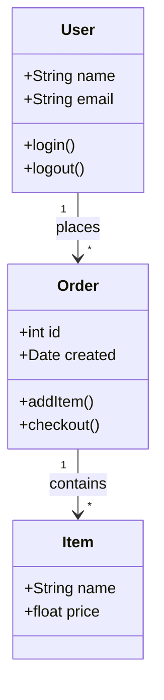
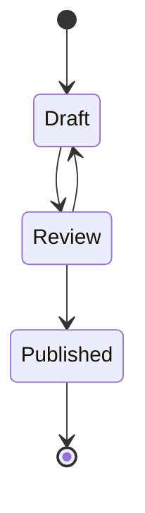
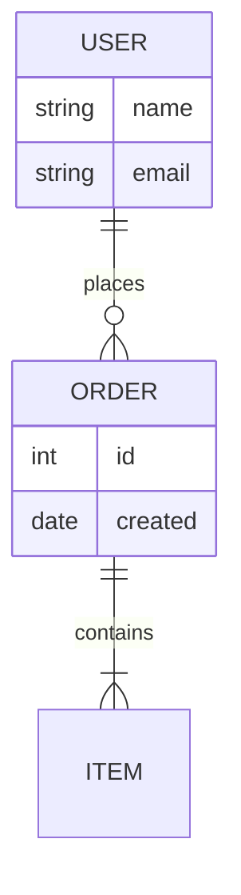
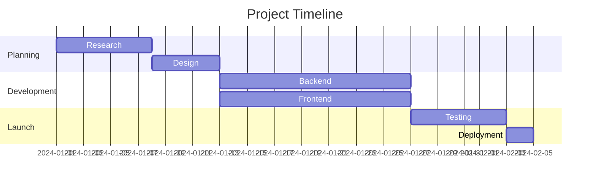
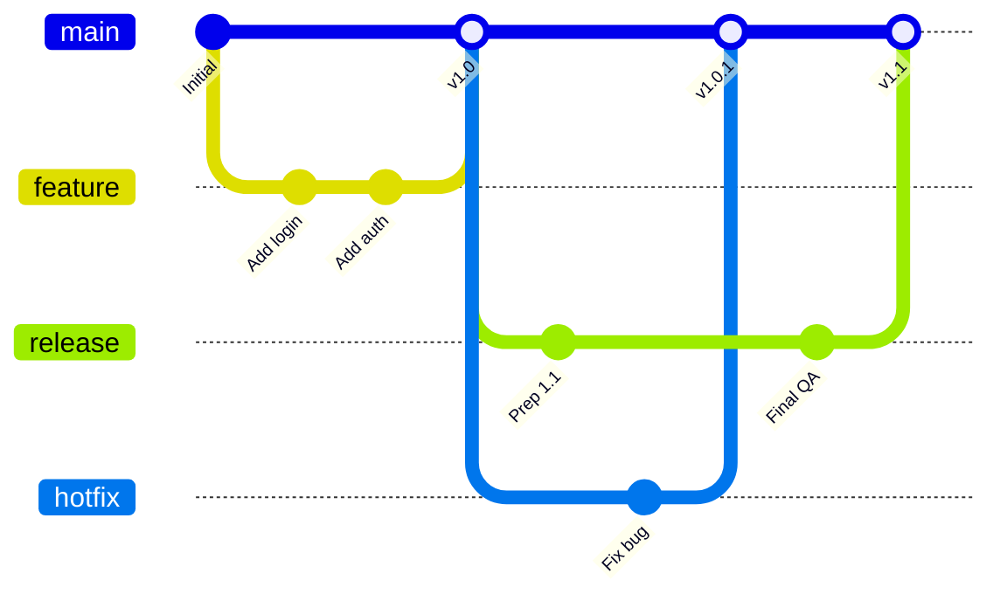
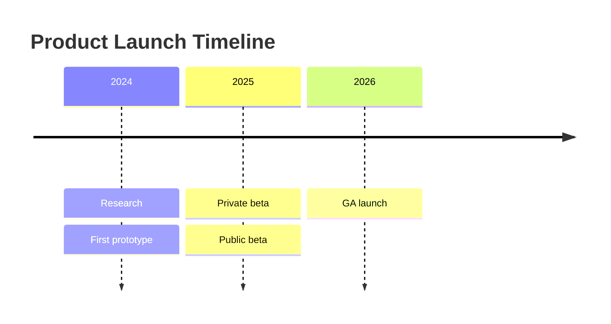

Schreiben Sie Diagramme als Text in umschlossenen Codeblöcken. Jamdesk rendert sie beim Build als SVG.

<Tip>
  Entwerfen und testen Sie Ihr Diagramm im [Jamdesk Mermaid-Editor](https://jamdesk.com/utilities/mermaid-editor),
  einem quelloffenen, browserbasierten Editor und Viewer. Schreiben Sie Mermaid-Syntax, sehen Sie sich
  das Ergebnis live an und fügen Sie es anschließend hier in einen umschlossenen `mermaid`-Block ein.
</Tip>

<Tip>
  Jamdesk unterstützt auch [D2-Diagramme](/de/components/d2) in umschlossenen `d2`-Blöcken.
  Verwenden Sie D2, wenn ein Diagramm verschachtelte Container, ein SQL-Schema mit
  Primär- und Fremdschlüsseln oder einen Wechsel der Layout-Engine erfordert. Zu den
  Mermaid-Beispielen auf dieser Seite gibt es D2-Entsprechungen auf der [D2-Seite](/de/components/d2).
</Tip>

## Grundlegende Verwendung

Verwenden Sie einen umschlossenen Codeblock mit der Sprachkennung `mermaid`:

````mdx

````


## Diagrammtypen

### Flussdiagramme

Die Richtung kann von oben nach unten (`TD`), von links nach rechts (`LR`), von unten nach oben (`BT`) oder von rechts nach links (`RL`) verlaufen.



````mdx

````

#### Untergraphen

Gruppieren Sie zusammengehörige Knoten mithilfe von Untergraphen. So lassen sich komplexe Flussdiagramme in logische Abschnitte wie „Frontend“ und „Backend“ oder in verschiedene Phasen einer Pipeline gliedern.



````mdx

````

### Sequenzdiagramme

Sequenzdiagramme zeigen, wie Komponenten im zeitlichen Verlauf interagieren. Verwenden Sie ein Sequenzdiagramm für Abläufe von API-Aufrufen und Authentifizierungs-Handshake-Prozesse. Beteiligte werden als vertikale Lebenslinien dargestellt, zwischen denen Nachrichten ausgetauscht werden.



````mdx

````

### Klassendiagramme

Klassendiagramme stellen die Struktur objektorientierter Systeme dar, etwa ein Datenmodell oder die zentralen Typen eines Dienstes. Sie zeigen Klassen mit ihren Attributen und Methoden sowie ihre Beziehungen untereinander.



````mdx

````

### Zustandsdiagramme

Zustandsdiagramme modellieren den Lebenszyklus eines Objekts oder Prozesses. Sie zeigen alle möglichen Zustände und die Übergänge zwischen ihnen. Bestellstatus und Workflows zur Dokumentfreigabe sind typische Beispiele.



````mdx

````

### Entity-Relationship-Diagramme

ER-Diagramme dokumentieren Datenbankschemas und Datenmodelle. Sie zeigen Entitäten (Tabellen), ihre Attribute (Spalten) und die Beziehungen zwischen ihnen. Die Symbole geben die Kardinalität an: eins zu eins, eins zu viele oder viele zu viele.



````mdx

````

### Gantt-Diagramme

Gantt-Diagramme veranschaulichen Projektpläne und Zeitabläufe. Aufgaben werden als horizontale Balken auf einer Zeitleiste angezeigt, die Dauer, Abhängigkeiten und parallele Arbeit darstellen. Ein Projektplan oder eine Roadmap eignet sich dafür besonders gut.



````mdx

````

### Git-Graphen

Git-Graphen veranschaulichen Branching-Strategien und Workflows zur Versionsverwaltung. Sie zeigen Commits, Branches, Merges und den gesamten Verlauf eines Repositorys. Jeder Branch ist zur einfachen Erkennung farblich gekennzeichnet.



````mdx

````

### Zeitachsendiagramme

Zeitachsen zeigen Ereignisse über bestimmte Zeiträume hinweg. Beginnen Sie mit dem Schlüsselwort `timeline`, fügen Sie optional einen `title` hinzu und anschließend eine Zeile pro Zeitraum mit durch Doppelpunkte getrennten Ereignissen:



````mdx

````

### Kreisdiagramme

Kreisdiagramme zeigen proportionale Daten als Kreissegmente. Verwenden Sie sie, wenn Teile ein Ganzes ergeben, etwa bei Marktanteilen oder Umfrageergebnissen. Beschränken Sie die Anzahl der Segmente für bessere Lesbarkeit auf höchstens 6.

```mermaid
pie title Browser Market Share
    "Chrome" : 65
    "Safari" : 19
    "Firefox" : 10
    "Edge" : 4
    "Other" : 2
```

````mdx
```mermaid
pie title Browser Market Share
    "Chrome" : 65
    "Safari" : 19
    "Firefox" : 10
    "Edge" : 4
    "Other" : 2
```
````

## Formen in Flussdiagrammen

Verschiedene Formen stehen in Flussdiagrammen für unterschiedliche Bedeutungen:

| Syntax     | Form                | Verwendung |
| ---------- | ------------------- | ------- |
| `[text]`   | Rechteck            | Prozessschritte, Aktionen |
| `(text)`   | Abgerundetes Rechteck | Start- und Endpunkte |
| `{text}`   | Raute                | Entscheidungen, Bedingungen |
| `([text])` | Stadion              | Ereignisse, Auslöser |
| `[[text]]` | Unterprogramm        | Vordefinierte Prozesse |
| `[(text)]` | Zylinder             | Datenbanken, Speicher |

## Pfeiltypen

Pfeile geben die Flussrichtung und die Art der Beziehung an:

| Syntax      | Beschreibung         | Verwendung |
| ----------- | -------------------- | ------- |
| `-->`       | Durchgezogener Pfeil | Normaler Ablauf |
| `---`       | Durchgezogene Linie  | Zuordnungen |
| `-.->`      | Gepunkteter Pfeil    | Optionaler oder asynchroner Ablauf |
| `==>`       | Dicker Pfeil         | Wichtige Pfade |
| `--text-->` | Pfeil mit Beschriftung | Übergang beschreiben |

## Breite Diagramme skalieren

Bei breiten Diagrammen wie Gantt-Diagrammen oder komplexen Git-Graphen können Sie die Komponente `Mermaid` direkt mit der Property `minWidth` verwenden, damit das Diagramm nicht gestaucht wird:

```mdx
<Mermaid minWidth="700px">
gantt
    title Wide Project Timeline
    ...
</Mermaid>
```

## Zum Vergrößern anklicken

Auf Bildschirmen ab 768 px öffnet sich ein Diagramm im Vollbild, wenn Sie darauf klicken. Mit der Tastatur können Sie das Diagramm fokussieren und Enter drücken. Drücken Sie Escape, klicken Sie auf die Schließen-Schaltfläche oder außerhalb des Diagramms, um es zu schließen.

Um diese Funktion für ein einzelnes Diagramm zu deaktivieren, verwenden Sie die Komponentenform mit `noZoom`:

```mdx
<Mermaid noZoom>
graph LR
    A[Request] --> B[Response]
</Mermaid>
```

Diagramme in ```` ```mermaid ````-Codeblöcken werden immer im Vollbild geöffnet.

## Tipps zur Gestaltung

<Tip>
  Mermaid-Diagramme passen sich automatisch an helle und dunkle Modi an. Die Farben
  sind in beiden Designs auf gute Lesbarkeit abgestimmt.
</Tip>

Für aussagekräftige Diagramme:

- Halten Sie es einfach: Teilen Sie komplexe Abläufe in mehrere kleinere Diagramme auf.
- Beschriften Sie Ihre Pfeile, um Übergänge zu erklären.
- Wählen Sie eine Richtung: `TD` (von oben nach unten) für hohe Diagramme, `LR` (von links nach rechts) für breite Diagramme.
- Begrenzen Sie jedes Diagramm zur besseren Übersicht auf 10–15 Knoten.

Um einen Knoten einzufärben, verwenden Sie `style` für einen einzelnen Knoten oder `classDef` für eine Gruppe:

```mermaid
graph LR
    A[Start] --> B[Review] --> C[Done]
    classDef good fill:#d1fae5,stroke:#059669
    style B fill:#fef3c7,stroke:#d97706
    class C good
```

Ihre Farben bleiben im hellen und dunklen Modus erhalten. Wenn Sie eine Füllfarbe, aber keine Textfarbe festlegen, wählt Jamdesk eine Beschriftungsfarbe, die sich gut von der Füllung abhebt.

## Weitere Informationen

Die vollständige Mermaid-Syntaxreferenz mit erweiterten Funktionen wie Gestaltung, Theming und zusätzlichen Diagrammtypen finden Sie in der [offiziellen Mermaid-Dokumentation](https://mermaid.js.org/intro/).

## Wie geht es weiter?

<Columns cols={2}>
  <Card title="D2-Diagramme" icon="diagram-project" href="/de/components/d2">
    Architektur, Container und SQL-Schemas mit D2
  </Card>
  <Card title="Komponentenübersicht" icon="puzzle-piece" href="/de/components/overview">
    Alle verfügbaren Komponenten ansehen
  </Card>
  <Card title="MDX-Grundlagen" icon="file-code" href="/de/content/mdx-basics">
    Erfahren Sie, wie Sie Komponenten in MDX verwenden
  </Card>
</Columns>