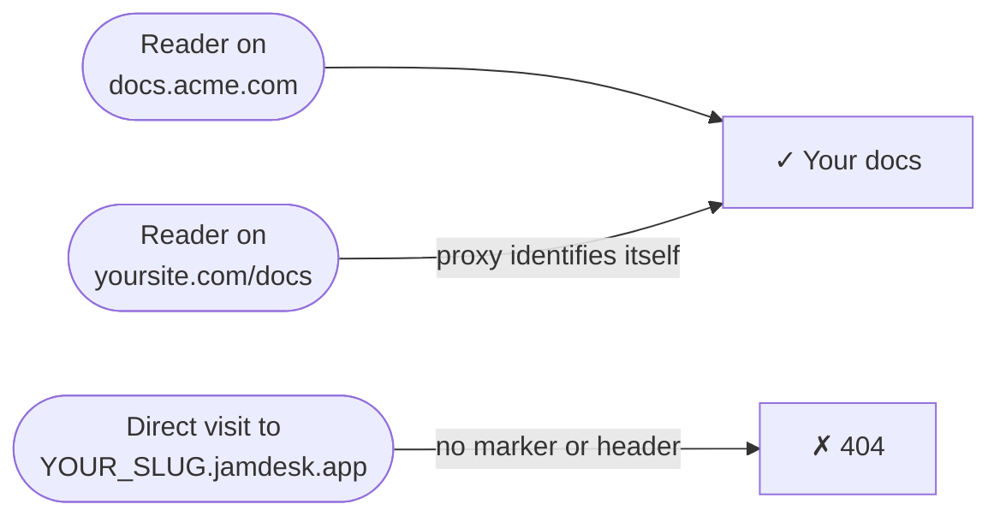

Ihre Dokumentation wird unter `YOUR_SLUG.jamdesk.app` gehostet. Die Subdomain antwortet weiterhin, nachdem Sie eine eigene Domain verbunden haben. Jede darüber ausgelieferte Seite enthält ein `<link rel="canonical">`-Tag, das auf Ihre Domain verweist. Suchmaschinen indexieren Ihre Domain, niemals die Subdomain.

Die Option **Nur eigene Domain** deaktiviert den direkten Zugriff auf die Subdomain. Ein direkter Aufruf von `YOUR_SLUG.jamdesk.app` gibt einen 404-Fehler zurück. Ihre Dokumentation ist nur über Ihre eigene Domain erreichbar.

Die Screenshots zeigen die Benutzeroberfläche auf Englisch.



<Warning>
Dadurch wird Ihre Subdomain verborgen. Es ist kein Passwortschutz. Alle, die Ihre Domain aufrufen, können Ihre Dokumentation weiterhin sehen. Mit dem [Passwortschutz](/de/setup/password-protection) legen Sie fest, *wer* sie lesen darf. Sie können beides aktivieren.
</Warning>

## Aktivierung

<Steps>
  <Step title="Eigene Domain verifizieren">
    Fügen Sie Ihre Domain im Dashboard hinzu und verifizieren Sie sie. Weitere Informationen finden Sie unter [Eigene Domains](/de/deploy/custom-domains). Die Option setzt eine Domain mit dem Status **Active** voraus.
  </Step>
  <Step title="Proxy überprüfen (nur Reverse-Proxy-Setups)">
    Wenn Ihre Domain ein einfacher CNAME-Eintrag ist, der auf Jamdesk verweist (z. B. `docs.acme.com`), überspringen Sie diesen Schritt. Wenn Sie Ihre Dokumentation über einen Proxy unter `yoursite.com/docs` bereitstellen, muss der Proxy sich bei jeder weitergeleiteten Anfrage zu erkennen geben. Weitere Informationen finden Sie unten unter [Proxy-Setups](#proxy-konfigurationen).
  </Step>
  <Step title="Option aktivieren">
    Öffnen Sie **Settings** Ihres Projekts im Dashboard. Klappen Sie die Karte **Custom Domain** auf und aktivieren Sie **Custom domain only**. Jamdesk prüft zuerst Ihre aktive Domain. Die Option bleibt deaktiviert, bis Ihre Konfiguration die Prüfung besteht. Schlägt die Prüfung fehl, erfahren Sie in der Meldung, was Sie korrigieren müssen.

    <Frame>
      
    </Frame>
  </Step>
</Steps>

Änderungen werden innerhalb einer Minute auf allen Edge-Servern übernommen.

## Proxy-Konfigurationen

Jamdesk liefert eine Anfrage an `YOUR_SLUG.jamdesk.app` nur dann aus, wenn es erkennt, dass sie über Ihren Proxy kommt. Dafür ist der Header `X-Jamdesk-Forwarded-Host` oder der Abfragemarker `?jd_proxy=1` erforderlich. Diese Einrichtungsanleitungen enthalten die passende Konfiguration:

- **[Vercel](/de/deploy/vercel)**: Rewrites in `vercel.json` fügen `?jd_proxy=1` hinzu. Edge Middleware setzt den Header.
- **[Cloudflare Workers](/de/deploy/cloudflare)**: Der Worker setzt den Header.
- **[AWS CloudFront](/de/deploy/aws)**: der benutzerdefinierte Origin-Header.
- **[Reverse-Proxy](/de/deploy/reverse-proxy)**: nginx, Apache, Caddy und HAProxy setzen den Header.

Verwenden Sie [MCP](/de/ai/mcp-server) oder das [Chat-Widget](/de/ai/chat) über einen Reverse-Proxy? Leiten Sie `/api/mcp/:path*` und `/api/chat/:path*` genauso weiter wie `/docs`. Auf Vercel:

```json vercel.json
{
  "rewrites": [
    { "source": "/api/mcp/:path*", "destination": "https://YOUR_SLUG.jamdesk.app/api/mcp/:path*?jd_proxy=1" },
    { "source": "/api/chat/:path*", "destination": "https://YOUR_SLUG.jamdesk.app/api/chat/:path*?jd_proxy=1" }
  ]
}
```

Bei einer Domain, deren CNAME auf Jamdesk verweist, sind für MCP und Chat keine Änderungen erforderlich. Verweisen Sie MCP-Clients auf `https://docs.acme.com/_mcp`.

## Wissenswertes

- **Auf der nackten Subdomain geben alle Inhalte einen 404-Fehler zurück**: Seiten, `sitemap.xml`, `robots.txt`, `llms.txt` und Markdown-Exporte. Im Browser wird eine Jamdesk-Fehlerseite angezeigt.
- **Bilder bleiben erreichbar.** Bilder, Videos und Social-Preview-Bilder (OG) sind davon ausgenommen. Die Website-Vorschau im Dashboard lädt sie direkt von der Subdomain.
- **Sie können sich nicht selbst aussperren.** Wenn die DNS-Konfiguration Ihrer Domain fehlerhaft ist, setzt Jamdesk die Sperre außer Kraft. Die Subdomain liefert wieder Inhalte aus, bis die Domain wieder erreichbar ist. Wenn Sie Ihre Proxy-Konfiguration beschädigen (z. B. indem Sie den Marker aus einem Rewrite entfernen), deaktivieren Sie die Option, während Sie den Fehler beheben.
- **Die [Search API](/de/jamdesk-api/docs-search-api) ist davon nicht betroffen.** Die Authentifizierung erfolgt über einen API-Schlüssel.

## Was kommt als Nächstes?

<Columns cols={3}>
  <Card title="Vercel" icon="cloud-arrow-up" href="/de/deploy/vercel">
    Fügen Sie den jd_proxy-Marker hinzu oder richten Sie Edge Middleware ein
  </Card>
  <Card title="Eigene Domains" icon="globe" href="/de/deploy/custom-domains">
    Registrieren und verifizieren Sie Ihre Domain
  </Card>
  <Card title="Passwortschutz" icon="lock" href="/de/setup/password-protection">
    Legen Sie fest, wer Ihre Dokumentation lesen darf
  </Card>
</Columns>