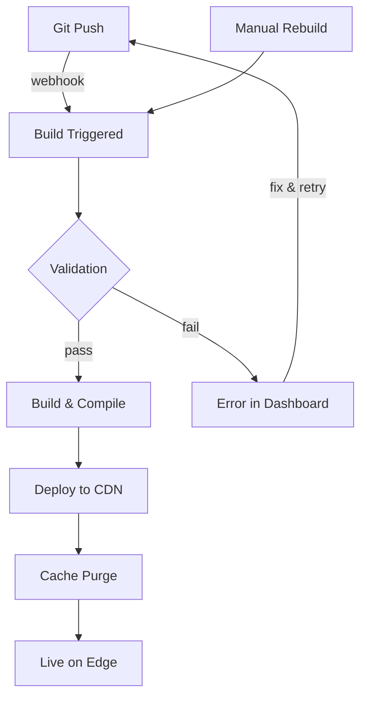

Push zu GitHub. Jamdesk baut und veröffentlicht deine Dokumentation innerhalb weniger Minuten.

Die Screenshots zeigen die Benutzeroberfläche auf Englisch.

## Build-Zyklus

## Build-Auslöser

| Auslöser | So funktioniert es | Anwendungsfall |
|---------|--------------|----------|
| **Git Push** | Webhook wird beim Push auf den verbundenen Branch ausgelöst | Normale Entwicklung |
| **Dashboard** | Klicke in den Projekteinstellungen auf „Rebuild“ | Erzwungene Aktualisierung nach Konfigurationsänderungen |

<Note>
Builds werden entprellt. Commits, die innerhalb von 10 Sekunden aufeinander folgen, landen in einem einzigen Build.
</Note>

## Was während eines Builds passiert

Jamdesk klont dein Repository und validiert `docs.json` sowie die MDX-Syntax. Es kompiliert die Seiten zu HTML mit einem Suchindex. Das Ergebnis wird nach Cloudflare R2 deployt. Die meisten Seiten werden in 30–90 Sekunden gebaut.

Die vollständige Pipeline und das Architekturdiagramm findest du unter [So funktioniert Jamdesk](/de/how-jamdesk-works).

## Bereitstellungsstatus

Das Dashboard zeigt für jeden Build einen dieser Status an:

| Status | Bedeutung |
|--------|---------|
| **Building** | Build läuft |
| **Deployed** | Live unter deiner Domain |
| **Failed** | Build-Fehler – Logs prüfen |
| **Queued** | Wartet auf den vorherigen Build |

Der Abschnitt Build History listet die letzten Deployments mit ihrem Status auf. Von dort aus kannst du einen manuellen Rebuild auslösen:

<SizedImage src="/images/dashboard/build-history.webp" alt="Build History showing recent deployments with Successful status badges, commit info, and Rebuild button" />

## Manueller Build

Löse einen Rebuild aus, ohne Änderungen zu pushen:

1. Öffne dein Projekt im Dashboard
2. Öffne **Settings**
3. Klicke auf **Rebuild**

Verwende dies, wenn:
- ein hängender Build behoben werden soll
- nach Plattform-Updates aktualisiert werden soll

## Build-Logs

1. Gehe in deinem Projekt zu **Deployments**
2. Klicke auf ein Deployment
3. Lies das vollständige Build-Log

Häufige Fehler im Log:
- Ungültige MDX-Syntax
- Fehlende Bilder oder Assets
- Defekte interne Links
- Konfigurationsfehler

## Rollbacks

1. Gehe zu **Deployments**
2. Suche das Deployment, das du wiederherstellen möchtest
3. Klicke auf **Rollback**

Die vorherige Version geht sofort live. Gleichzeitig startet ein neuer Build.

## Branch-Bereitstellungen

<Note>
Branch-Deployments sind in den Pro-Tarifen verfügbar.
</Note>

Änderungen vor dem Merge in der Vorschau prüfen:

1. Push auf einen Feature-Branch
2. Jamdesk erstellt eine Vorschau unter `branch-name.your-project.jamdesk.app`
3. Prüfen und mergen, sobald es bereit ist

## Wie geht es weiter?

<Columns cols={2}>
  <Card title="Deployment-Übersicht" icon="cloud-arrow-up" href="/de/deploy/overview">
    Wähle zwischen Subdomain, eigener Domain oder Subpath-Hosting
  </Card>
  <Card title="Subpath-Hosting" icon="route" href="/de/deploy/subpath-hosting">
    Dokumentation unter example.com/docs hosten
  </Card>
</Columns>