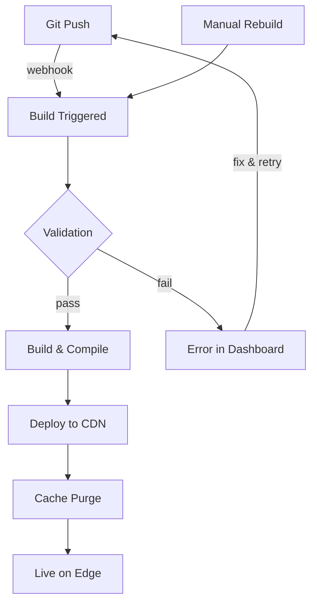

Jamdesk verwaltet den gesamten Build- und Bereitstellungszyklus automatisch. Pushen Sie zu GitHub, und Ihre Dokumentation ist innerhalb weniger Minuten live.

Die Screenshots zeigen die Benutzeroberfläche auf Englisch.

## Build-Zyklus

## Build-Auslöser

| Auslöser | Funktionsweise | Anwendungsfall |
|---------|--------------|----------|
| **Git Push** | Webhook wird bei einem Push in den verbundenen Branch ausgelöst | Normale Entwicklung |
| **Dashboard** | Klicken Sie in den Projekteinstellungen auf „Rebuild“ | Aktualisierung nach Konfigurationsänderungen erzwingen |

<Note>
Builds werden entprellt. Mehrere Commits innerhalb von 10 Sekunden werden zu einem einzelnen Build zusammengefasst.
</Note>

## Was während eines Builds passiert

Jamdesk klont Ihr Repository, validiert `docs.json` und die MDX-Syntax, kompiliert optimiertes HTML mit Suchindex und stellt es anschließend auf Cloudflare R2 bereit. Die meisten Websites werden in 30–90 Sekunden erstellt.

Eine vollständige Aufschlüsselung der Pipeline mit Architekturdiagramm finden Sie unter [So funktioniert Jamdesk](/de/how-jamdesk-works).

## Bereitstellungsstatus

Prüfen Sie den Build-Status im Dashboard:

| Status | Bedeutung |
|--------|---------|
| **Building** | Build wird ausgeführt |
| **Deployed** | Unter Ihrer Domain live |
| **Failed** | Build-Fehler – prüfen Sie die Logs |
| **Queued** | Wartet auf den vorherigen Build |

Im Abschnitt „Build History“ werden die letzten Bereitstellungen samt Status angezeigt. Dort können Sie auch manuelle Builds auslösen:

<SizedImage src="/images/dashboard/build-history.webp" alt="Build History mit letzten Bereitstellungen, Successful-Status-Badges, Commit-Informationen und Rebuild-Schaltfläche" />

## Manueller Build

Lösen Sie einen Build aus, ohne Änderungen zu pushen:

1. Öffnen Sie Ihr Projekt im Dashboard.
2. Öffnen Sie **Settings**.
3. Klicken Sie auf **Rebuild**.

Verwenden Sie diese Funktion, wenn Sie:
- einen hängenden Build beheben
- nach Plattformaktualisierungen eine Aktualisierung durchführen

## Build-Logs

Rufen Sie detaillierte Build-Logs zur Fehlerbehebung auf:

1. Öffnen Sie **Deployments** in Ihrem Projekt.
2. Klicken Sie auf eine bestimmte Bereitstellung.
3. Sehen Sie sich das vollständige Build-Log an.

Häufige Probleme werden in den Logs angezeigt:
- Ungültige MDX-Syntax
- Fehlende Bilder oder Assets
- Fehlerhafte interne Links
- Konfigurationsfehler

## Rollbacks

Kehren Sie zu einer vorherigen Version zurück:

1. Öffnen Sie **Deployments**.
2. Suchen Sie die Bereitstellung, die Sie wiederherstellen möchten.
3. Klicken Sie auf **Rollback**.

Die vorherige Version ist sofort wieder live, während ein neuer Build startet.

## Branch-Bereitstellungen

<Note>
Branch-Bereitstellungen sind in Pro-Tarifen verfügbar.
</Note>

Zeigen Sie Änderungen vor dem Zusammenführen in der Vorschau an:

1. Pushen Sie in einen Feature-Branch.
2. Jamdesk erstellt eine Vorschau unter `branch-name.your-project.jamdesk.app`.
3. Prüfen Sie die Änderungen und führen Sie sie zusammen, sobald alles bereit ist.

## Wie geht es weiter?

<Columns cols={2}>
  <Card title="Bereitstellungsübersicht" icon="cloud-arrow-up" href="/de/deploy/overview">
    Wählen Sie zwischen Hosting auf einer Subdomain, einer benutzerdefinierten Domain oder einem Unterpfad.
  </Card>
  <Card title="Unterpfad-Hosting" icon="route" href="/de/deploy/subpath-hosting">
    Hosten Sie Dokumentation unter example.com/docs.
  </Card>
</Columns>