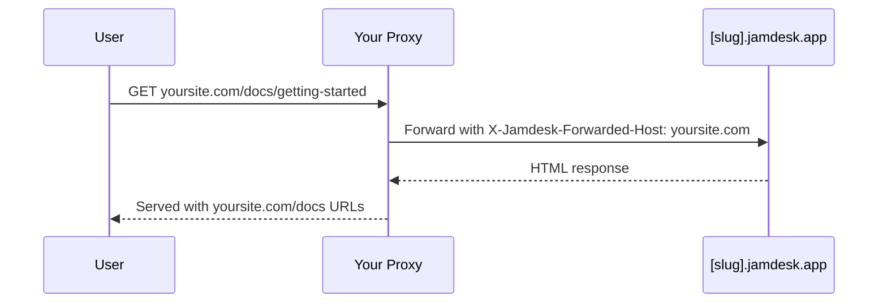

Hosten Sie Ihre Dokumentation unter einem Subpfad Ihrer Domain statt unter einer eigenen Subdomain. Der Standard ist `yoursite.com/docs`, oder Sie wählen ein eigenes Segment wie `yoursite.com/help`. Alle Bereitstellungsoptionen finden Sie unter [Deployment-Übersicht](/de/deploy/overview).

Die Screenshots zeigen die Benutzeroberfläche auf Englisch.

## Warum einen Pfad verwenden?

Ein Subpfad hält Leser auf Ihrer primären Domain. Ihre Dokumentationsseiten stärken so die Suchautorität dieser Domain. Eine Subdomain wie `docs.yoursite.com` verteilt Ranking-Signale dagegen auf zwei Hosts.

## So funktioniert es

Ihr Webserver oder CDN leitet Anfragen von `/docs/*` an Ihre Jamdesk-Site weiter. Der Browser behält die ursprüngliche URL bei:

Der Proxy übergibt den Header `X-Jamdesk-Forwarded-Host` mit Ihrer Domain. Jamdesk verwendet diesen, um:

1. **Ihre Domain zu prüfen**, ob sie zur Auslieferung der Inhalte berechtigt ist
2. **Ihre Konfiguration aus dem Dashboard anzuwenden**

Die Proxy-Konfiguration ist eine einmalige Einrichtung. Änderungen im Dashboard erfordern keine Anpassung am Proxy.

## Einrichtung nach Anbieter

<Columns cols={2}>
  <Card title="Cloudflare" icon="cloud" href="/de/deploy/cloudflare">
    Verwenden Sie Cloudflare Workers, um /docs-Traffic zu proxyen
  </Card>
  <Card title="AWS" icon="aws" href="/de/deploy/aws">
    CloudFront mit Route 53 konfigurieren
  </Card>
  <Card title="Vercel" icon="triangle" href="/de/deploy/vercel">
    Rewrites in vercel.json hinzufügen
  </Card>
  <Card title="Reverse Proxy" icon="server" href="/de/deploy/reverse-proxy">
    nginx, Apache oder andere Proxy-Server
  </Card>
</Columns>

## Voraussetzungen

Führen Sie diese Schritte aus, bevor Sie Ihren Proxy konfigurieren:

1. **Fügen Sie Ihre Domain hinzu** im [Jamdesk-Dashboard](https://dashboard.jamdesk.com) unter Settings → Custom Domain
2. **Aktivieren Sie „Host at a subpath“**
3. **Wählen Sie Ihren Subpfad** (optional; siehe unten [Ihren Subpfad wählen](#subpath-auswählen)) und klicken Sie auf **Save**

Das Dashboard zeigt Ihre Jamdesk-Subdomain (z. B. `acme.jamdesk.app`). Ihre Proxy-Konfiguration benötigt diese.

<Note>
Das Speichern einer Änderung am Subpfad-Hosting löst einen vollständigen Neuaufbau Ihrer Dokumentation aus. Das gilt auch für das Ein- und Ausschalten sowie das Ändern des Subpfads. Die URL-Struktur ändert sich dabei (zum Beispiel zwischen `/introduction` und `/docs/introduction`).
</Note>

## Subpath auswählen

Ihre Dokumentation wird standardmäßig unter `/docs` ausgeliefert. Geben Sie in das Subpfad-Feld neben dem Schalter einen anderen Wert ein, etwa `/help` oder `/support`. Ist das Feld leer, zeigt der Schalter `Host at a subpath (e.g. /docs)`. Sobald Sie einen Wert eingeben, ändert sich die Beschriftung auf den Pfad, den Sie aktivieren möchten (`Host at /help` usw.).

<Frame>
  
</Frame>

Das Feld akzeptiert ein einzelnes Segment in Kleinbuchstaben: nur Buchstaben, Ziffern und Bindestriche innerhalb des Werts, kein führender oder abschließender Bindestrich, maximal 63 Zeichen. Jamdesk lehnt reservierte Segmente ab, darunter `api`, `jd`, gängige Admin-Pfade wie `wp-admin` sowie Sprachcodes, die Ihre Dokumentation verwenden könnte (`fr`, `es`, `de` und ähnliche). Ihr Subpfad kann daher nie mit einer Route kollidieren, die Jamdesk bereits ausliefert.

Lassen Sie das Feld leer, um den Standard `/docs` beizubehalten.

## Subpath umbenennen oder entfernen

Das Ändern oder Leeren Ihres Subpfads unterbricht bereits indexierte oder gespeicherte Links nicht:

- **`/docs` hört nie auf, auszuliefern.** Die ursprünglichen `/docs/*`-Pfade antworten weiterhin, nachdem Sie auf einen eigenen Subpfad wie `/help` umgestellt haben. Sie antworten auf Ihrer Subdomain `[slug].jamdesk.app` und über jeden Proxy, der noch darauf zeigt. Kanonische Links wechseln sofort auf Ihren neuen Subpfad. Suchmaschinen indexieren dort neu. Aktualisieren Sie Ihre Proxy-Konfiguration in Ihrem eigenen Tempo.
- **Das Umbenennen eines eigenen Subpfads leitet den alten für eine Umbenennung weiter.** Benennen Sie `/help` in `/guide` um, werden Anfragen an `/help/*` per 308-Weiterleitung auf den passenden Pfad `/guide/*` geleitet. Diese Historie reicht eine Ebene tief. Benennen Sie erneut von `/guide` in `/support` um, leitet `/guide/*` auf `/support/*` weiter. Jamdesk verfolgt `/help/*` (das Segment von vor zwei Umbenennungen) nicht mehr. Diese Links landen auf einer „Nicht gefunden“-Seite, teils nach einer Weiterleitung auf einen seltsam wirkenden kombinierten Pfad. Verketten Sie keine Umbenennungen, wenn Sie sich darauf verlassen, dass die Weiterleitung alte Links weiterträgt. Aktualisieren Sie externe Links stattdessen auf den aktuellen Subpfad.
- **Ein Zurücksetzen auf `/docs`** leitet Ihren vorherigen eigenen Subpfad (eine Ebene Historie) auf `/docs/*` weiter.

<Warning>
`/docs` leitet **nicht** auf den von Ihnen gewählten Subpfad weiter. `/docs` wird weiterhin direkt und dauerhaft ausgeliefert. Die Weiterleitung über eine Ebene gilt nur für einen *eigenen* Subpfad, von dem Sie wegziehen.
</Warning>

Testen Sie Ihren Proxy, indem Sie `https://yoursite.com/docs` (oder Ihren konfigurierten Subpfad) aufrufen. Prüfen Sie, ob Assets und Links laden.

## Muss ich die jamdesk.app-Subdomain verbergen?

Nein. Ihre Subdomain `[slug].jamdesk.app` bleibt erreichbar. Sie ist der Upstream-Ursprung, an den Ihr Proxy weiterleitet. Sie konkurriert nicht mit Ihrer Site in den Suchergebnissen:

- **Domain registriert**: Seiten, die über die Subdomain ausgeliefert werden, enthalten einen kanonischen Link auf dieselbe Seite auf Ihrer Domain. Suchmaschinen rechnen die Ranking-Signale Ihrer Domain zu.
- **Noch keine Domain registriert**: Seiten der Subdomain im Subpfad-Modus werden mit `noindex` markiert. Sie gelangen nie in den Index.

Um die Inhalte auch auf der Subdomain zu blockieren (nicht nur aus dem Index zu nehmen), aktivieren Sie den [Passwortschutz](/de/setup/password-protection). Die Subdomain zeigt dann einen Entsperrbildschirm statt Ihrer Dokumentation.

## Nächste Schritte?

<Columns cols={2}>
  <Card title="Deployment-Übersicht" icon="cloud-arrow-up" href="/de/deploy/overview">
    Subdomain-, Custom-Domain- und Subpfad-Hosting vergleichen
  </Card>
  <Card title="Custom Domains" icon="globe" href="/de/deploy/custom-domains">
    DNS prüfen und Probleme bei der Domain-Einrichtung beheben
  </Card>
</Columns>