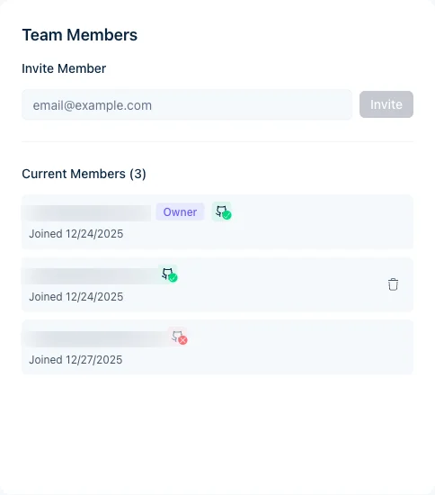

Lade Kollegen ein, um Builds zu überwachen, Analysen zu prüfen und Rebuilds auszulösen. Es gibt die Rollen Owner und Member.

<Note>
Die Mitgliedschaft entscheidet auch, welche GitHub-Pushes gebaut werden. Jamdesk ordnet die pushende Person anhand ihres verknüpften GitHub-Kontos oder ihrer E-Mail-Adresse zu. Ein Push von einer Person, die kein Mitglied ist, lässt den Build fehlschlagen. Der Projekt-Owner erhält eine E-Mail. Lade die pushende Person mit ihrer Commit-E-Mail ein. Zum Annehmen muss sie sich mit dieser E-Mail bei Jamdesk anmelden. Ist die Person bereits Mitglied, kann sie stattdessen [ihr GitHub-Konto verknüpfen](/de/integrations/github#persönliches-github-konto-benutzerebene).
</Note>

## Mitglieder einladen

<Steps>
  <Step title="Projekteinstellungen öffnen">
    Öffne dein Projekt und klicke auf **Settings**.
  </Step>
  <Step title="Members auswählen">
    Wechsle zum Tab **Members**.
  </Step>
  <Step title="E-Mail-Adresse eingeben">
    Gib die E-Mail-Adresse in das Feld **Invite Member** ein.
  </Step>
  <Step title="Einladung senden">
    Klicke auf **Invite**. Die Person erhält eine E-Mail mit einem Link zum Beitreten.
  </Step>
</Steps>

<Note>
Eingeladene Personen benötigen ein Jamdesk-Konto. Die Einladung fordert sie auf, eines zu erstellen, falls sie noch keines haben.
</Note>

<Tip>
Wenn in deinem Konto [Single Sign-On](/de/setup/sso) eingerichtet ist, melden sich Teammitglieder, deren E-Mail-Adresse zu deiner verifizierten Domain passt, über deinen Identity Provider an, anstatt ein Passwort zu erstellen. Das Einladungsformular kennzeichnet, wenn eine Adresse SSO verwenden wird.
</Tip>

<Frame>
  
</Frame>

*Die Screenshots zeigen die Benutzeroberfläche auf Englisch.*

## Mitgliederrollen

| Rolle | Berechtigungen |
|------|-------------|
| **Owner** | Voller Zugriff, kann Mitglieder entfernen, Eigentümerschaft übertragen und das Projekt löschen |
| **Member** | Builds und Analysen einsehen, Rebuilds auslösen |

Klicke neben dem Namen eines Mitglieds auf **Transfer Ownership**, um diese Person zum Owner zu machen. Details findest du unter [Eigentümerschaft übertragen](/de/help/projects/ownership-transfer).

<Tip>
Um jemandem die Kontrolle über die Abrechnung und alle Projekte zu geben, die du besitzt, mache die Person zum [Kontoadministrator](/de/help/projects/account-admins). Kontoadministratoren werden in der Mitgliederliste mit dem Chip **Account admin** angezeigt. Du entfernst sie über **User Settings** statt hier.
</Tip>

<Note>
**Teammitglieder sind nicht dasselbe wie Leser der Dokumentationsseite.** Teammitglieder sehen Builds und Analysen im Jamdesk-Dashboard. [Access Control](/de/setup/access-control) legt fest, wer deine veröffentlichte Dokumentationsseite _lesen_ darf: öffentlich, passwortgeschützt, gemischt oder SSO. Auf einer passwortgeschützten Seite kannst du außerdem [dein Team die Anmeldung mit Jamdesk nutzen lassen](/de/setup/password-protection#lass-dein-team-sich-mit-jamdesk-anmelden), sodass Mitglieder das gemeinsame Passwort nicht benötigen.
</Note>

## Mitglieder entfernen

Nur der Projekt-Owner kann Teammitglieder entfernen:

1. Gehe zu **Settings** → **Members**
2. Suche das Mitglied
3. Klicke auf **Remove**
4. Bestätige die Entfernung

Entfernte Mitglieder verlieren den Zugriff sofort. Du kannst sie später erneut einladen.

## Ausstehende Einladungen

Einladungen, die noch nicht angenommen wurden, erscheinen in der Liste **Members** und sind als ausstehend markiert. Storniere eine Einladung mit dem Papierkorbsymbol daneben.

Ausstehende Einladungen laufen nicht ab. Sie bleiben gültig, bis die Person sie annimmt oder du sie stornierst.

## Teamgröße

Teammitglieder sind in jedem Projekt unbegrenzt möglich, ohne Mehrkosten.

## Verwandte Artikel

<Columns cols={2}>
  <Card title="Eigentümerschaft übertragen" icon="arrow-right-arrow-left" href="/de/help/projects/ownership-transfer">
    Projekteigentümerschaft übertragen
  </Card>
  <Card title="Projekteinstellungen" icon="gear" href="/de/help/projects/settings">
    Projektoptionen konfigurieren
  </Card>
</Columns>