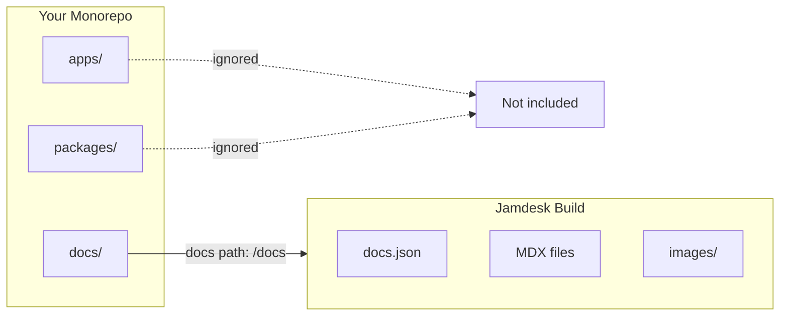

Wenn sich deine `docs.json` in einem Unterverzeichnis befindet (`docs/`, `packages/docs/` oder einem anderen Verzeichnis), aktiviere den Monorepo-Modus in den Projekteinstellungen und gib den Pfad an. Jamdesk erstellt nur Inhalte aus diesem Verzeichnis.

Die Screenshots zeigen die Benutzeroberfläche auf Englisch.

<Note>
**Voraussetzungen:** Du benötigst ein [Jamdesk-Projekt](/de/setup/creating-projects), das mit einem [GitHub-Repository](/de/setup/connecting-github) verbunden ist, bevor du die Monorepo-Unterstützung konfigurierst.
</Note>

## So beschränkt Jamdesk Ihren Build



## Schnelle Einrichtung

<Steps>
  <Step title="Projekteinstellungen öffnen">
    Öffne dein Projekt im [Jamdesk-Dashboard](https://dashboard.jamdesk.com) und gehe zu **Settings**.
  </Step>

  <Step title="Monorepo-Modus aktivieren">
    Aktiviere im Abschnitt **Git Repository** die Option **Set up as monorepo**.

    <Frame>
      
    </Frame>
  </Step>

  <Step title="Docs-Pfad eingeben">
    Gib den Pfad zum Verzeichnis ein, das deine `docs.json`-Datei enthält.

    <Frame>
      
    </Frame>

    In der Vorschau siehst du, wo Jamdesk nach deiner Konfigurationsdatei sucht.
  </Step>

  <Step title="Speichern und neu erstellen">
    Klicke auf **Save Changes**. Beim nächsten Build wird der neue Pfad verwendet.
  </Step>
</Steps>

## Den Docs-Pfad verstehen

<Warning>
Gib nur den Verzeichnispfad ein, nicht den Dateinamen. Verwende `docs` statt `docs/docs.json`.
</Warning>

### Pfadbeispiele

| Repository-Struktur | Wert für den Docs-Pfad |
|---------------------|------------------------|
| `my-repo/docs/docs.json` | `docs` |
| `my-repo/packages/docs/docs.json` | `packages/docs` |
| `my-repo/apps/website/docs/docs.json` | `apps/website/docs` |
| `my-repo/documentation/docs.json` | `documentation` |

### Was eingeschlossen wird

Jamdesk verarbeitet nur Dateien innerhalb des Docs-Pfads:

- **Inhaltsdateien** (`.mdx`, `.md`) werden zu Seiten kompiliert
- **Assets** in Unterverzeichnissen (z. B. `images/`) werden einbezogen
- **Konfiguration** (`docs.json`) definiert deine Website

Dateien außerhalb des Docs-Pfads werden bei Builds ignoriert.

## Gängige Monorepo-Muster

<Tabs>
  <Tab title="Eigenständiges /docs">
    Dokumentation in einem Verzeichnis auf oberster Ebene.

    ```bash
    monorepo/
    ├── packages/
    ├── apps/
    └── docs/                    # Docs path: docs
        ├── docs.json
        ├── introduction.mdx
        └── guides/
    ```

    **Docs-Pfad:** `docs`
  </Tab>

  <Tab title="Paket in /packages">
    Dokumentation als Workspace-Paket.

    ```bash
    monorepo/
    ├── packages/
    │   ├── core/
    │   ├── cli/
    │   └── docs/                # Docs path: packages/docs
    │       ├── docs.json
    │       └── pages/
    └── apps/
    ```

    **Docs-Pfad:** `packages/docs`
  </Tab>

  <Tab title="In einer App">
    Dokumentation in einem Anwendungs-Unterverzeichnis.

    ```bash
    monorepo/
    ├── apps/
    │   └── website/
    │       ├── src/
    │       └── docs/            # Docs path: apps/website/docs
    │           ├── docs.json
    │           └── introduction.mdx
    └── packages/
    ```

    **Docs-Pfad:** `apps/website/docs`
  </Tab>

  <Tab title="Benutzerdefiniertes Verzeichnis">
    Ein beliebiger Verzeichnisname.

    ```bash
    monorepo/
    ├── src/
    ├── tests/
    └── documentation/           # Docs path: documentation
        ├── docs.json
        └── getting-started.mdx
    ```

    **Docs-Pfad:** `documentation`
  </Tab>
</Tabs>

## Mit Assets arbeiten

Asset-Pfade in `docs.json` beziehen sich immer auf dein Docs-Verzeichnis, nicht auf das Repository-Stammverzeichnis.

### Beispiel

Bei Docs in `packages/docs/`:

```json packages/docs/docs.json
{
  "logo": {
    "light": "/images/logo.svg"
  },
  "favicon": "/images/favicon.svg"
}
```

Diese Pfade verweisen auf:
- `packages/docs/images/logo.svg`
- `packages/docs/images/favicon.svg`

<Warning>
Verwende keine absoluten Pfade vom Repository-Stammverzeichnis. Das funktioniert nicht:

```json
"favicon": "/packages/docs/images/favicon.svg"
```
</Warning>

### In MDX-Dateien

Für Bilder in MDX gilt dieselbe Regel:

```mdx

```

Der Verweis führt zu einem Bild unter `[docs-path]/images/tabs-preview.png`.

## Interne Links

Interne Links hängen nicht von deiner Repository-Struktur ab. Verwende Pfade relativ zum Docs-Stammverzeichnis:

```mdx
[See the quickstart guide](/quickstart)
[Installation steps](/quickstart#installation)
```

Diese Pfade entsprechen deiner Navigationsstruktur, nicht deinem Dateisystem.

## Build-Verhalten

Nur Änderungen innerhalb des Docs-Pfads lösen einen Build aus:

- Änderungen an `packages/docs/**` lösen einen Build aus
- Änderungen an `packages/core/**` lösen keinen Build aus

<Tip>
**Muss bei Änderungen an anderem Code ein neuer Build erstellt werden?**

Wenn deine Docs aus Quellcode generiert werden (z. B. API-Dokumentation aus Codekommentaren), starte einen manuellen Build über das Dashboard oder richte einen Webhook in deiner CI-Pipeline ein.
</Tip>

## Kompatibilität mit Workspace-Tools

Lege den Docs-Pfad fest. Für diese Monorepo-Tools ist keine weitere Konfiguration erforderlich.

| Tool | Unterstützt |
|------|-------------|
| npm workspaces | Ja |
| Yarn workspaces | Ja |
| pnpm workspaces | Ja |
| Turborepo | Ja |
| Nx | Ja |
| Lerna | Ja |

## Fehlerbehebung

<AccordionGroup>
  <Accordion title="Fehler: docs.json nicht gefunden" icon="circle-exclamation">
    1. Prüfe, ob der genaue Pfad in deinem Repository mit deiner Eingabe übereinstimmt
    2. Stelle sicher, dass `docs.json` an diesem Speicherort vorhanden ist
    3. Prüfe die Schreibweise. Bei Pfaden wird zwischen Groß- und Kleinschreibung unterschieden
    4. Denke daran: Verwende `docs` statt `docs/docs.json`

    **Schnellprüfung:** Die Datei sollte sich in deinem Repository unter `[your-docs-path]/docs.json` befinden.
  </Accordion>

  <Accordion title="Assets werden nicht geladen" icon="image">
    Asset-Pfade müssen relativ zu deinem Docs-Verzeichnis sein.

    **Richtig** (relativ zum Docs-Verzeichnis):
    ```json
    "favicon": "/images/favicon.svg"
    ```

    **Falsch** (absoluter Pfad vom Repository-Stammverzeichnis):
    ```json
    "favicon": "/packages/docs/images/favicon.svg"
    ```

    Prüfe, ob deine Bilder unter `[docs-path]/images/` vorhanden sind.
  </Accordion>

  <Accordion title="Änderungen lösen keine Builds aus" icon="rotate">
    Nur Änderungen innerhalb des Docs-Pfads lösen automatische Builds aus.

    1. Prüfe, ob du Dateien innerhalb des Docs-Pfads änderst
    2. Stelle sicher, dass du in den richtigen Branch pushst
    3. Prüfe den Zustellungsstatus von Webhooks in den GitHub-Repository-Einstellungen

    Um bei Änderungen außerhalb des Docs-Pfads einen Build auszulösen, starte manuelle Builds oder verwende CI-Webhooks.
  </Accordion>
</AccordionGroup>

## Wie geht es weiter?

<Columns cols={2}>
  <Card title="GitHub verbinden" icon="github" href="/de/setup/connecting-github">
    Verknüpfe dein Repository für automatische Builds
  </Card>
  <Card title="Verzeichnisstruktur" icon="folder-tree" href="/de/setup/directory-structure">
    Organisiere deine Docs für eine größere Skalierung
  </Card>
</Columns>