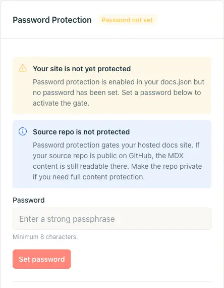
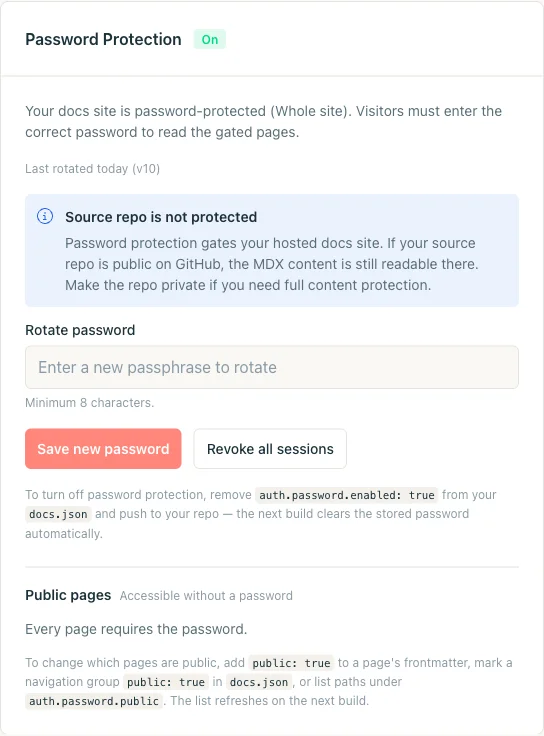
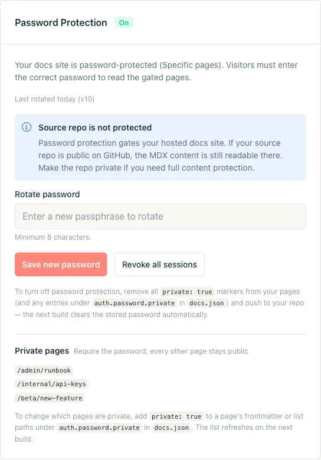
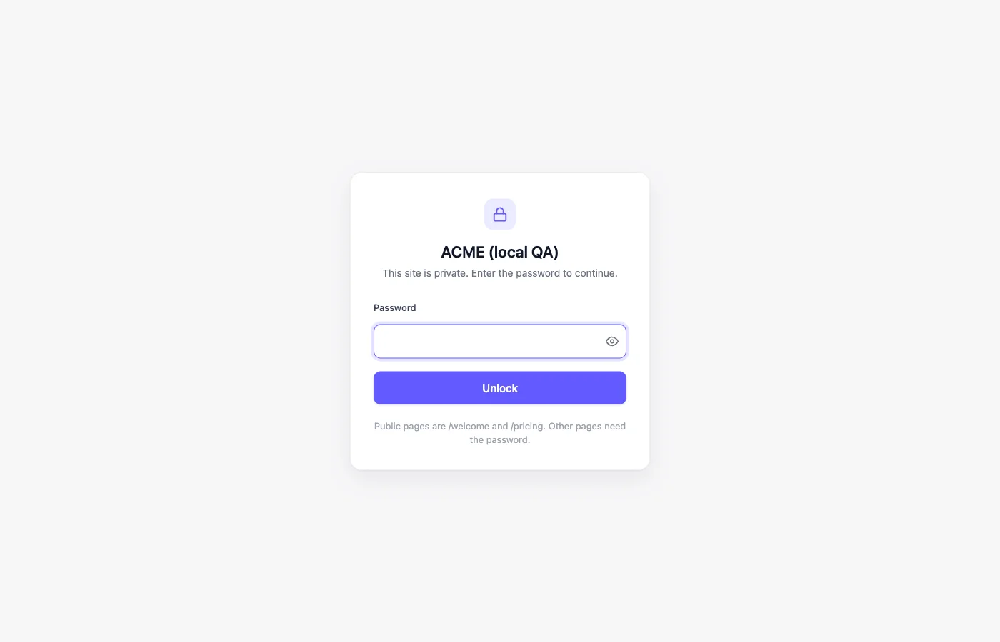
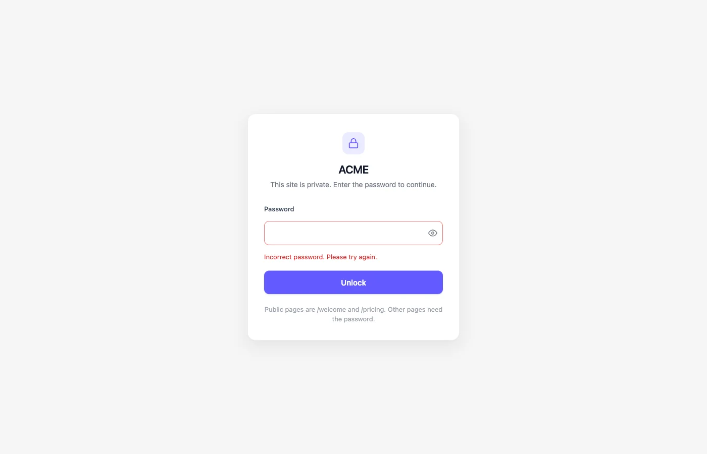

Der Passwortschutz sperrt Dokumentation, die in Git bleibt, aber nicht öffentlich sein soll: Runbooks, Anleitungen vor dem Release, Dokumente nur für Partner, Funktionen im frühen Zugang. Eine gemeinsame Passphrase sperrt deine gesamte Website oder eine Reihe von Seiten. Nichts wird aus deinem Repository verschoben.

Die Screenshots zeigen die Benutzeroberfläche auf Englisch.

<Tip>
  Für Authentifizierung pro Benutzer verwende die [JWT-Authentifizierung](/de/setup/jwt-authentication). Sie sperrt deine Dokumentation hinter deinem eigenen Login-System, mit Sitzungen pro Benutzer und seitenbezogenem Zugriff auf Gruppenbasis.
</Tip>

<Note>
  Der Passwortschutz setzt ein Jamdesk-Projekt voraus, das [mit einem Git-Repository verbunden](/de/setup/connecting-github) ist. Die Konfiguration liegt in `docs.json` und wird mit deinem normalen Build ausgeliefert.
</Note>

## Welchen Modus sollte ich wählen?

Wähle einen Modus abhängig davon, was öffentlich ist.

| | **Modus für die ganze Website** | **Modus für bestimmte Seiten** |
|---|---|---|
| **Verwenden, wenn** | Alles ist privat: interne Engineering-Dokumentation, eine Staging-Kopie deiner öffentlichen Website, ein nicht veröffentlichtes Produkt. | Der Großteil der Dokumentation ist öffentlich. Du blendest einige wenige Seiten aus (ein Runbook, eine Beta-Funktion, eine interne API-Referenz). |
| **So aktivierst du es** | Setze `auth.password.enabled: true` in `docs.json`. | Markiere Seiten mit `private: true` im Frontmatter oder trage Pfade unter `auth.password.private[]` ein. |
| **Öffentliche Ausnahmen** | Ja: Du kannst einzelne Seiten, Navigationsgruppen oder Glob-Muster als öffentlich markieren. | Nicht zutreffend. Jede Seite ist öffentlich, außer du markierst sie als privat. |

Die Dashboard-Karte, der Entsperrbildschirm sowie die Steuerelemente zum Rotieren und Widerrufen sind in beiden Modi gleich. Du wechselst den Modus, indem du `docs.json` bearbeitest und veröffentlichst.

## Gesamte Website schützen

<Steps>
  <Step title="auth.password.enabled in docs.json hinzufügen">
    Deklariere den Schutz für die ganze Website in `docs.json`. Das Feld `hint` ist optional. Es ist der einzige Hinweis auf dem Bildschirm, den Leser darüber erhalten, wie sie das Passwort bekommen.

    ```json docs.json
    {
      "$schema": "https://jamdesk.com/docs.json",
      "name": "Acme Docs",
      "theme": "jam",
      "auth": {
        "password": {
          "enabled": true,
          "hint": "Ask #docs-access on Slack"
        }
      }
    }
    ```

    Hinweise sind Klartext, maximal 200 Zeichen, kein HTML.

    <Tip>
      Lege das Passwort nicht in `docs.json` ab. Setze es nach dem Build im Dashboard. Dein Repository enthält nur das Opt-in-Flag und einen optionalen Hinweis.
    </Tip>
  </Step>

  <Step title="Committen und pushen">
    Schiebe die Änderung in deinen konfigurierten Branch. Der Build aktiviert den Passwortschutz im Modus für die ganze Website.

    ```bash
    git add docs.json
    git commit -m "Turn on password protection"
    git push
    ```

    Die Dashboard-Karte wechselt von **Off** zu **Password not set**. Die Website ist gesperrt. Jede Seite liefert `401` zurück und zeigt den Passwortbildschirm. Kein Passwort funktioniert, bis du eines setzt. Seiten, die du als öffentlich markiert hast, bleiben offen. Projekt-API-Schlüssel funktionieren weiterhin für die Search API, den MCP-Server, `.md`-URLs und die llms-Dateien. Um die ganze Website wieder öffentlich zu machen, setze `auth.password.enabled` auf `false` und pushe.

    
  </Step>

  <Step title="Passwort im Dashboard setzen">
    Öffne **Project Settings** im Dashboard und scrolle zur Karte **Password Protection**. Gib eine Passphrase ein (mindestens 8 Zeichen). Klicke auf **Set password**.

    Die Karte wechselt auf **On**. Besucher ohne Passwort sehen den Entsperrbildschirm.

    

    <Warning>
      Jamdesk speichert dein Passwort nie im Klartext. Es wird mit scrypt im Dashboard-Datenspeicher gehasht und nie in dein Repository oder in `docs.json` geschrieben. Jamdesk kann es dir nicht per E-Mail schicken, wenn du es vergisst. Rotiere es stattdessen.
    </Warning>
  </Step>

  <Step title="Das Gate prüfen">
    Öffne deine Dokumentationsseite in einem privaten Browserfenster (oder rufe sie mit `curl` auf) und prüfe, ob der Entsperrbildschirm erscheint. Probiere ein falsches Passwort, um den Fehlerzustand zu prüfen. Gib dann das richtige ein.

    ```bash
    # Should respond with HTTP/1.1 401 and the unlock HTML
    curl -I https://acme.jamdesk.app/

    # Submit the password. On success, sets the jd_auth_<slug> cookie.
    curl -i -X POST https://acme.jamdesk.app/jd/unlock \
      -d "password=your-passphrase&from=/"
    ```

    Eine erfolgreiche Entsperrung liefert eine Weiterleitung mit `303` und einen Header `Set-Cookie: jd_auth_acme=...; HttpOnly; Secure; SameSite=Lax; Max-Age=2592000`. Sende dieses Cookie bei der nächsten Anfrage mit.
  </Step>
</Steps>

### Öffentliche Ausnahmen

Halte bestimmte Seiten öffentlich, während der Rest der Website gesperrt ist, zum Beispiel eine Marketing-Landingpage oder ein Anmeldeformular.

Du markierst eine Seite auf drei Wegen als öffentlich. Der Build führt sie zu einer einzigen Allow-Liste zusammen.

**Frontmatter** ist die feinkörnigste Option. Füge `public: true` zu einer `.mdx`-Datei hinzu, um diese Seite öffentlich zu machen:

```yaml
---
title: Get started
public: true
---
```

**Navigationsgruppen** decken einen ganzen Abschnitt ab. Setze `public: true` auf eine `group` oder einen `tab` in deiner `docs.json`-Navigation, um jede Seite darunter öffentlich zu machen. Zum Beispiel ein Tab „Marketing“ neben privaten Engineering-Dokumenten:

```json docs.json
{
  "navigation": {
    "tabs": [
      {
        "tab": "Marketing",
        "public": true,
        "groups": [
          {
            "group": "Overview",
            "pages": ["landing", "pricing", "changelog"]
          }
        ]
      },
      {
        "tab": "Internal",
        "groups": [
          { "group": "Runbooks", "pages": ["deploys", "oncall"] }
        ]
      }
    ]
  }
}
```

**Explizite Globs** unter `auth.password.public[]` decken ab, was Frontmatter und Navigation nicht können: Landingpages auf oberster Ebene, dynamisch erzeugte Routen oder einen Teilbaum, den du lieber nicht umschreiben willst.

```json docs.json
{
  "auth": {
    "password": {
      "enabled": true,
      "hint": "Ask #docs-access on Slack",
      "public": [
        "/landing",
        "/pricing",
        "/marketing/**",
        "/blog/*"
      ]
    }
  }
}
```

Globs unterstützen `*` (ein Pfadsegment) und `**` (beliebige Tiefe). Die Validierung lehnt ein nacktes `/` ab, denn das würde deine gesamte Website entsperren. Die Dashboard-Karte zeigt die Allow-Liste, die der letzte Build aufgelöst hat.

## Nur einige Seiten schützen

Im Modus für bestimmte Seiten ist standardmäßig alles öffentlich. Du nimmst einzelne Seiten explizit in das Gate auf.

<Steps>
  <Step title="Eine Seite als privat markieren">
    Füge `private: true` zum Frontmatter der Seite hinzu.

    ```yaml
    ---
    title: Incident Runbook
    description: What to do when the deploys dashboard is on fire.
    private: true
    ---
    ```

    Um die Liste der geschützten Pfade in einer Datei zu halten, trage sie unter `auth.password.private[]` in `docs.json` ein. Beide Ansätze ergänzen sich.

    ```json docs.json
    {
      "auth": {
        "password": {
          "hint": "Ask the on-call engineer",
          "private": ["/admin/runbook", "/internal/api-keys"]
        }
      }
    }
    ```

    Hier gibt es kein `enabled: true`. Wenn du `auth.password.private[]` ohne `enabled` setzt, wird der Modus für bestimmte Seiten aktiviert.
  </Step>

  <Step title="Committen und pushen">
    Pushe deine Änderungen. Der nächste Build aktiviert den Schutz im Modus für bestimmte Seiten. Das Dashboard fordert dich auf, ein Passwort zu setzen.

    ```bash
    git add content/runbook.mdx docs.json
    git commit -m "Gate the incident runbook"
    git push
    ```
  </Step>

  <Step title="Passwort setzen">
    Öffne **Project Settings**, finde die Karte **Password Protection** und setze eine Passphrase. Der Kartenkopf zeigt **On** mit **Specific pages** statt **Whole site**. Sie listet die privaten Seiten auf, die der Build aufgelöst hat.

    
  </Step>

  <Step title="Das Gate prüfen">
    Durchsuche deine Dokumentationsseite. Öffentliche Seiten laden wie zuvor. Private Seiten leiten zum Entsperrbildschirm weiter. Das Passwort meldet dich auf diesem Gerät für 30 Tage an.
  </Step>
</Steps>

## Was Besucher sehen

Eine gesperrte Seite zeigt eine zentrierte Entsperrkarte mit dem Namen der Website und einem optionalen Hinweis. Es gibt keine Seitenleiste und keine Navigation.



Die Karte trägt das Logo deiner Website und die Primärfarbe aus `docs.json`. Das Passwortfeld hat ein Umschalten zum Anzeigen und ist automatisch fokussiert.

Ein falsches Passwort rendert dieselbe Karte mit einer Fehlermeldung, einem neuen Eingabefeld und einer kleinen Verzögerung zwischen den Versuchen. Auf der Seite ist nichts zu erkennen, was „Passwort falsch“ von „noch kein Passwort eingegeben“ unterscheidet.



Das richtige Passwort setzt ein signiertes Cookie. Es gilt, bis die Sitzung abläuft oder du sie widerrufst.

## KI-Tools und API-Schlüssel

Tools, die das Passwort nicht eingeben können, etwa ein MCP-Client oder ein Skript, das `llms.txt` abruft, können stattdessen einen Projekt-API-Schlüssel verwenden. Der Schlüssel funktioniert für den [MCP-Server](/de/ai/mcp-server#websites-mit-login-schutz), `.md`-Seiten-URLs und die [llms-Dateien](/de/ai/llms-txt#websites-mit-login-schutz). Er öffnet nie HTML-Seiten oder den KI-Chat.

## Lass dein Team sich mit Jamdesk anmelden

Deine Teammitglieder haben bereits Jamdesk-Logins und brauchen deshalb nicht zusätzlich das gemeinsame Passwort. Füge `allowMembers` hinzu, dann zeigt der Entsperrbildschirm neben dem Passwortfeld eine Schaltfläche **Sign in with Jamdesk** an. Externe Leser verwenden weiterhin das Passwort.

```json docs.json
{
  "auth": {
    "password": {
      "enabled": true,
      "allowMembers": true
    }
  }
}
```

Standardmäßig ist es deaktiviert. Pushe die Änderung, dann erscheint die Schaltfläche nach dem nächsten Build.

Wenn ein Teammitglied auf **Sign in with Jamdesk** klickt, öffnet sich das Jamdesk-Dashboard. Ist es dort bereits angemeldet, schickt es es direkt zurück zu der Seite, die es gelesen hat. Wenn nicht, meldet es sich zuerst an und landet dann wieder in deiner Dokumentation.

### Wer sich anmelden kann

Der Projektinhaber kann sich anmelden, und ebenso jeder, der unter **Settings → Members** im Dashboard als Mitglied hinzugefügt wurde. Eine eingeladene Person kann die Dokumentation lesen, sobald sie die Einladung angenommen hat.

<Warning>
  Ein Mitglied erhält außerdem vollen Editor-Zugriff auf das Projekt im Dashboard. Füge nur Personen hinzu, denen du das zutraust.
</Warning>

### So funktionieren Team-Sitzungen

Eine Team-Anmeldung gilt 14 Tage. Danach klickt dein Teammitglied erneut auf die Schaltfläche.

Um jemandem den Zugriff zu entziehen, entferne die Person aus dem Projekt. Der Dokumentationszugriff endet innerhalb von etwa einer Minute.

Das Ändern des gemeinsamen Passworts meldet Teammitglieder nicht ab, und ebenso wenig **Revoke all sessions**. Team-Anmeldungen lassen auch Passwort-Sitzungen unberührt.

Nach der Anmeldung kann ein Teammitglied den KI-Chat, den MCP-Server, `.md`-URLs und `llms.txt` auf dieselbe Weise nutzen, wie es nach der Passworteingabe möglich gewesen wäre.

### Dokumentation nur für dein Team

Aktiviere `enabled` und `allowMembers` und setze im Dashboard kein Passwort. Der Entsperrbildschirm zeigt dann nur die Anmeldeschaltfläche, sodass dein Team hineinkommt und niemand sonst.

### Domains und Tarife

Team-Anmeldung funktioniert auf deiner Subdomain `<slug>.jamdesk.app` und auf der mit dem Projekt verbundenen eigenen Domain. Dazu gehören Cloudflare-Worker- und Unterpfad-Setups, die deine Dokumentation über die eigene Domain ausliefern. Andere Aliasse, etwa eine `www.`-Kopie deiner Domain, werden nicht unterstützt. Jeder Host hat seine eigene Sitzung, daher meldet dich eine Anmeldung auf einem Host nicht auf dem anderen an.

Wie der Passwortschutz erfordert die Team-Anmeldung einen kostenpflichtigen Tarif. Läuft der Tarif des Inhabers ab, enden neue Team-Anmeldungen. Bereits begonnene Sitzungen funktionieren weiter, bis sie ablaufen, höchstens 14 Tage später.

`allowMembers` gilt nur für den Passwortschutz. Websites mit [JWT-Authentifizierung](/de/setup/jwt-authentication) sind nicht betroffen.

## Sitzungen ändern und widerrufen

Öffne die Karte **Password Protection**, gib im Feld **Rotate password** eine neue Passphrase ein und klicke auf **Save new password**. Das alte Passwort funktioniert bei der nächsten Anfrage nicht mehr. Die Rotation wirkt sofort und erfordert keinen neuen Build.

Um alle aktiven Sitzungen abzumelden, ohne die Passphrase zu ändern (etwa wenn ein Laptop verloren ging), klicke auf **Revoke all sessions**. Dadurch wird ein serverseitiger Versionszähler erhöht. Jedes Cookie, das vor der Erhöhung ausgestellt wurde, funktioniert nicht mehr. Besucher geben dann das aktuelle Passwort erneut ein.

## Schutz deaktivieren

Du deaktivierst den Schutz, indem du `docs.json` bearbeitest und pushst.

- **Ganze Website:** entferne `auth.password.enabled` (oder setze es auf `false`).
- **Bestimmte Seiten:** entferne jede Markierung `private: true` und leere `auth.password.private`.

Der nächste Build löscht den gespeicherten Passwort-Hash, und die Karte wechselt wieder auf **Off**. Wenn du den Schutz später erneut aktivierst, brauchst du ein neues Passwort.

<Warning>
  Dein Quell-Repository ist nicht passwortgeschützt. Der Passwortschutz sichert die gehostete Dokumentationsseite unter `*.jamdesk.app` (oder deiner eigenen Domain) ab. Ein öffentliches GitHub-Repository legt die MDX-Inhalte weiterhin offen. Mache das Repository privat, wenn du den Inhalt vollständig schützen willst.
</Warning>

## Vorrangregeln

Eine Seite kann mehrere Signale erfüllen. Die Auflösungsreihenfolge, vom spezifischsten zum allgemeinsten:

- `auth.password.enabled: true` sperrt die ganze Website. `private: true` auf einzelnen Seiten wird dann überflüssig.
- Eine Seite mit `public: true` und `private: true` ist öffentlich. **Öffentlich gewinnt**.
- Frontmatter-`public: true`, `public: true` in Navigationsgruppen und `auth.password.public[]`-Globs werden zu einer Allow-Liste zusammengeführt. Sagt irgendein Signal, dass eine Seite öffentlich ist, dann ist sie es.
- `auth.password.private[]` ohne `auth.password.enabled` aktiviert den Modus für bestimmte Seiten.

## Funktionsweise von Sitzungen und Ratenbegrenzung

**Das Sitzungs-Cookie.** Nach einer erfolgreichen Entsperrung setzt Jamdesk ein Cookie mit dem Namen `jd_auth_<slug>` (zum Beispiel `jd_auth_acme`). Es ist `HttpOnly`, `Secure`, `SameSite=Lax`, an den Host gebunden und mit HMAC-SHA256 signiert. Die Nutzlast enthält den Projekt-Slug, den aktuellen Versionszähler und einen Ablaufzeitpunkt. Manipulation schlägt bei der Validierung fehl. Die Standarddauer beträgt **30 Tage** und wird bei jeder erfolgreichen Entsperrung erneuert.

**Ratenbegrenzung.** Der Entsperr-Endpunkt wendet zwei Zähler pro Stunde an: **10 Versuche pro IP** und **100 Versuche pro Projekt**. Sie laufen vor der scrypt-Hash-Prüfung. Ein Brute-Force-Versuch kann so keine CPU verbrauchen und keine Timing-Informationen preisgeben. Wird eines der Limits erreicht, antwortet der Server mit `429 Too Many Requests` und einem Header `Retry-After`.

**Speicherung.** Dein Passwort wird mit scrypt gehasht und in Firestore des Dashboards gespeichert. Es landet nie in deinem Repository, in deiner `docs.json` oder in einem Build-Artefakt. Wenn du es verlierst, rotiere es. Es gibt keinen Wiederherstellungsweg.

## Lokale Entwicklung testen

`jamdesk dev` betreibt deine Dokumentation mit den Live-R2-Inhalten und der Live-Konfiguration. Der Passwortschutz wird im lokalen Dev-Server **nicht erzwungen**. Du kannst gesperrte Seiten also ohne Passwort in der Vorschau ansehen.

Um das Gate zu testen, öffne die veröffentlichte Website unter `<slug>.jamdesk.app` (oder deiner eigenen Domain) in einem Browserfenster ohne Cookie.

## Fehlerbehebung

<Accordion title="Der Build ist fertig, aber der Entsperrbildschirm erscheint nie">
  Die Dashboard-Karte zeigt wahrscheinlich **Password not set**. Der Schutz braucht (1) die in `docs.json` übertragene Konfiguration und (2) ein unter **Project Settings** gesetztes Passwort. Bis du das Passwort setzt, liefert jede Anfrage `401` mit dem Entsperrbildschirm als Inhalt.
</Accordion>

<Accordion title="Ich habe das Passwort gesetzt, aber mein Teammitglied sieht weiterhin den Entsperrbildschirm">
  Der Browser des Teammitglieds hat ein altes `jd_auth_<slug>`-Cookie von vor deiner Rotation. Warte 30 Tage, bis das Cookie abläuft, klicke im Dashboard auf **Revoke all sessions** oder lass die Cookies für die Dokumentationsdomain löschen. Beim nächsten Besuch wird das aktuelle Passwort abgefragt.
</Accordion>

<Accordion title="Kann ich verschiedenen Gruppen unterschiedliche Passwörter geben?">
  Nicht direkt. Jamdesk verwendet pro Website ein gemeinsames Passwort. Für gruppenbezogenen Zugriff teile deine Dokumentation auf mehrere Projekte auf (jeweils mit eigenem Passwort) oder verwende den Modus für bestimmte Seiten mit getrennten öffentlichen und privaten Bereichen pro Zielgruppe.
</Accordion>

<Accordion title="Funktioniert der Passwortschutz mit eigenen Domains und Unterpfad-Proxys?">
  Ja. Das Entsperr-Cookie ist an den Host gebunden. Die Subdomain `*.jamdesk.app` und deine eigene Domain authentifizieren sich unabhängig. Entsperrst du den einen Host, entsperrst du den anderen nicht.

  Unterpfad-Setups (Dokumentation unter `yoursite.com/docs` hinter deinem eigenen Proxy) funktionieren sofort. Das Entsperrformular sendet unter dem Pfadpräfix `/_jd/`. Jede dokumentierte Proxy-Konfiguration leitet das bereits weiter. Das Ein- und Ausschalten des Passwortschutzes erfordert keine Proxy-Änderungen.

  Für einen Proxy, der vor der Ergänzung der `/_jd/`-Weiterleitung im Setup-Leitfaden konfiguriert wurde, füge `/_jd/*` zu den weitergeleiteten Pfaden hinzu.
</Accordion>

<Accordion title="Erscheint eine gesperrte Website noch in Suchmaschinen?">
  Nein. Geschützte Websites setzen `noindex, nofollow` auf dem Entsperrbildschirm und liefern für jede gesperrte Seite `401` zurück. Crawler können nichts hinter dem Gate indexieren. Öffentliche Seiten innerhalb einer geschützten Website werden weiterhin indexiert.
</Accordion>

## Wie geht es weiter?

<Columns cols={2}>
  <Card title="Übersicht Zugriffskontrolle" icon="shield" href="/de/setup/access-control">
    Vergleiche den Passwortschutz mit SSO und dem Muster mit mehreren Projekten.
  </Card>
  <Card title="JWT-Authentifizierung" icon="lock" href="/de/setup/jwt-authentication">
    Ersetze die gemeinsame Passphrase durch Sitzungen pro Benutzer aus deinem eigenen Login-System.
  </Card>
  <Card title="SSO (Enterprise)" icon="key" href="/de/setup/sso">
    Ersetze gemeinsame Passphrasen durch Anmeldung pro Benutzer über deinen Identitätsanbieter.
  </Card>
  <Card title="Eigene Domains" icon="globe" href="/de/deploy/custom-domains">
    Bringe deine Dokumentation auf deine eigene Domain, bevor du den Link teilst.
  </Card>
  <Card title="auth.password-Schema" icon="book" href="/de/config/docs-json-reference#authpassword">
    Vollständige Feldreferenz für `enabled`, `hint`, `public`, `private` und `allowMembers`.
  </Card>
</Columns>