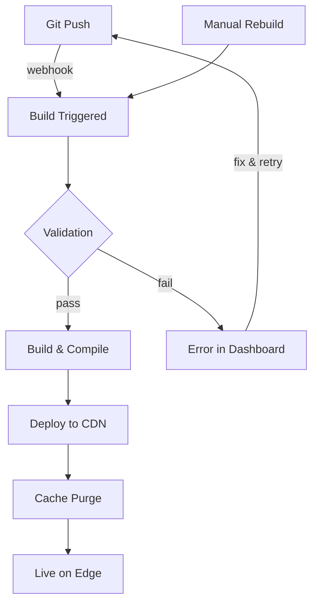

Push to GitHub. Jamdesk builds and deploys your docs within minutes.

## Build Lifecycle

## Build Triggers

| Trigger | How It Works | Use Case |
|---------|--------------|----------|
| **Git Push** | Webhook fires on push to connected branch | Normal development |
| **Dashboard** | Click "Rebuild" in project settings | Force refresh after config changes |

<Note>
Builds are debounced. Commits within 10 seconds of each other go into one build.
</Note>

## What Happens During a Build

Jamdesk clones your repo and validates `docs.json` and MDX syntax. It compiles the pages to HTML with a search index. It deploys the result to Cloudflare R2. Most sites build in 30-90 seconds.

See [How Jamdesk Works](/how-jamdesk-works) for the full pipeline and architecture diagram.

## Deployment Status

The dashboard shows one of these statuses for each build:

| Status | Meaning |
|--------|---------|
| **Building** | Build in progress |
| **Deployed** | Live at your domain |
| **Failed** | Build error - check logs |
| **Queued** | Waiting for previous build |

The Build History section lists recent deployments with their status. Trigger a manual rebuild from there:

<SizedImage src="/images/dashboard/build-history.webp" alt="Build History showing recent deployments with Successful status badges, commit info, and Rebuild button" />

## Manual Rebuild

Trigger a rebuild without pushing changes:

1. Go to your project in the dashboard
2. Open **Settings**
3. Click **Rebuild**

Use this when:
- Fixing a stuck build
- Refreshing after platform updates

## Build Logs

1. Go to **Deployments** in your project
2. Click a deployment
3. Read the full build log

Common errors in the logs:
- Invalid MDX syntax
- Missing images or assets
- Broken internal links
- Configuration errors

## Rollbacks

1. Go to **Deployments**
2. Find the deployment you want to restore
3. Click **Rollback**

The previous version goes live immediately. A new build starts at the same time.

## Branch Deployments

<Note>
Branch deployments are available on Pro plans.
</Note>

Preview changes before merging:

1. Push to a feature branch
2. Jamdesk creates a preview at `branch-name.your-project.jamdesk.app`
3. Review and merge when ready

## What's Next?

<Columns cols={2}>
  <Card title="Deployment Overview" icon="cloud-arrow-up" href="/deploy/overview">
    Choose between subdomain, custom domain, or subpath hosting
  </Card>
  <Card title="Subpath Hosting" icon="route" href="/deploy/subpath-hosting">
    Host docs at example.com/docs
  </Card>
</Columns>
