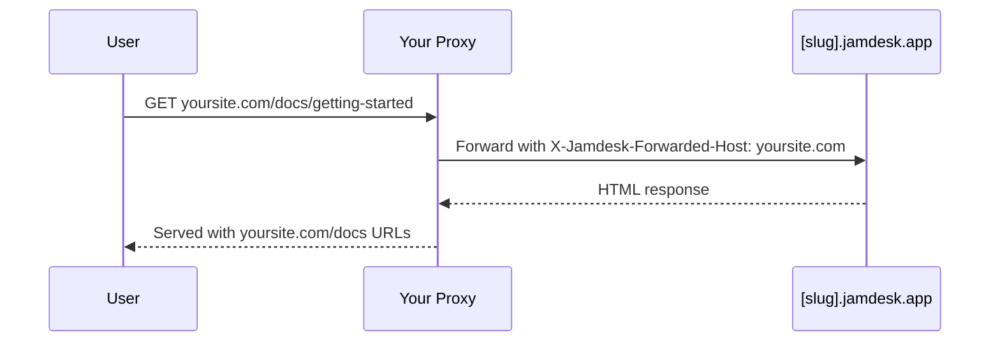

Host your docs at a subpath on your domain instead of a separate subdomain. The default is `yoursite.com/docs`, or pick a custom segment like `yoursite.com/help`. See [Deployment Overview](/deploy/overview) for every deployment option.

## Why Use a Subpath?

A subpath keeps readers on your primary domain. Your documentation pages add to that domain's search authority. A subdomain like `docs.yoursite.com` splits ranking signals across two hosts.

## How It Works

Your web server or CDN proxies requests from `/docs/*` to your Jamdesk site. The browser keeps the original URL:

The proxy passes the `X-Jamdesk-Forwarded-Host` header with your domain. Jamdesk uses this to:

1. **Verify your domain** is authorized to serve the content
2. **Apply your configuration** from the dashboard

Your proxy configuration is a one-time setup. Dashboard changes need no proxy update.

## Setup by Provider

<Columns cols={2}>
  <Card title="Cloudflare" icon="cloud" href="/deploy/cloudflare">
    Use Cloudflare Workers to proxy /docs traffic
  </Card>
  <Card title="AWS" icon="aws" href="/deploy/aws">
    Configure CloudFront with Route 53
  </Card>
  <Card title="Vercel" icon="triangle" href="/deploy/vercel">
    Add rewrites to vercel.json
  </Card>
  <Card title="Reverse Proxy" icon="server" href="/deploy/reverse-proxy">
    nginx, Apache, or other proxy servers
  </Card>
</Columns>

## Prerequisites

Do these steps before you configure your proxy:

1. **Add your domain** in your [Jamdesk dashboard](https://dashboard.jamdesk.com) under Settings → Custom Domain
2. **Toggle "Host at a subpath"** on
3. **Choose your subpath** (optional; see [Choosing Your Subpath](#choosing-your-subpath) below) and click **Save**

The dashboard shows your Jamdesk subdomain (e.g., `acme.jamdesk.app`). Your proxy configuration needs it.

<Note>
Saving a change to subpath hosting triggers a full rebuild of your documentation. That includes turning it on or off and changing the subpath. The URL structure changes (for example, between `/introduction` and `/docs/introduction`).
</Note>

## Choosing Your Subpath

Your docs are served at `/docs` by default. Enter another value, like `/help` or `/support`, in the subpath field next to the toggle. A blank field shows the toggle as `Host at a subpath (e.g. /docs)`. Type a value and the label changes to the path you are about to enable (`Host at /help`, and so on).

<Frame>
  
</Frame>

The field accepts one lowercase segment: letters, digits, and inner hyphens only, no leading or trailing hyphen, 63 characters maximum. Jamdesk rejects reserved segments, including `api`, `jd`, common admin paths like `wp-admin`, and any locale code your docs might use (`fr`, `es`, `de`, and similar). Your subpath can never collide with a route Jamdesk already serves.

Leave the field blank to keep the default `/docs`.

## Renaming or Removing Your Subpath

Changing or clearing your subpath does not break links that are already indexed or bookmarked:

- **`/docs` never stops serving.** The original `/docs/*` paths keep responding after you switch to a custom subpath like `/help`. They respond on your `[slug].jamdesk.app` subdomain and through any proxy still pointed at them. Canonical links move to your new subpath immediately. Search engines re-index there. Update your proxy configuration at your own pace.
- **Renaming a custom subpath forwards the old one, for one rename.** Rename `/help` to `/guide`, and requests to `/help/*` 308-redirect to the matching `/guide/*` path. This history is one level deep. Rename again from `/guide` to `/support`, and `/guide/*` redirects to `/support/*`. Jamdesk no longer tracks `/help/*` (the segment from two renames ago). Those links land on a "not found" page, sometimes after a redirect to an odd-looking combined path. Don't chain renames if you rely on the redirect to carry old links forward. Update external links to the current subpath instead.
- **Rolling back to `/docs`** redirects your previous custom subpath (one level of history) to `/docs/*`.

<Warning>
`/docs` does **not** redirect to the subpath you choose. `/docs` keeps serving directly, permanently. The one-level redirect applies only to a *custom* subpath you're moving away from.
</Warning>

Test your proxy by visiting `https://yoursite.com/docs` (or your configured subpath). Check that assets and links load.

## Do I need to hide the jamdesk.app subdomain?

No. Your `[slug].jamdesk.app` subdomain stays reachable. It is the upstream
origin your proxy forwards to. It won't compete with your site in search
results:

- **Domain registered**: pages served from the subdomain include a canonical
  link pointing at the same page on your domain. Search engines credit your
  domain with the ranking signals.
- **No domain registered yet**: subpath-mode subdomain pages are marked
  `noindex`. They never enter the index.

To block the content on the subdomain too (not only unindex it), enable
[Password Protection](/setup/password-protection). The subdomain then serves
an unlock screen instead of your docs.

## What's Next?

<Columns cols={2}>
  <Card title="Deployment Overview" icon="cloud-arrow-up" href="/deploy/overview">
    Compare subdomain, custom domain, and subpath hosting
  </Card>
  <Card title="Custom Domains" icon="globe" href="/deploy/custom-domains">
    Verify DNS and troubleshoot domain setup
  </Card>
</Columns>
