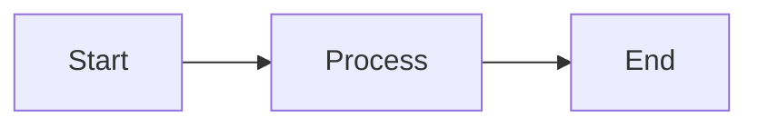
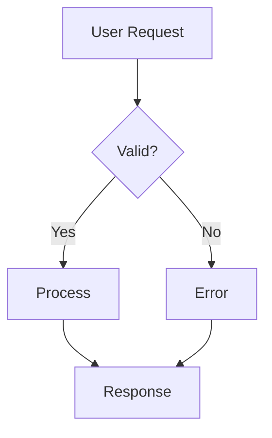
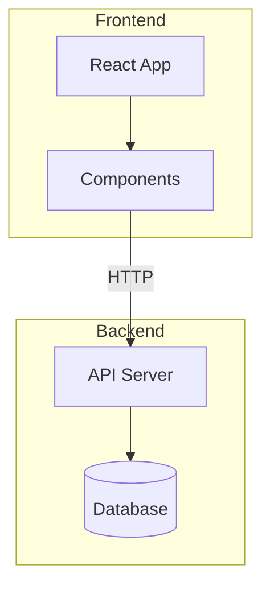
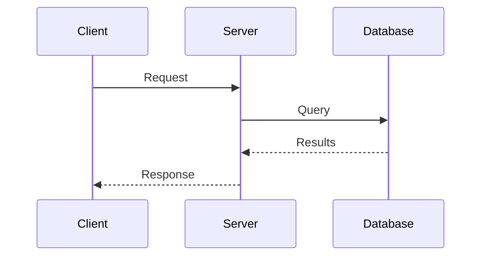
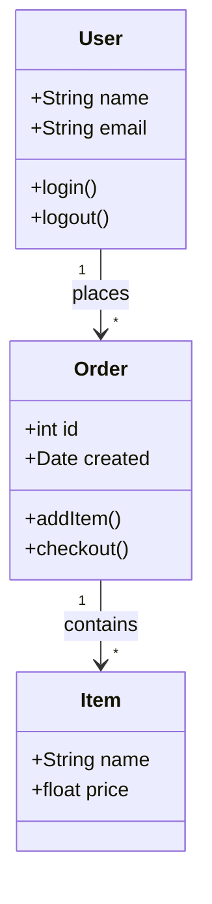
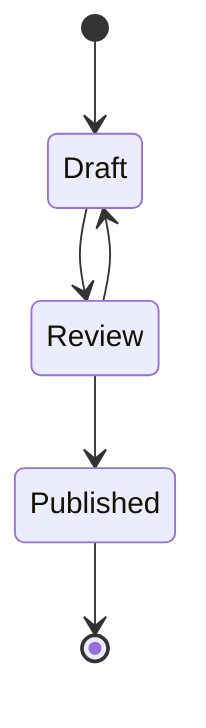
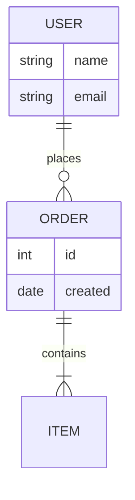
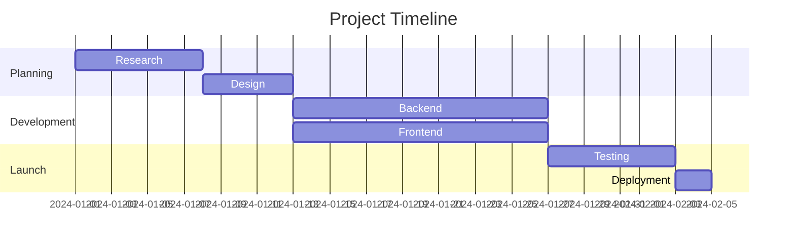
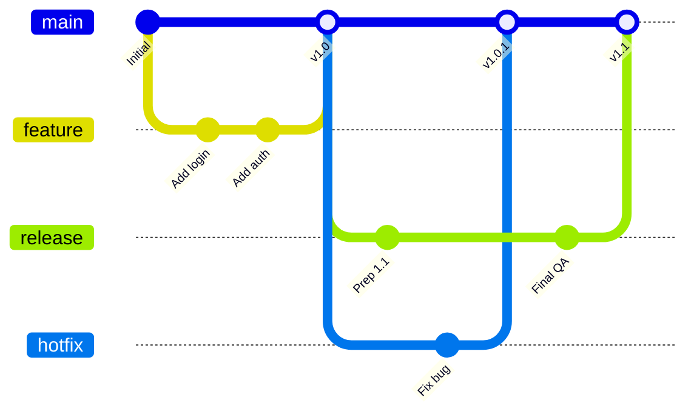
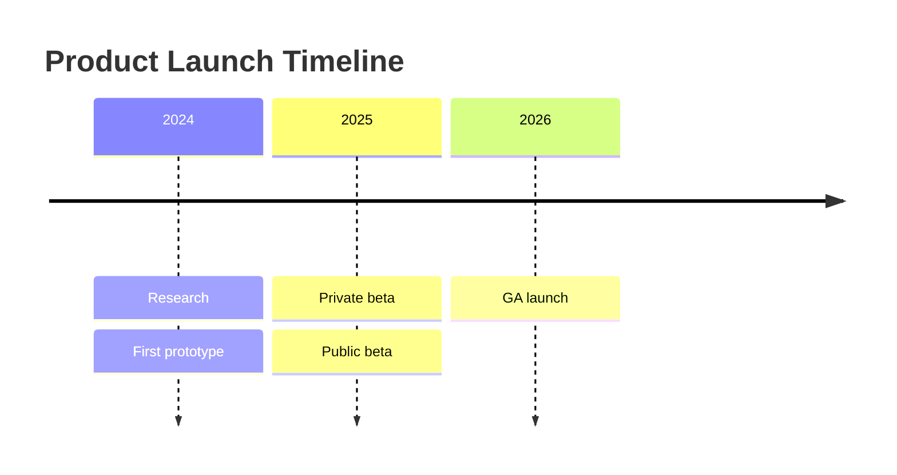

Scrivi i diagrammi come testo in blocchi di codice recintati. Jamdesk li renderizza come SVG in fase di build.

<Tip>
  Crea e visualizza in anteprima il diagramma nell'[editor Mermaid di Jamdesk](https://jamdesk.com/utilities/mermaid-editor).
  È un editor open source che funziona nel browser e mostra il risultato mentre digiti.
  Incolla il risultato in un blocco recintato `mermaid`.
</Tip>

<Tip>
  Jamdesk renderizza anche i [diagrammi D2](/it/components/d2) nei blocchi recintati `d2`.
  Usa D2 quando un diagramma richiede contenitori annidati, uno schema SQL con
  chiavi primarie ed esterne, oppure quando vuoi cambiare motore di layout. Gli esempi Mermaid di questa pagina hanno equivalenti D2 nella [pagina D2](/it/components/d2).
</Tip>

## Utilizzo di base

Usa un blocco di codice recintato con l'identificatore di linguaggio `mermaid`:

````mdx

````


## Tipi di diagramma

### Diagrammi di flusso

La direzione può essere dall'alto verso il basso (`TD`), da sinistra a destra (`LR`), dal basso verso l'alto (`BT`) o da destra a sinistra (`RL`).



````mdx

````

#### Sottografi

Raggruppa i nodi correlati con i sottografi. Usali per suddividere un diagramma di flusso grande in sezioni come "Frontend" e "Backend", oppure in fasi di una pipeline.



````mdx

````

### Diagrammi di sequenza

I diagrammi di sequenza mostrano come i componenti interagiscono nel tempo. Usane uno per i flussi di chiamate API e gli handshake di autenticazione. I partecipanti appaiono come linee verticali. I messaggi viaggiano tra di loro.



````mdx

````

### Diagrammi delle classi

I diagrammi delle classi mostrano la struttura di sistemi orientati agli oggetti, come un modello dati o i tipi principali di un servizio. Mostrano le classi con i loro attributi, metodi e relazioni.



````mdx

````

### Diagrammi di stato

I diagrammi di stato modellano il ciclo di vita di un oggetto o di un processo. Mostrano ogni stato e le transizioni tra di essi. Gli stati degli ordini e i flussi di approvazione dei documenti sono esempi tipici.



````mdx

````

### Diagrammi entità-relazione

I diagrammi ER documentano schemi di database e modelli dati. Mostrano entità (tabelle), i loro attributi (colonne) e le relazioni tra di esse. I simboli indicano la cardinalità: uno-a-uno, uno-a-molti o molti-a-molti.



````mdx

````

### Diagrammi di Gantt

I diagrammi di Gantt mostrano le pianificazioni dei progetti. Le attività appaiono come barre orizzontali su una timeline, con durata, dipendenze e lavoro in parallelo. Usane uno per un piano di progetto o una roadmap.



````mdx

````

### Grafici Git

I grafici Git mostrano strategie di branching e flussi di controllo di versione: commit, branch, merge e cronologia del repository. Ogni branch ha il proprio colore.



````mdx

````

### Diagrammi timeline

Le timeline mostrano eventi nel corso di periodi. Inizia con la parola chiave `timeline`, un `title` opzionale, poi una riga per periodo con gli eventi separati da due punti:



````mdx

````

### Grafici a torta

I grafici a torta mostrano proporzioni come fette di un cerchio. Usane uno quando le parti compongono un tutto, come quote di mercato o risultati di un sondaggio. Non superare le 6 fette.

```mermaid
pie title Browser Market Share
    "Chrome" : 65
    "Safari" : 19
    "Firefox" : 10
    "Edge" : 4
    "Other" : 2
```

````mdx
```mermaid
pie title Browser Market Share
    "Chrome" : 65
    "Safari" : 19
    "Firefox" : 10
    "Edge" : 4
    "Other" : 2
```
````

## Forme dei diagrammi di flusso

Ogni forma ha un significato convenzionale nei diagrammi di flusso:

| Sintassi   | Forma               | Usala per |
| ---------- | ------------------- | --------- |
| `[text]`   | Rettangolo          | Passaggi di processo, azioni |
| `(text)`   | Rettangolo arrotondato | Punti di inizio/fine |
| `{text}`   | Rombo               | Decisioni, condizioni |
| `([text])` | Stadio              | Eventi, trigger |
| `[[text]]` | Subroutine          | Processi predefiniti |
| `[(text)]` | Cilindro            | Database, storage |

## Tipi di freccia

Le frecce indicano la direzione del flusso e i tipi di relazione:

| Sintassi    | Descrizione      | Usala per |
| ----------- | ---------------- | --------- |
| `-->`       | Freccia continua | Flusso normale |
| `---`       | Linea continua   | Associazioni |
| `-.->`      | Freccia puntinata | Flusso opzionale o asincrono |
| `==>`       | Freccia spessa   | Percorsi importanti |
| `--text-->` | Freccia con etichetta | Descrivi la transizione |

## Ridimensionare i diagrammi larghi

Usa il componente `Mermaid` con la prop `minWidth` per evitare che un diagramma largo, come un diagramma di Gantt o un grafico Git grande, venga compresso:

```mdx
<Mermaid minWidth="700px">
gantt
    title Wide Project Timeline
    ...
</Mermaid>
```

## Fare clic per espandere

Clicca su un diagramma per aprirlo a schermo intero su schermi da 768px in su. Con la tastiera, metti il focus sul diagramma e premi Invio. Chiudilo con Escape, con il pulsante di chiusura o cliccando fuori dal diagramma.

Disattivalo per un singolo diagramma con la forma del componente e `noZoom`:

```mdx
<Mermaid noZoom>
graph LR
    A[Request] --> B[Response]
</Mermaid>
```

I diagrammi scritti come blocchi ```` ```mermaid ```` si aprono sempre a schermo intero.

## Suggerimenti per lo stile

<Tip>
  I diagrammi Mermaid passano alla modalità scura insieme al sito.
</Tip>

- Suddividi un flusso grande in diagrammi più piccoli.
- Etichetta le frecce per spiegare le transizioni.
- Scegli una direzione: `TD` (dall'alto verso il basso) per i diagrammi alti, `LR` (da sinistra a destra) per quelli larghi.
- Limita ogni diagramma a 10-15 nodi.

Per colorare un nodo, usa `style` per un singolo nodo o `classDef` per un gruppo:

```mermaid
graph LR
    A[Start] --> B[Review] --> C[Done]
    classDef good fill:#d1fae5,stroke:#059669
    style B fill:#fef3c7,stroke:#d97706
    class C good
```

Jamdesk mantiene i tuoi colori in modalità scura. Un riempimento senza colore del testo riceve un colore di etichetta che Jamdesk sceglie per essere leggibile sul riempimento.

## Approfondimenti

Consulta la [documentazione ufficiale di Mermaid](https://mermaid.js.org/intro/) per la sintassi completa, inclusi lo styling, i temi e altri tipi di diagramma.

## Prossimi passi

<Columns cols={2}>
  <Card title="Diagrammi D2" icon="diagram-project" href="/it/components/d2">
    Architettura, contenitori e schemi SQL con D2
  </Card>
  <Card title="Panoramica dei componenti" icon="puzzle-piece" href="/it/components/overview">
    Scopri tutti i componenti disponibili
  </Card>
  <Card title="Nozioni base MDX" icon="file-code" href="/it/content/mdx-basics">
    Scopri come usare i componenti in MDX
  </Card>
</Columns>