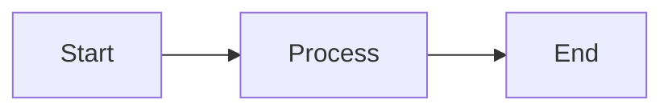
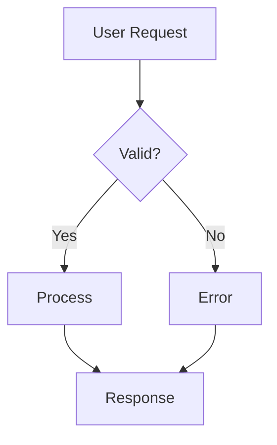
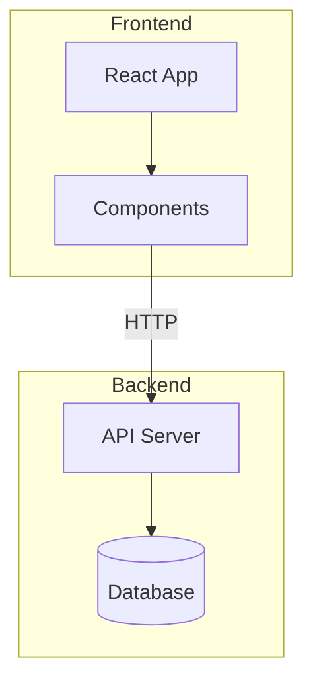
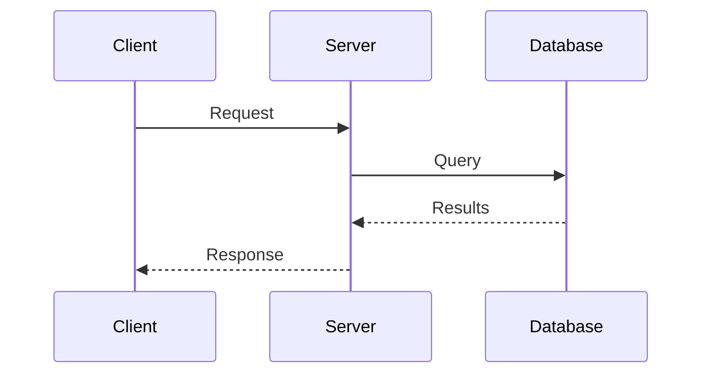
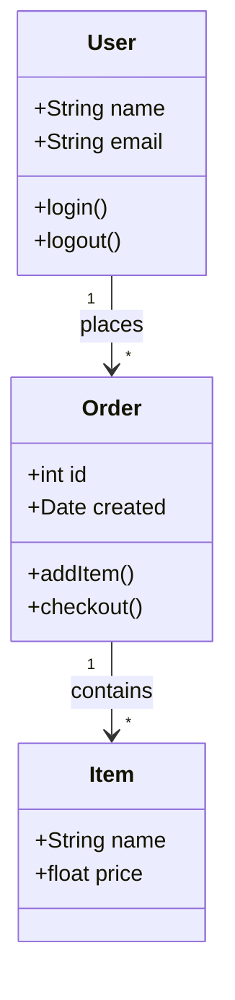
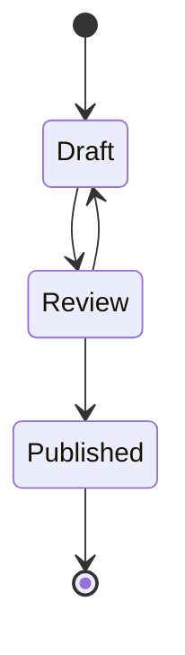
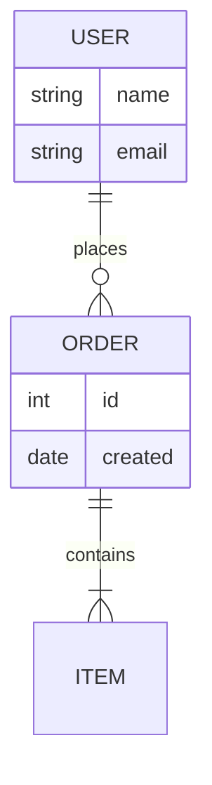
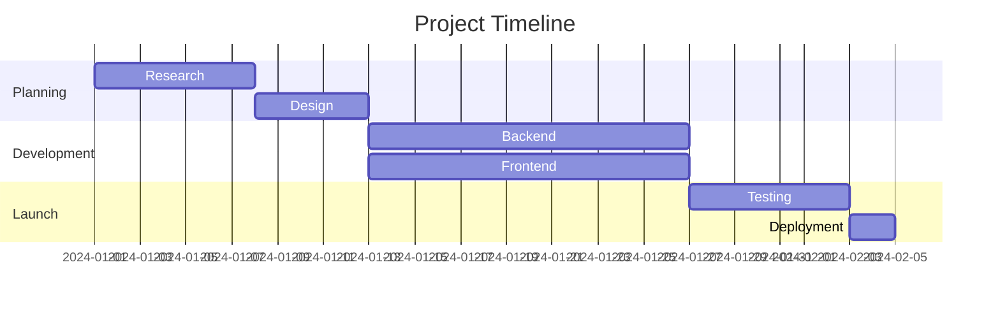
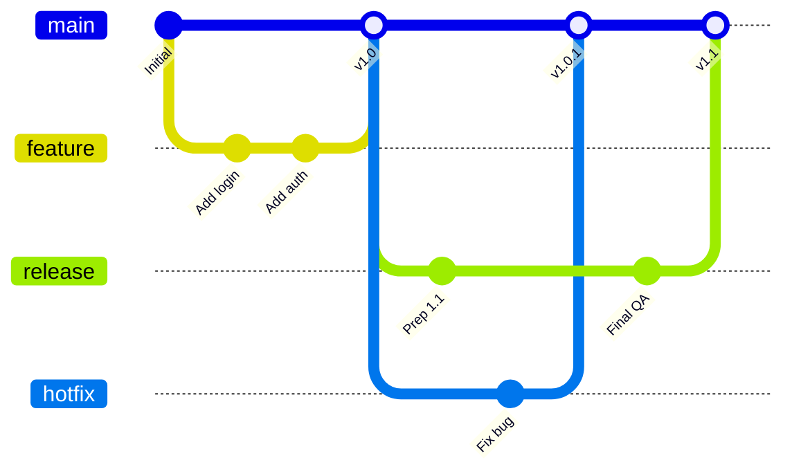
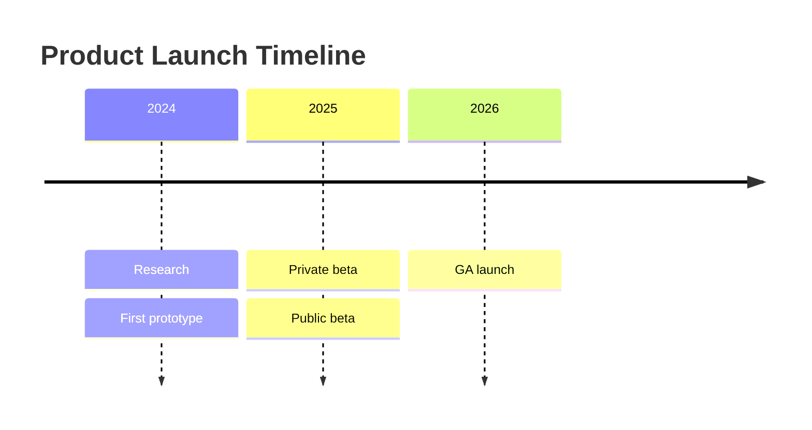

Scrivi i diagrammi come testo in blocchi di codice delimitati. Jamdesk li genera come SVG durante la build.

<Tip>
  Crea una bozza e visualizza in anteprima il diagramma nell'[editor Mermaid di Jamdesk](https://jamdesk.com/utilities/mermaid-editor),
  un editor e visualizzatore open source basato su browser. Scrivi la sintassi Mermaid,
  visualizzane il risultato in tempo reale e incollala qui in un blocco delimitato `mermaid`.
</Tip>

<Tip>
  Jamdesk supporta anche i [diagrammi D2](/it/components/d2) nei blocchi delimitati `d2`.
  Scegli D2 quando un diagramma richiede contenitori annidati, uno schema SQL con
  chiavi primarie ed esterne oppure quando vuoi cambiare motore di layout. Gli
  esempi Mermaid di questa pagina hanno equivalenti D2 nella [pagina D2](/it/components/d2).
</Tip>

## Utilizzo di base

Usa un blocco di codice delimitato con l'identificatore di linguaggio `mermaid`:

````mdx

````


## Tipi di diagramma

### Diagrammi di flusso

La direzione può essere dall'alto verso il basso (`TD`), da sinistra a destra (`LR`), dal basso verso l'alto (`BT`) o da destra a sinistra (`RL`).



````mdx

````

#### Sottografi

Raggruppa i nodi correlati usando i sottografi. In questo modo puoi organizzare diagrammi di flusso complessi in sezioni logiche, come "Frontend" e "Backend", o in diverse fasi di una pipeline.



````mdx

````

### Diagrammi di sequenza

I diagrammi di sequenza mostrano come interagiscono i componenti nel tempo. Usali per rappresentare i flussi di chiamate API e gli handshake di autenticazione. I partecipanti appaiono come linee di vita verticali, con i messaggi che passano dall'uno all'altro.



````mdx

````

### Diagrammi delle classi

I diagrammi delle classi rappresentano la struttura dei sistemi orientati agli oggetti, come un modello di dati o i tipi fondamentali di un servizio. Mostrano le classi con attributi, metodi e relazioni reciproche.



````mdx

````

### Diagrammi di stato

I diagrammi di stato modellano il ciclo di vita di un oggetto o processo. Mostrano tutti gli stati possibili e le transizioni tra loro. Gli stati di un ordine e i flussi di approvazione dei documenti sono esempi tipici.



````mdx

````

### Diagrammi entità-relazione

I diagrammi ER documentano schemi di database e modelli di dati, mostrando entità (tabelle), attributi (colonne) e relazioni. I simboli indicano la cardinalità: uno a uno, uno a molti o molti a molti.



````mdx

````

### Diagrammi di Gantt

I diagrammi di Gantt visualizzano programmi e timeline di progetto. Le attività sono rappresentate come barre orizzontali lungo una timeline, che mostrano durata, dipendenze e attività parallele. Sono ideali per piani di progetto e roadmap.



````mdx

````

### Grafici Git

I grafici Git visualizzano strategie di branching e flussi di lavoro per il controllo delle versioni. Mostrano commit, branch, merge e la cronologia complessiva di un repository. Ogni branch ha un colore diverso per facilitarne l'identificazione.



````mdx

````

### Diagrammi timeline

Le timeline mostrano eventi distribuiti su diversi periodi. Inizia con la parola chiave `timeline`, aggiungi un `title` facoltativo e poi una riga per ogni periodo, separando gli eventi con i due punti:



````mdx

````

### Grafici a torta

I grafici a torta mostrano dati proporzionali come sezioni di un cerchio. Usali quando le parti costituiscono un insieme, ad esempio per rappresentare quote di mercato o risultati di sondaggi. Per mantenere la leggibilità, limita il grafico a 6 sezioni.

```mermaid
pie title Browser Market Share
    "Chrome" : 65
    "Safari" : 19
    "Firefox" : 10
    "Edge" : 4
    "Other" : 2
```

````mdx
```mermaid
pie title Browser Market Share
    "Chrome" : 65
    "Safari" : 19
    "Firefox" : 10
    "Edge" : 4
    "Other" : 2
```
````

## Forme dei diagrammi di flusso

Le forme hanno significati diversi nei diagrammi di flusso:

| Sintassi  | Forma              | Uso |
| ---------- | ------------------- | ------- |
| `[text]`   | Rettangolo          | Fasi del processo, azioni |
| `(text)`   | Rettangolo arrotondato | Punti di inizio/fine |
| `{text}`   | Rombo               | Decisioni, condizioni |
| `([text])` | Stadio              | Eventi, trigger |
| `[[text]]` | Sottoprogramma      | Processi predefiniti |
| `[(text)]` | Cilindro            | Database, archiviazione |

## Tipi di freccia

Le frecce indicano la direzione del flusso e i tipi di relazione:

| Sintassi    | Descrizione       | Uso |
| ----------- | ---------------- | ------- |
| `-->`       | Freccia continua | Flusso normale |
| `---`       | Linea continua   | Associazioni |
| `-.->`      | Freccia tratteggiata | Flusso facoltativo o asincrono |
| `==>`       | Freccia spessa   | Percorsi importanti |
| `--text-->` | Freccia con etichetta | Descrive la transizione |

## Ridimensionare i diagrammi larghi

Per i diagrammi larghi, come i diagrammi di Gantt o i grafici Git complessi, puoi usare direttamente il componente `Mermaid` con la proprietà `minWidth` per evitare che il diagramma venga compresso:

```mdx
<Mermaid minWidth="700px">
gantt
    title Wide Project Timeline
    ...
</Mermaid>
```

## Fare clic per espandere

Sui dispositivi con schermi da almeno 768 px, facendo clic su un diagramma lo apri a schermo intero. Per usare la tastiera, sposta il focus sul diagramma e premi Invio. Premi Esc, fai clic sul pulsante di chiusura oppure all'esterno del diagramma per chiuderlo.

Per disattivare questa funzione per un diagramma, usa la sintassi del componente con `noZoom`:

```mdx
<Mermaid noZoom>
graph LR
    A[Request] --> B[Response]
</Mermaid>
```

I diagrammi scritti nei blocchi di codice delimitati da ```` ```mermaid ```` si aprono sempre a schermo intero.

## Suggerimenti per lo stile

<Tip>
  I diagrammi Mermaid si adattano automaticamente alle modalità chiara e scura. I colori
  sono ottimizzati per la leggibilità in entrambi i temi.
</Tip>

Per creare diagrammi efficaci:

- Mantieni la semplicità: suddividi i flussi complessi in più diagrammi piccoli.
- Aggiungi etichette alle frecce per spiegare le transizioni.
- Scegli una direzione: `TD` (dall'alto verso il basso) per i diagrammi alti, `LR` (da sinistra a destra) per quelli larghi.
- Limita ogni diagramma a 10-15 nodi per mantenerlo chiaro.

Per colorare un nodo, usa `style` per un singolo nodo oppure `classDef` per un gruppo:

```mermaid
graph LR
    A[Start] --> B[Review] --> C[Done]
    classDef good fill:#d1fae5,stroke:#059669
    style B fill:#fef3c7,stroke:#d97706
    class C good
```

I colori vengono mantenuti sia nella modalità chiara sia in quella scura. Se imposti un colore di riempimento ma non un colore del testo, Jamdesk sceglie un colore per l'etichetta che risulti leggibile sullo sfondo.

## Approfondimenti

Per consultare il riferimento completo alla sintassi Mermaid, con funzionalità avanzate come stili, temi e altri tipi di diagramma, visita la [documentazione ufficiale di Mermaid](https://mermaid.js.org/intro/).

## Prossimi passi

<Columns cols={2}>
  <Card title="Diagrammi D2" icon="diagram-project" href="/it/components/d2">
    Architetture, contenitori e schemi SQL con D2
  </Card>
  <Card title="Panoramica dei componenti" icon="puzzle-piece" href="/it/components/overview">
    Esplora tutti i componenti disponibili
  </Card>
  <Card title="Nozioni base MDX" icon="file-code" href="/it/content/mdx-basics">
    Scopri come usare i componenti in MDX
  </Card>
</Columns>