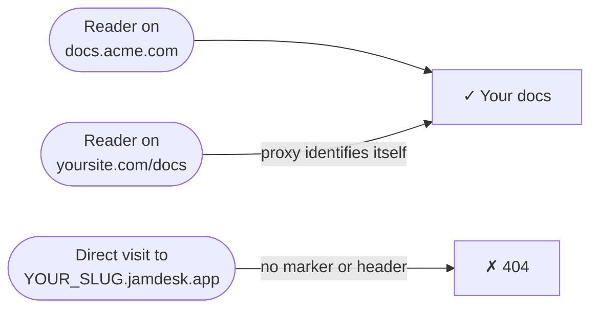

La tua documentazione è ospitata su `YOUR_SLUG.jamdesk.app`. Il sottodominio continua a rispondere anche dopo che hai collegato un dominio personalizzato. Ogni pagina che serve include un tag `<link rel="canonical">` che punta al tuo dominio. I motori di ricerca indicizzano il tuo dominio, mai il sottodominio.

Gli screenshot mostrano l'interfaccia in inglese.

**Solo dominio personalizzato** disattiva il sottodominio per i visitatori diretti. Una visita diretta a `YOUR_SLUG.jamdesk.app` restituisce un 404. La documentazione è accessibile solo tramite il tuo dominio.



<Warning>
Questo nasconde il tuo sottodominio. Non è una password. Chiunque acceda tramite il tuo dominio può comunque consultare la documentazione. Per controllare *chi* può leggerla, usa la [protezione con password](/it/setup/password-protection). Puoi attivare entrambe le opzioni.
</Warning>

## Attivazione

<Steps>
  <Step title="Verifica il tuo dominio personalizzato">
    Aggiungi e verifica il tuo dominio nella dashboard. Consulta [Domini personalizzati](/it/deploy/custom-domains). Per attivare l'opzione, il dominio deve avere lo stato **Active**.
  </Step>
  <Step title="Controlla il proxy (solo configurazioni con reverse proxy)">
    Se il tuo dominio è un semplice CNAME che punta a Jamdesk (come `docs.acme.com`), salta questo passaggio. Se servi la documentazione su `yoursite.com/docs` tramite un proxy, quest'ultimo deve identificarsi in ogni richiesta inoltrata. Consulta [Configurazioni proxy](#configurazioni-proxy) qui sotto.
  </Step>
  <Step title="Attiva l'opzione">
    Apri **Settings** del progetto nella dashboard. Espandi la scheda **Custom Domain** e attiva **Custom domain only**. Jamdesk controlla prima il tuo dominio attivo. L'opzione resta disattivata finché la configurazione non supera il controllo. Se il controllo non riesce, il messaggio indica cosa correggere.

    <Frame>
      
    </Frame>
  </Step>
</Steps>

Le modifiche raggiungono tutti i server edge entro un minuto.

## Configurazioni proxy

Jamdesk serve una richiesta a `YOUR_SLUG.jamdesk.app` solo se rileva che proviene dal tuo proxy. La richiesta deve includere l'header `X-Jamdesk-Forwarded-Host` oppure il parametro `?jd_proxy=1`. Queste guide di configurazione indicano quale usare:

- **[Vercel](/it/deploy/vercel)**: le riscritture in `vercel.json` includono `?jd_proxy=1`. Edge Middleware imposta l'header.
- **[Cloudflare Workers](/it/deploy/cloudflare)**: il Worker imposta l'header.
- **[AWS CloudFront](/it/deploy/aws)**: usa l'header personalizzato dell'origine.
- **[Reverse proxy](/it/deploy/reverse-proxy)**: nginx, Apache, Caddy e HAProxy impostano l'header.

Usi [MCP](/it/ai/mcp-server) o il [widget di chat](/it/ai/chat) tramite un reverse proxy? Inoltra `/api/mcp/:path*` e `/api/chat/:path*` come fai con `/docs`. Su Vercel:

```json vercel.json
{
  "rewrites": [
    { "source": "/api/mcp/:path*", "destination": "https://YOUR_SLUG.jamdesk.app/api/mcp/:path*?jd_proxy=1" },
    { "source": "/api/chat/:path*", "destination": "https://YOUR_SLUG.jamdesk.app/api/chat/:path*?jd_proxy=1" }
  ]
}
```

MCP e la chat non richiedono modifiche se il dominio usa un CNAME che punta a Jamdesk. Indirizza i client MCP a `https://docs.acme.com/_mcp`.

## Da sapere

- **Sul sottodominio semplice tutto restituisce 404**: pagine, `sitemap.xml`, `robots.txt`, `llms.txt` ed esportazioni Markdown. I browser mostrano una pagina Jamdesk di contenuto non trovato.
- **Le immagini restano accessibili.** Immagini, video e immagini di anteprima social (OG) sono esclusi. L'anteprima del sito nella dashboard li carica direttamente dal sottodominio.
- **Non puoi bloccarti fuori.** Se il DNS del tuo dominio smette di funzionare, Jamdesk interrompe l'applicazione del blocco. Il sottodominio torna a servire i contenuti finché il dominio non viene ripristinato. Se si rompe la configurazione del proxy (ad esempio, rimuovendo il parametro da una riscrittura), disattiva l'opzione mentre la correggi.
- **L'[API di ricerca](/it/jamdesk-api/docs-search-api) non è interessata.** L'autenticazione avviene tramite chiave API.

## E adesso?

<Columns cols={3}>
  <Card title="Vercel" icon="cloud-arrow-up" href="/it/deploy/vercel">
    Aggiungi il parametro jd_proxy o Edge Middleware
  </Card>
  <Card title="Domini personalizzati" icon="globe" href="/it/deploy/custom-domains">
    Registra e verifica il tuo dominio
  </Card>
  <Card title="Protezione con password" icon="lock" href="/it/setup/password-protection">
    Controlla chi può consultare la documentazione
  </Card>
</Columns>