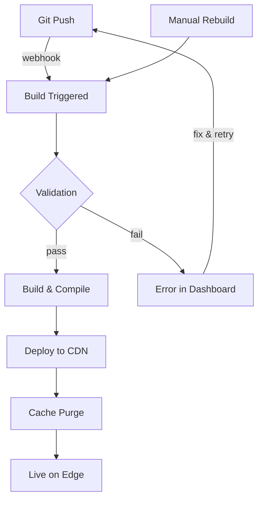

Jamdesk gestisce automaticamente l'intero ciclo di build e deploy. Esegui il push su GitHub e la documentazione sarà online in pochi minuti.

Gli screenshot mostrano l'interfaccia in inglese.

## Ciclo di build

## Trigger di build

| Trigger | Come funziona | Caso d'uso |
|---------|--------------|----------|
| **Git Push** | Il Webhook si attiva quando esegui il push sul branch collegato | Sviluppo ordinario |
| **Dashboard** | Fai clic su "Rebuild" nelle impostazioni del progetto | Forzare un aggiornamento dopo modifiche alla configurazione |

<Note>
Le build vengono accorpate. Più commit eseguiti nell'arco di 10 secondi vengono raggruppati in una singola build.
</Note>

## Cosa succede durante una build

Jamdesk clona il repository, convalida la sintassi di `docs.json` e MDX, compila il tutto in HTML ottimizzato con indicizzazione della ricerca, quindi esegue il deploy su Cloudflare R2. La build della maggior parte dei siti richiede 30-90 secondi.

Per una panoramica completa della pipeline con diagramma dell'architettura, consulta [Come funziona Jamdesk](/it/how-jamdesk-works).

## Stato del deploy

Controlla lo stato della build nella dashboard:

| Stato | Significato |
|--------|---------|
| **Building** | Build in corso |
| **Deployed** | Online sul tuo dominio |
| **Failed** | Errore di build: controlla i log |
| **Queued** | In attesa del completamento della build precedente |

La sezione Build History mostra i deploy recenti, il relativo stato e la possibilità di avviare build manuali:

<SizedImage src="/images/dashboard/build-history.webp" alt="Build History con i deploy recenti, badge di stato Successful, informazioni sui commit e pulsante Rebuild" />

## Ricostruzione manuale

Avvia una nuova build senza eseguire il push di modifiche:

1. Vai al tuo progetto nella dashboard
2. Apri **Settings**
3. Fai clic su **Rebuild**

Usa questa opzione per:
- Risolvere una build bloccata
- Aggiornare dopo gli aggiornamenti della piattaforma

## Log di build

Consulta i log dettagliati della build per eseguire il debug:

1. Vai a **Deployments** nel tuo progetto
2. Fai clic su un deploy specifico
3. Consulta il log completo della build

Nei log possono comparire problemi comuni:
- Sintassi MDX non valida
- Immagini o risorse mancanti
- Link interni non funzionanti
- Errori di configurazione

## Rollback

Ripristina una versione precedente:

1. Vai a **Deployments**
2. Individua il deploy da ripristinare
3. Fai clic su **Rollback**

La versione precedente torna subito online mentre viene avviata una nuova build.

## Deploy dei branch

<Note>
I deploy dei branch sono disponibili con i piani Pro.
</Note>

Visualizza in anteprima le modifiche prima di unirle al branch principale:

1. Esegui il push su un branch di funzionalità
2. Jamdesk crea un'anteprima all'indirizzo `branch-name.your-project.jamdesk.app`
3. Esamina le modifiche e uniscile quando sono pronte

## Prossimi passi

<Columns cols={2}>
  <Card title="Panoramica del deploy" icon="cloud-arrow-up" href="/it/deploy/overview">
    Scegli tra hosting con sottodominio, dominio personalizzato o sottopercorso
  </Card>
  <Card title="Hosting su sottopercorso" icon="route" href="/it/deploy/subpath-hosting">
    Ospita la documentazione su example.com/docs
  </Card>
</Columns>