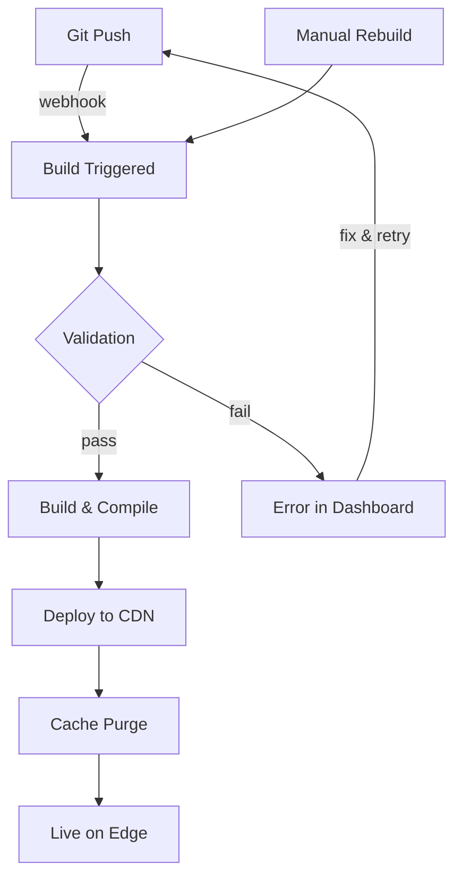

Invia il push a GitHub. Jamdesk esegue la build e il deploy della documentazione in pochi minuti.

Gli screenshot mostrano l'interfaccia in inglese.

## Ciclo di build

## Trigger di build

| Trigger | Come funziona | Caso d'uso |
|---------|--------------|----------|
| **Push Git** | Il Webhook si attiva quando viene eseguito un push sul branch collegato | Sviluppo normale |
| **Dashboard** | Fai clic su "Rebuild" nelle impostazioni del progetto | Forza l'aggiornamento dopo modifiche alla configurazione |

<Note>
Le build vengono accorpate. I commit eseguiti entro 10 secondi l'uno dall'altro confluiscono in un'unica build.
</Note>

## Cosa succede durante una build

Jamdesk clona il repository e convalida la sintassi di `docs.json` e MDX. Compila le pagine in HTML e crea un indice di ricerca. Esegue il deploy del risultato su Cloudflare R2. La maggior parte dei siti viene compilata in 30-90 secondi.

Consulta [Come funziona Jamdesk](/it/how-jamdesk-works) per informazioni sulla pipeline completa e il diagramma dell'architettura.

## Stato del deploy

La dashboard mostra uno di questi stati per ogni build:

| Stato | Significato |
|--------|---------|
| **Building** | Build in corso |
| **Deployed** | Online sul tuo dominio |
| **Failed** | Errore di build: controlla i log |
| **Queued** | In attesa del completamento della build precedente |

La sezione Build History elenca i deploy recenti e il relativo stato. Da qui puoi avviare una build manuale:

<SizedImage src="/images/dashboard/build-history.webp" alt="Cronologia delle build con i deploy recenti, badge di stato Successful, informazioni sui commit e pulsante Rebuild" />

## Ricostruzione manuale

Avvia una build senza eseguire il push di modifiche:

1. Vai al tuo progetto nella dashboard
2. Apri **Settings**
3. Fai clic su **Rebuild**

Usa questa opzione per:
- Correggere una build bloccata
- Aggiornare dopo gli aggiornamenti della piattaforma

## Log di build

1. Vai a **Deployments** nel tuo progetto
2. Fai clic su un deployment
3. Consulta il log di build completo

Errori comuni nei log:
- Sintassi MDX non valida
- Immagini o risorse mancanti
- Link interni non funzionanti
- Errori di configurazione

## Rollback

1. Vai a **Deployments**
2. Individua il deployment da ripristinare
3. Fai clic su **Rollback**

La versione precedente torna online immediatamente. Nel frattempo viene avviata una nuova build.

## Deploy dei branch

<Note>
I deploy dei branch sono disponibili nei piani Pro.
</Note>

Visualizza in anteprima le modifiche prima dell'unione:

1. Esegui il push su un branch di funzionalità
2. Jamdesk crea un'anteprima all'indirizzo `branch-name.your-project.jamdesk.app`
3. Esamina le modifiche e unisci il branch quando è tutto pronto

## Prossimi passi

<Columns cols={2}>
  <Card title="Panoramica dei deploy" icon="cloud-arrow-up" href="/it/deploy/overview">
    Scegli tra hosting su sottodominio, dominio personalizzato o sottopercorso
  </Card>
  <Card title="Hosting su sottopercorso" icon="route" href="/it/deploy/subpath-hosting">
    Ospita la documentazione su example.com/docs
  </Card>
</Columns>