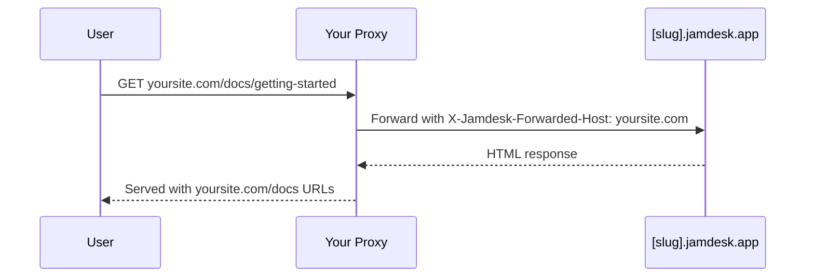

Ospita la documentazione in un sottopercorso del tuo dominio invece che in un sottodominio separato. Il valore predefinito è `yoursite.com/docs`, ma puoi scegliere un segmento personalizzato, come `yoursite.com/help`. Consulta [Panoramica del deploy](/it/deploy/overview) per tutte le opzioni di deploy.

Gli screenshot mostrano l'interfaccia in inglese.

## Perché usare un sottopercorso?

Un sottopercorso mantiene i lettori sul tuo dominio principale. Le pagine della documentazione contribuiscono all'autorevolezza del tuo dominio nei motori di ricerca. Un sottodominio come `docs.yoursite.com` distribuisce i segnali di posizionamento tra due host.

## Come funziona

Il tuo server web o CDN inoltra le richieste da `/docs/*` al tuo sito Jamdesk. Il browser mantiene l'URL originale:

Il proxy invia l'header `X-Jamdesk-Forwarded-Host` con il tuo dominio. Jamdesk lo usa per:

1. **Verificare che il tuo dominio** sia autorizzato a pubblicare i contenuti
2. **Applicare la tua configurazione** dal dashboard

La configurazione del proxy si imposta una sola volta. Le modifiche al dashboard non richiedono aggiornamenti del proxy.

## Configurazione per provider

<Columns cols={2}>
  <Card title="Cloudflare" icon="cloud" href="/it/deploy/cloudflare">
    Usa Cloudflare Workers per inoltrare il traffico /docs
  </Card>
  <Card title="AWS" icon="aws" href="/it/deploy/aws">
    Configura CloudFront con Route 53
  </Card>
  <Card title="Vercel" icon="triangle" href="/it/deploy/vercel">
    Aggiungi le regole di riscrittura a vercel.json
  </Card>
  <Card title="Reverse Proxy" icon="server" href="/it/deploy/reverse-proxy">
    nginx, Apache o altri server proxy
  </Card>
</Columns>

## Prerequisiti

Segui questi passaggi prima di configurare il proxy:

1. **Aggiungi il tuo dominio** nel [dashboard di Jamdesk](https://dashboard.jamdesk.com), alla voce Settings → Custom Domain
2. **Attiva "Host at a subpath"**
3. **Scegli il sottopercorso** (facoltativo; vedi [Scegliere il sottopercorso](#scegliere-il-sottopercorso) qui sotto) e fai clic su **Save**

Il dashboard mostra il tuo sottodominio Jamdesk (ad esempio, `acme.jamdesk.app`). Ti servirà per configurare il proxy.

<Note>
Salvare una modifica all'hosting su sottopercorso avvia una ricompilazione completa della documentazione. Questo vale sia per l'attivazione o la disattivazione, sia per la modifica del sottopercorso. La struttura degli URL cambia (ad esempio, da `/introduction` a `/docs/introduction`).
</Note>

## Scegliere il sottopercorso

Per impostazione predefinita, la documentazione è disponibile su `/docs`. Inserisci un altro valore, come `/help` o `/support`, nel campo del sottopercorso accanto all'interruttore. Se il campo è vuoto, l'interruttore mostra `Host at a subpath (e.g. /docs)`. Inserisci un valore e l'etichetta cambia nel percorso che stai per attivare (`Host at /help` e così via).

<Frame>
  
</Frame>

Il campo accetta un solo segmento in minuscolo: solo lettere, cifre e trattini interni, senza trattini iniziali o finali, per un massimo di 63 caratteri. Jamdesk rifiuta i segmenti riservati, tra cui `api`, `jd`, percorsi amministrativi comuni come `wp-admin` e qualsiasi codice di lingua che la documentazione potrebbe usare (`fr`, `es`, `de` e simili). Il sottopercorso non può mai coincidere con un percorso già utilizzato da Jamdesk.

Lascia vuoto il campo per mantenere il valore predefinito `/docs`.

## Rinominare o rimuovere il sottopercorso

Cambiare o svuotare il sottopercorso non interrompe i link già indicizzati o salvati nei segnalibri:

- **`/docs` resta sempre disponibile.** I percorsi originali `/docs/*` continuano a rispondere anche dopo il passaggio a un sottopercorso personalizzato come `/help`. Restano disponibili sul sottodominio `[slug].jamdesk.app` e tramite qualsiasi proxy che li utilizzi ancora. I link canonici passano subito al nuovo sottopercorso. I motori di ricerca reindicizzano le pagine lì. Puoi aggiornare la configurazione del proxy con i tuoi tempi.
- **La rinomina di un sottopercorso personalizzato inoltra quello precedente, per una sola rinomina.** Rinomina `/help` in `/guide` e le richieste a `/help/*` vengono reindirizzate con un codice 308 al percorso corrispondente `/guide/*`. La cronologia è limitata a un livello. Se rinomini di nuovo `/guide` in `/support`, `/guide/*` reindirizza a `/support/*`. Jamdesk non tiene più traccia di `/help/*` (il segmento di due rinomine prima). Questi link portano a una pagina "not found", a volte dopo un reindirizzamento a un percorso combinato insolito. Evita di concatenare le rinomine se vuoi che il reindirizzamento mantenga validi i vecchi link. Aggiorna invece i link esterni al sottopercorso attuale.
- **Tornando a `/docs`**, il sottopercorso personalizzato precedente (un livello della cronologia) viene reindirizzato a `/docs/*`.

<Warning>
`/docs` **non** reindirizza al sottopercorso scelto. `/docs` continua a essere disponibile direttamente, in modo permanente. Il reindirizzamento a un livello si applica solo a un sottopercorso *personalizzato* che stai abbandonando.
</Warning>

Verifica il proxy visitando `https://yoursite.com/docs` (o il sottopercorso configurato). Controlla che gli asset e i link vengano caricati.

## Devo nascondere il sottodominio jamdesk.app?

No. Il sottodominio `[slug].jamdesk.app` resta raggiungibile. È l'origine upstream a cui il proxy inoltra le richieste. Non entrerà in competizione con il tuo sito nei risultati di ricerca:

- **Dominio registrato**: le pagine pubblicate dal sottodominio includono un link canonico che punta alla stessa pagina sul tuo dominio. I motori di ricerca attribuiscono al tuo dominio i segnali di posizionamento.
- **Nessun dominio ancora registrato**: le pagine del sottodominio in modalità sottopercorso sono contrassegnate con `noindex`. Non entrano mai nell'indice.

Per bloccare i contenuti anche sul sottodominio, non solo escluderli dall'indice, attiva la [protezione con password](/it/setup/password-protection). Il sottodominio mostrerà una schermata di sblocco invece della documentazione.

## Qual è il prossimo passo?

<Columns cols={2}>
  <Card title="Panoramica del deploy" icon="cloud-arrow-up" href="/it/deploy/overview">
    Confronta l'hosting su sottodominio, dominio personalizzato e sottopercorso
  </Card>
  <Card title="Domini personalizzati" icon="globe" href="/it/deploy/custom-domains">
    Verifica il DNS e risolvi i problemi di configurazione del dominio
  </Card>
</Columns>