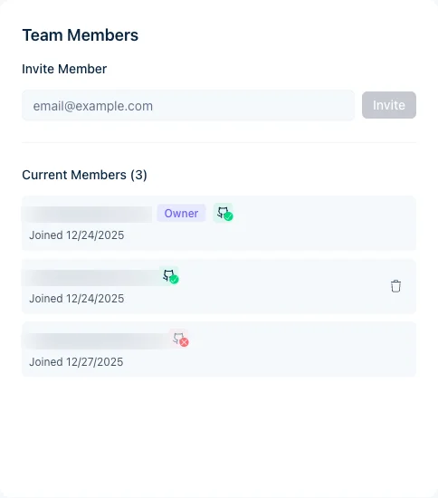

Invita i colleghi a monitorare le build, consultare le analisi e avviare nuove build. I ruoli disponibili sono Owner e Member.

Gli screenshot mostrano l'interfaccia in inglese.

<Note>
L'appartenenza al team determina anche quali push su GitHub avviano una build. Jamdesk associa chi ha effettuato il push tramite l'account GitHub collegato o tramite l'email. Un push da parte di un non membro fa fallire la build. Il proprietario del progetto riceve un'email. Invita chi ha fatto il push usando l'email del commit. Per accettare, deve accedere a Jamdesk con quella email. Se è già membro, può [collegare il proprio account GitHub](/it/integrations/github#account-github-personale-livello-utente).
</Note>

## Invitare membri

<Steps>
  <Step title="Apri le impostazioni del progetto">
    Vai al tuo progetto e fai clic su **Settings**.
  </Step>
  <Step title="Seleziona Members">
    Vai alla scheda **Members**.
  </Step>
  <Step title="Inserisci la sua email">
    Digita l'indirizzo email nel campo **Invite Member**.
  </Step>
  <Step title="Invia l'invito">
    Fai clic su **Invite**. Riceverà un'email con un link per unirsi.
  </Step>
</Steps>

<Note>
Gli invitati devono avere un account Jamdesk. L'invito li invita a crearne uno se non ne hanno.
</Note>

<Tip>
Se il tuo account ha configurato il [Single Sign-On](/it/setup/sso), i membri del team con un'email che corrisponde al dominio verificato accedono tramite il tuo provider di identità invece di creare una password. Il modulo di invito segnala quando un indirizzo userà SSO.
</Tip>

<Frame>
  
</Frame>

Nota: questo screenshot mostra l'interfaccia in inglese.

## Ruoli dei membri

| Role | Permissions |
|------|-------------|
| **Owner** | Accesso completo, può rimuovere membri, trasferire la proprietà, eliminare il progetto |
| **Member** | Visualizzare build e analisi, avviare nuove build |

Fai clic su **Transfer Ownership** accanto al nome di un membro per renderlo proprietario. Consulta [Trasferimento della proprietà](/it/help/projects/ownership-transfer) per i dettagli.

<Note>
**I membri del team non sono gli stessi lettori del sito di documentazione.** I membri del team vedono build e analisi nella dashboard di Jamdesk. [Controllo degli accessi](/it/setup/access-control) stabilisce chi può _leggere_ il tuo sito di documentazione pubblicato: pubblico, protetto da password, misto o SSO. Su un sito protetto da password puoi anche [consentire al tuo team di accedere con Jamdesk](/it/setup/password-protection#lascia-accedere-il-tuo-team-con-jamdesk), così i membri non devono usare la password condivisa.
</Note>

## Rimuovere membri

Solo il proprietario del progetto può rimuovere membri del team:

1. Vai a **Settings** → **Members**
2. Trova il membro
3. Fai clic su **Remove**
4. Conferma la rimozione

I membri rimossi perdono l'accesso immediatamente. Puoi invitarli di nuovo in seguito.

## Inviti in sospeso

Gli inviti non ancora accettati compaiono nell'elenco **Members**, contrassegnati come in sospeso. Annullane uno con l'icona del cestino accanto ad esso.

Gli inviti in sospeso non scadono. Restano validi finché la persona non accetta o tu non li annulli.

## Dimensioni del team

I membri del team sono illimitati su ogni progetto, senza costi aggiuntivi.

## Articoli correlati

<Columns cols={2}>
  <Card title="Trasferimento della proprietà" icon="arrow-right-arrow-left" href="/it/help/projects/ownership-transfer">
    Trasferisci la proprietà del progetto
  </Card>
  <Card title="Impostazioni del progetto" icon="gear" href="/it/help/projects/settings">
    Configura le opzioni del progetto
  </Card>
</Columns>