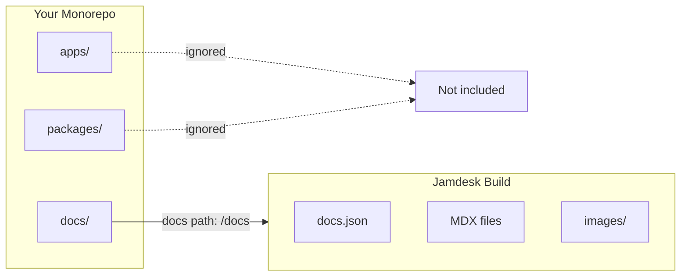

Se `docs.json` si trova in una sottodirectory (`docs/`, `packages/docs/` o un'altra), attiva la modalità monorepo nelle impostazioni del progetto e inserisci il percorso. Jamdesk compila solo quella directory.

Gli screenshot mostrano l'interfaccia in inglese.

<Note>
**Prerequisiti:** prima di configurare il supporto monorepo, devi avere un [progetto Jamdesk](/it/setup/creating-projects) collegato a un [repository GitHub](/it/setup/connecting-github).
</Note>

## Come Jamdesk limita la build



## Configurazione rapida

<Steps>
  <Step title="Apri le impostazioni del progetto">
    Apri il progetto nella [dashboard di Jamdesk](https://dashboard.jamdesk.com) e vai su **Settings**.
  </Step>

  <Step title="Attiva la modalità monorepo">
    Nella sezione **Git Repository**, attiva **Set up as monorepo**.

    <Frame>
      
    </Frame>
  </Step>

  <Step title="Inserisci il percorso di docs">
    Inserisci il percorso della directory che contiene il file `docs.json`.

    <Frame>
      
    </Frame>

    L'anteprima mostra dove Jamdesk cerca il file di configurazione.
  </Step>

  <Step title="Salva e avvia una nuova build">
    Fai clic su **Save Changes**. La build successiva userà il nuovo percorso.
  </Step>
</Steps>

## Comprendere il percorso della documentazione

<Warning>
Inserisci solo il percorso della directory, non il nome del file. Usa `docs`, non `docs/docs.json`.
</Warning>

### Esempi di percorsi

| Struttura del repository | Valore del percorso di docs |
|---------------------|-----------------|
| `my-repo/docs/docs.json` | `docs` |
| `my-repo/packages/docs/docs.json` | `packages/docs` |
| `my-repo/apps/website/docs/docs.json` | `apps/website/docs` |
| `my-repo/documentation/docs.json` | `documentation` |

### Cosa viene incluso

Jamdesk elabora solo i file all'interno del percorso di docs:

- I **file di contenuto** (`.mdx`, `.md`) vengono compilati in pagine
- Le **risorse** nelle sottodirectory (come `images/`) vengono incluse
- La **configurazione** (`docs.json`) definisce il sito

Durante le build, i file al di fuori del percorso di docs vengono ignorati.

## Strutture monorepo comuni

<Tabs>
  <Tab title="Directory /docs dedicata">
    Documentazione in una directory di primo livello.

    ```bash
    monorepo/
    ├── packages/
    ├── apps/
    └── docs/                    # Docs path: docs
        ├── docs.json
        ├── introduction.mdx
        └── guides/
    ```

    **Percorso di docs:** `docs`
  </Tab>

  <Tab title="Pacchetto in /packages">
    Documentazione come pacchetto workspace.

    ```bash
    monorepo/
    ├── packages/
    │   ├── core/
    │   ├── cli/
    │   └── docs/                # Docs path: packages/docs
    │       ├── docs.json
    │       └── pages/
    └── apps/
    ```

    **Percorso di docs:** `packages/docs`
  </Tab>

  <Tab title="All'interno di un'app">
    Documentazione in una sottodirectory di un'applicazione.

    ```bash
    monorepo/
    ├── apps/
    │   └── website/
    │       ├── src/
    │       └── docs/            # Docs path: apps/website/docs
    │           ├── docs.json
    │           └── introduction.mdx
    └── packages/
    ```

    **Percorso di docs:** `apps/website/docs`
  </Tab>

  <Tab title="Directory personalizzata">
    Una directory con qualsiasi nome personalizzato.

    ```bash
    monorepo/
    ├── src/
    ├── tests/
    └── documentation/           # Docs path: documentation
        ├── docs.json
        └── getting-started.mdx
    ```

    **Percorso di docs:** `documentation`
  </Tab>
</Tabs>

## Lavorare con le risorse

I percorsi delle risorse in `docs.json` sono sempre relativi alla directory docs, non alla radice del repository.

### Esempio

Per la documentazione in `packages/docs/`:

```json packages/docs/docs.json
{
  "logo": {
    "light": "/images/logo.svg"
  },
  "favicon": "/images/favicon.svg"
}
```

Questi percorsi fanno riferimento a:
- `packages/docs/images/logo.svg`
- `packages/docs/images/favicon.svg`

<Warning>
Non usare percorsi assoluti dalla radice del repository. Questo non funziona:

```json
"favicon": "/packages/docs/images/favicon.svg"
```
</Warning>

### Nei file MDX

Le immagini nei file MDX seguono la stessa regola:

```mdx

```

Questo fa riferimento a un'immagine in `[docs-path]/images/tabs-preview.png`.

## Link interni

I link interni non dipendono dalla struttura del repository. Usa percorsi relativi alla radice di docs:

```mdx
[See the quickstart guide](/quickstart)
[Installation steps](/quickstart#installation)
```

Questi percorsi corrispondono alla struttura di navigazione, non al file system.

## Comportamento delle build

Solo le modifiche all'interno del percorso di docs avviano una build:

- Le modifiche a `packages/docs/**` avviano una build
- Le modifiche a `packages/core/**` non avviano una build

<Tip>
**Devi avviare una build quando cambia altro codice?**

Per la documentazione generata dal codice sorgente (ad esempio, la documentazione API ricavata dai commenti nel codice), avvia manualmente una nuova build dalla dashboard oppure configura un webhook nella pipeline CI.
</Tip>

## Compatibilità con gli strumenti per workspace

Imposta il percorso di docs. Per questi strumenti monorepo non serve alcun'altra configurazione.

| Strumento | Supportato |
|------|-----------|
| npm workspaces | Sì |
| Yarn workspaces | Sì |
| pnpm workspaces | Sì |
| Turborepo | Sì |
| Nx | Sì |
| Lerna | Sì |

## Risoluzione dei problemi

<AccordionGroup>
  <Accordion title="Errore: docs.json non trovato" icon="circle-exclamation">
    1. Verifica che il percorso esatto nel repository corrisponda a quello inserito
    2. Assicurati che `docs.json` esista in quella posizione
    3. Controlla che non ci siano errori di battitura. I percorsi distinguono tra maiuscole e minuscole
    4. Ricorda: usa `docs`, non `docs/docs.json`

    **Verifica rapida:** nel repository, il file deve trovarsi in `[your-docs-path]/docs.json`
  </Accordion>

  <Accordion title="Risorse non caricate" icon="image">
    I percorsi delle risorse devono essere relativi alla directory docs.

    **Corretto** (relativo alla directory docs):
    ```json
    "favicon": "/images/favicon.svg"
    ```

    **Errato** (percorso assoluto dalla radice del repository):
    ```json
    "favicon": "/packages/docs/images/favicon.svg"
    ```

    Verifica che le immagini siano presenti in `[docs-path]/images/`.
  </Accordion>

  <Accordion title="Le modifiche non avviano le build" icon="rotate">
    Solo le modifiche all'interno del percorso di docs avviano build automatiche.

    1. Verifica di modificare file all'interno del percorso di docs
    2. Controlla di eseguire il push sul branch corretto
    3. Controlla lo stato di consegna dei webhook nelle impostazioni del repository GitHub

    Per avviare una build quando cambiano file al di fuori del percorso di docs, usa le build manuali o i webhook CI.
  </Accordion>
</AccordionGroup>

## E adesso?

<Columns cols={2}>
  <Card title="Collega GitHub" icon="github" href="/it/setup/connecting-github">
    Collega il repository per avviare build automatiche
  </Card>
  <Card title="Struttura delle directory" icon="folder-tree" href="/it/setup/directory-structure">
    Organizza la documentazione per facilitarne la crescita
  </Card>
</Columns>