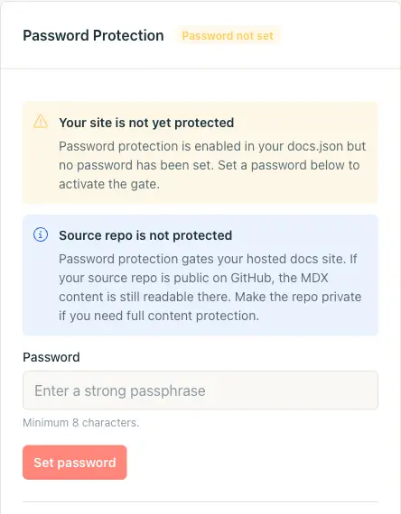
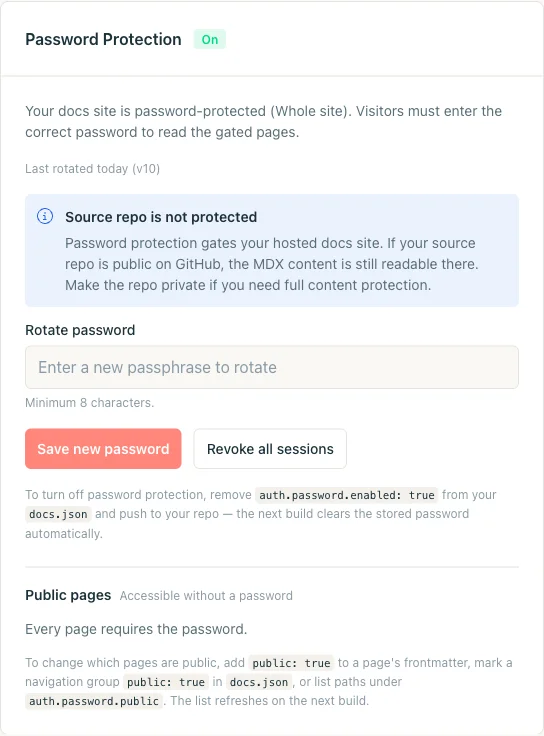
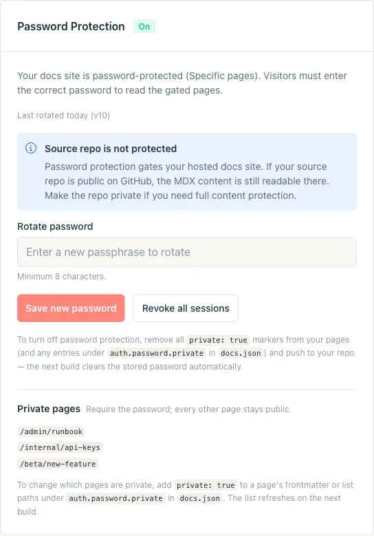
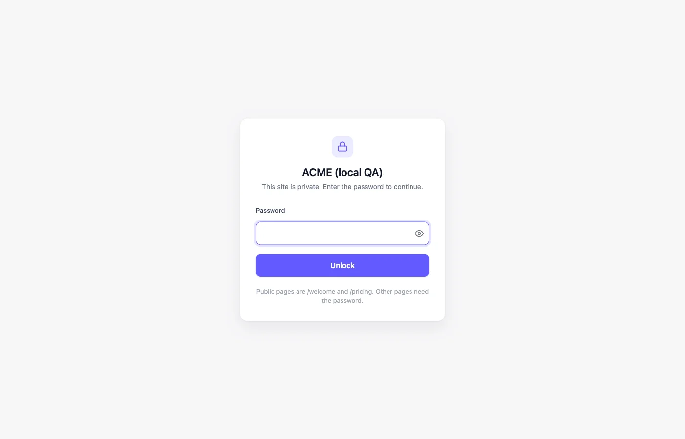
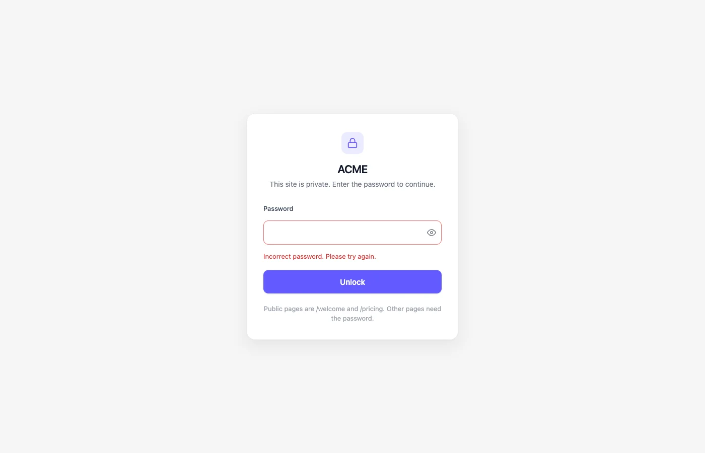

La protezione con password limita l'accesso alla documentazione che resta in Git ma non deve essere pubblica: runbook, guide pre-rilascio, documenti riservati ai partner, funzionalità in accesso anticipato. Una sola password condivisa protegge l'intero sito o un insieme di pagine. Nulla lascia il repository.

Gli screenshot mostrano l'interfaccia in inglese.

<Tip>
  Per l'autenticazione per singolo utente, usa [autenticazione JWT](/it/setup/jwt-authentication). Protegge la documentazione tramite il tuo sistema di login, con sessioni per utente e accesso alle pagine basato sui gruppi.
</Tip>

<Note>
  La protezione con password richiede un progetto Jamdesk [collegato a un repository Git](/it/setup/connecting-github). La configurazione risiede in `docs.json` e viene applicata con la normale build.
</Note>

## Quale modalità scegliere?

Scegli la modalità in base a ciò che è pubblico.

| | **Modalità intero sito** | **Modalità pagine specifiche** |
|---|---|---|
| **Quando usarla** | Tutto è privato: documentazione interna di ingegneria, una copia di staging del sito pubblico, un prodotto non ancora rilasciato. | La maggior parte della documentazione è pubblica. Nascondi alcune pagine (un runbook, una funzionalità beta, un riferimento API interno). |
| **Come attivarla** | Imposta `auth.password.enabled: true` in `docs.json`. | Contrassegna le pagine come private con `private: true` nel frontmatter, oppure elenca i percorsi in `auth.password.private[]`. |
| **Eccezioni pubbliche** | Sì: puoi contrassegnare singole pagine, gruppi di navigazione o pattern glob come pubblici. | Non applicabile. Ogni pagina è pubblica finché non la contrassegni come privata. |

La scheda della dashboard, la schermata di sblocco e i controlli di rotazione e revoca sono gli stessi in entrambe le modalità. Per cambiare modalità, modifica `docs.json` e pubblica le modifiche.

## Proteggi l'intero sito

<Steps>
  <Step title="Aggiungi auth.password.enabled a docs.json">
    Dichiara la protezione dell'intero sito in `docs.json`. Il campo `hint` è facoltativo: è l'unico suggerimento visibile ai lettori su come ottenere la password.

    ```json docs.json
    {
      "$schema": "https://jamdesk.com/docs.json",
      "name": "Acme Docs",
      "theme": "jam",
      "auth": {
        "password": {
          "enabled": true,
          "hint": "Ask #docs-access on Slack"
        }
      }
    }
    ```

    I suggerimenti sono testo semplice, massimo 200 caratteri, senza HTML.

    <Tip>
      Non inserire la password in `docs.json`. Impostala nella dashboard dopo la build. Il repository contiene solo il flag di attivazione e un suggerimento facoltativo.
    </Tip>
  </Step>

  <Step title="Esegui commit e push">
    Invia la modifica al branch configurato. La build attiva la protezione con password in modalità intero sito.

    ```bash
    git add docs.json
    git commit -m "Turn on password protection"
    git push
    ```

    La scheda della dashboard passa da **Off** a **Password non impostata**. Il sito è bloccato. Ogni pagina restituisce `401` e mostra la schermata della password. Nessuna password funziona finché non ne impostI una. Le pagine che hai contrassegnato come pubbliche restano aperte. Le chiavi API del progetto continuano a funzionare per la Search API, il server MCP, gli URL `.md` e i file llms. Per rendere di nuovo pubblico l'intero sito, imposta `auth.password.enabled` su `false` e pubblica.

    
  </Step>

  <Step title="Imposta la password nella dashboard">
    Apri **Impostazioni progetto** nella dashboard e scorri fino alla scheda **Protezione con password**. Digita una password (minimo 8 caratteri). Fai clic su **Imposta password**.

    La scheda passa a **On**. I visitatori senza password vedono la schermata di sblocco.

    

    <Warning>
      Jamdesk non memorizza mai la password in chiaro. Viene sottoposta a hash con scrypt nel database della dashboard e non viene mai scritta nel repository o in `docs.json`. Jamdesk non può inviartela via email se la dimentichi. In quel caso, ruota la password.
    </Warning>
  </Step>

  <Step title="Verifica il blocco">
    Apri il sito della documentazione in una finestra privata del browser (oppure usa `curl`) e verifica di ottenere la schermata di sblocco. Prova una password errata per controllare lo stato di errore, poi inserisci quella corretta.

    ```bash
    # Should respond with HTTP/1.1 401 and the unlock HTML
    curl -I https://acme.jamdesk.app/

    # Submit the password. On success, sets the jd_auth_<slug> cookie.
    curl -i -X POST https://acme.jamdesk.app/jd/unlock \
      -d "password=your-passphrase&from=/"
    ```

    Uno sblocco riuscito restituisce un redirect `303` con l'intestazione `Set-Cookie: jd_auth_acme=...; HttpOnly; Secure; SameSite=Lax; Max-Age=2592000`. Invia quel cookie con la richiesta successiva.
  </Step>
</Steps>

### Eccezioni pubbliche

Mantieni pubbliche pagine specifiche mentre il resto del sito è protetto, ad esempio una landing page di marketing o un modulo di iscrizione.

Puoi contrassegnare una pagina come pubblica in tre modi. La build unisce le indicazioni in un'unica allow-list.

**Frontmatter** è l'opzione più granulare. Aggiungi `public: true` a un file `.mdx` per renderlo pubblico:

```yaml
---
title: Get started
public: true
---
```

**Gruppi di navigazione** coprono un'intera sezione. Imposta `public: true` su un `group` o un `tab` nella navigazione di `docs.json` per rendere pubbliche tutte le pagine al suo interno. Ad esempio, una scheda "Marketing" accanto alla documentazione interna privata:

```json docs.json
{
  "navigation": {
    "tabs": [
      {
        "tab": "Marketing",
        "public": true,
        "groups": [
          {
            "group": "Overview",
            "pages": ["landing", "pricing", "changelog"]
          }
        ]
      },
      {
        "tab": "Internal",
        "groups": [
          { "group": "Runbooks", "pages": ["deploys", "oncall"] }
        ]
      }
    ]
  }
}
```

I **glob espliciti** in `auth.password.public[]` coprono ciò che frontmatter e navigazione non possono: landing page di primo livello, route generate dinamicamente o un sottoalbero che preferisci non riscrivere.

```json docs.json
{
  "auth": {
    "password": {
      "enabled": true,
      "hint": "Ask #docs-access on Slack",
      "public": [
        "/landing",
        "/pricing",
        "/marketing/**",
        "/blog/*"
      ]
    }
  }
}
```

I glob supportano `*` (un segmento del percorso) e `**` (qualsiasi profondità). La validazione rifiuta un `/` isolato, che sbloccherebbe l'intero sito. La scheda della dashboard mostra l'allow-list risolta dall'ultima build.

## Proteggi solo alcune pagine

In modalità pagine specifiche tutto è pubblico per impostazione predefinita. Abilita il blocco solo per le singole pagine.

<Steps>
  <Step title="Contrassegna una pagina come privata">
    Aggiungi `private: true` al frontmatter della pagina.

    ```yaml
    ---
    title: Incident Runbook
    description: What to do when the deploys dashboard is on fire.
    private: true
    ---
    ```

    Per mantenere l'elenco dei percorsi protetti in un unico file, aggiungili in `auth.password.private[]` in `docs.json`. I due approcci sono cumulativi.

    ```json docs.json
    {
      "auth": {
        "password": {
          "hint": "Ask the on-call engineer",
          "private": ["/admin/runbook", "/internal/api-keys"]
        }
      }
    }
    ```

    Non serve `enabled: true`. Impostare `auth.password.private[]` senza `enabled` attiva la modalità pagine specifiche.
  </Step>

  <Step title="Esegui commit e push">
    Invia le modifiche. La build successiva attiva la protezione in modalità pagine specifiche. La dashboard ti chiederà di impostare una password.

    ```bash
    git add content/runbook.mdx docs.json
    git commit -m "Gate the incident runbook"
    git push
    ```
  </Step>

  <Step title="Imposta la password">
    Apri **Impostazioni progetto**, trova la scheda **Protezione con password** e imposta una password. L'intestazione della scheda riporta **On** con **Pagine specifiche** invece di **Intero sito**. Elenca le pagine private risolte dalla build.

    
  </Step>

  <Step title="Verifica il blocco">
    Naviga nel sito della documentazione. Le pagine pubbliche si caricano come prima. Le pagine private reindirizzano alla schermata di sblocco. La password ti autentica per 30 giorni su quel dispositivo.
  </Step>
</Steps>

## Cosa vedono i visitatori

Una pagina protetta mostra una scheda di sblocco centrata con il nome del sito e un suggerimento facoltativo. Non ci sono barra laterale né navigazione.



La scheda riporta il logo del sito e il colore primario definiti in `docs.json`. Il campo password ha un pulsante per mostrare il testo e il focus automatico.

Una password errata mostra la stessa scheda con un messaggio di errore, un campo vuoto e una breve pausa tra i tentativi. Nulla nella pagina distingue "password errata" da "nessuna password ancora inserita".



La password corretta imposta un cookie firmato. Dura fino alla scadenza della sessione o fino alla revoca.

## Strumenti AI e chiavi API

Gli strumenti che non possono inserire la password, come un client MCP o uno script che recupera `llms.txt`, possono usare una chiave API del progetto. La chiave funziona per il [server MCP](/it/ai/mcp-server#siti-protetti-da-login), per gli URL di pagina `.md` e per i [file llms](/it/ai/llms-txt#siti-protetti-da-login). Non apre mai le pagine HTML né la chat AI.

## Lascia accedere il tuo team con Jamdesk

I tuoi collaboratori hanno già un account Jamdesk, quindi non hanno bisogno anche della password condivisa. Aggiungi `allowMembers` e la schermata di sblocco mostra un pulsante **Accedi con Jamdesk** accanto al campo password. I lettori esterni continuano a usare la password.

```json docs.json
{
  "auth": {
    "password": {
      "enabled": true,
      "allowMembers": true
    }
  }
}
```

È disattivato per impostazione predefinita. Pubblica la modifica e il pulsante comparirà dopo la build successiva.

Quando un collaboratore fa clic su **Accedi con Jamdesk**, si apre la dashboard di Jamdesk. Se ha già effettuato l'accesso, viene riportato direttamente alla pagina che stava leggendo. Altrimenti accede prima e torna poi alla documentazione.

### Chi può accedere

Può accedere il proprietario del progetto, così come chiunque sia stato aggiunto come membro in **Impostazioni → Membri** nella dashboard. Chi invitate può leggere la documentazione una volta accettato l'invito.

<Warning>
  Un membro ottiene anche accesso completo da editor al progetto nella dashboard. Aggiungi solo persone di cui ti fidi per questo.
</Warning>

### Come funzionano le sessioni del team

L'accesso di un membro del team dura 14 giorni. Dopo, il collaboratore deve fare di nuovo clic sul pulsante.

Per revocare l'accesso a qualcuno, rimuovilo dal progetto. Il suo accesso alla documentazione cessa entro circa un minuto.

Cambiare la password condivisa non disconnette i membri del team, e non li disconnette nemmeno **Revoca tutte le sessioni**. Gli accessi del team non influiscono sulle sessioni con password.

Una volta autenticato, un collaboratore può usare la chat AI, il server MCP, gli URL `.md` e `llms.txt` esattamente come farebbe dopo aver digitato la password.

### Documentazione solo per il team

Attiva `enabled` e `allowMembers`, poi non impostare alcuna password nella dashboard. La schermata di sblocco mostra solo il pulsante di accesso, così il team può entrare e nessun altro può farlo.

### Domini e piani

L'accesso del team funziona sul sottodominio `<slug>.jamdesk.app` e sul dominio personalizzato collegato al progetto. Include le configurazioni Cloudflare Worker e con sottopercorso che servono la documentazione dal dominio personalizzato. Altri alias, come una copia `www.` del dominio, non sono supportati. Ogni host mantiene la propria sessione, quindi l'accesso su uno non vale per l'altro.

Come la protezione con password, anche l'accesso del team richiede un piano a pagamento. Se il piano del proprietario scade, i nuovi accessi del team si interrompono. Le sessioni già avviate continuano a funzionare fino alla scadenza, al massimo 14 giorni dopo.

`allowMembers` si applica solo alla protezione con password. I siti che usano [autenticazione JWT](/it/setup/jwt-authentication) non sono interessati.

## Rotazione e revoca delle sessioni

Apri la scheda **Protezione con password**, digita una nuova password nel campo **Ruota password** e fai clic su **Salva nuova password**. La vecchia password smette di funzionare alla richiesta successiva. La rotazione è immediata e non richiede una nuova build.

Per disconnettere tutte le sessioni attive senza cambiare la password (ad esempio se un laptop è stato smarrito), fai clic su **Revoca tutte le sessioni**. Questo incrementa un contatore di versione lato server. Ogni cookie emesso prima dell'incremento smette di funzionare. I visitatori devono reinserire la password attuale.

## Disattivare la protezione

Disattiva la protezione modificando `docs.json` e pubblicando.

- **Intero sito:** rimuovi `auth.password.enabled` (o impostalo su `false`).
- **Pagine specifiche:** rimuovi ogni marcatore `private: true` e svuota `auth.password.private`.

La build successiva elimina l'hash della password memorizzato e riporta la scheda su **Off**. Per riattivare la protezione in seguito serve una nuova password.

<Warning>
  Il repository sorgente non è protetto da password. La protezione con password limita il sito di documentazione ospitato su `*.jamdesk.app` (o sul tuo dominio personalizzato). Un repository GitHub pubblico espone comunque i contenuti MDX. Rendi privato il repository per una protezione completa dei contenuti.
</Warning>

## Regole di precedenza

Una pagina può corrispondere a più segnali. L'ordine di risoluzione, dal più specifico al meno specifico:

- `auth.password.enabled: true` protegge l'intero sito. `private: true` sulle singole pagine diventa ridondante.
- Una pagina con `public: true` e `private: true` è pubblica. **Vince il pubblico**.
- `public: true` nel frontmatter, `public: true` nel gruppo di navigazione e i glob di `auth.password.public[]` si uniscono in un'unica allow-list. Se un segnale indica che una pagina è pubblica, lo è.
- `auth.password.private[]` senza `auth.password.enabled` attiva la modalità pagine specifiche.

## Come funzionano le sessioni e il rate limiting

**Il cookie di sessione.** Dopo uno sblocco riuscito, Jamdesk imposta un cookie chiamato `jd_auth_<slug>` (ad esempio `jd_auth_acme`). È `HttpOnly`, `Secure`, `SameSite=Lax`, limitato all'host e firmato con HMAC-SHA256. Il payload include lo slug del progetto, il contatore di versione corrente e una data di scadenza. Una modifica fa fallire la validazione. La durata predefinita è **30 giorni**, rinnovata a ogni sblocco riuscito.

**Rate limiting.** L'endpoint di sblocco applica due contatori all'ora: **10 tentativi per IP** e **100 tentativi per progetto**. Vengono controllati prima del confronto dell'hash scrypt. Un tentativo di forza bruta non può consumare CPU né far trapelare informazioni sui tempi. Superare uno dei due limiti restituisce `429 Too Many Requests` con un'intestazione `Retry-After`.

**Archiviazione.** La tua password viene sottoposta a hash con scrypt e memorizzata nel Firestore della dashboard. Non finisce mai nel repository, in `docs.json` o in un artefatto di build. Se la perdi, ruotala. Non esiste un percorso di recupero.

## Test durante lo sviluppo locale

`jamdesk dev` esegue la documentazione con i contenuti R2 e la configurazione attivi. La protezione con password **non viene applicata** nel server di sviluppo locale. Puoi visualizzare in anteprima le pagine protette senza password.

Per testare il blocco, apri il sito pubblicato su `<slug>.jamdesk.app` (o sul tuo dominio personalizzato) in una finestra del browser senza il cookie.

## Risoluzione dei problemi

<Accordion title="La build è completata ma la schermata di sblocco non compare mai">
  Probabilmente la scheda della dashboard mostra **Password non impostata**. La protezione richiede (1) la configurazione pubblicata in `docs.json` e (2) una password impostata in **Impostazioni progetto**. Finché non imposti la password, ogni richiesta restituisce `401` con la schermata di sblocco come corpo.
</Accordion>

<Accordion title="Ho impostato la password ma il mio collaboratore vede ancora la schermata di sblocco">
  Il suo browser ha un vecchio cookie `jd_auth_<slug>` emesso prima della rotazione. Attendi 30 giorni che il cookie scada, fai clic su **Revoca tutte le sessioni** nella dashboard, oppure chiedigli di cancellare i cookie del dominio della documentazione. La visita successiva chiederà la password attuale.
</Accordion>

<Accordion title="Posso condividere password diverse con gruppi diversi?">
  Non direttamente. Jamdesk usa una sola password condivisa per sito. Per un accesso differenziato per gruppo, suddividi la documentazione in più progetti (ciascuno con la propria password) oppure usa la modalità pagine specifiche con confini pubblico/privato separati per ciascun pubblico.
</Accordion>

<Accordion title="La protezione con password funziona con domini personalizzati e proxy con sottopercorso?">
  Sì. Il cookie di sblocco è legato all'host. Il sottodominio `*.jamdesk.app` e il tuo dominio personalizzato si autenticano in modo indipendente. Sbloccarne uno non sblocca l'altro.

  Le configurazioni con sottopercorso (documentazione su `tuosito.com/docs` dietro il tuo proxy) funzionano subito. Il modulo di sblocco invia i dati sotto il prefisso di percorso `/_jd/`. Ogni configurazione proxy documentata inoltra già questo percorso. Attivare o disattivare la protezione con password non richiede modifiche al proxy.

  Per un proxy configurato prima che la guida di setup aggiungesse l'inoltro di `/_jd/`, aggiungi `/_jd/*` ai percorsi inoltrati.
</Accordion>

<Accordion title="Un sito protetto appare ancora nei motori di ricerca?">
  No. I siti protetti impostano `noindex, nofollow` sulla schermata di sblocco e restituiscono `401` per ogni pagina protetta. I crawler non possono indicizzare nulla dietro il blocco. Le pagine pubbliche all'interno di un sito protetto restano indicizzate.
</Accordion>

## Cosa c'è dopo

<Columns cols={2}>
  <Card title="Panoramica del controllo accessi" icon="shield" href="/it/setup/access-control">
    Confronta la protezione con password con SSO e il pattern multi-progetto.
  </Card>
  <Card title="Autenticazione JWT" icon="lock" href="/it/setup/jwt-authentication">
    Sostituisci la password condivisa con sessioni per utente dal tuo sistema di login.
  </Card>
  <Card title="SSO (Enterprise)" icon="key" href="/it/setup/sso">
    Sostituisci le password condivise con l'accesso per utente tramite il tuo provider di identità.
  </Card>
  <Card title="Domini personalizzati" icon="globe" href="/it/deploy/custom-domains">
    Pubblica la documentazione sul tuo dominio prima di condividere il link.
  </Card>
  <Card title="Schema auth.password" icon="book" href="/it/config/docs-json-reference#authpassword">
    Riferimento completo dei campi `enabled`, `hint`, `public`, `private` e `allowMembers`.
  </Card>
</Columns>