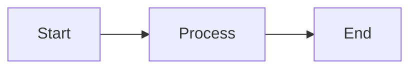
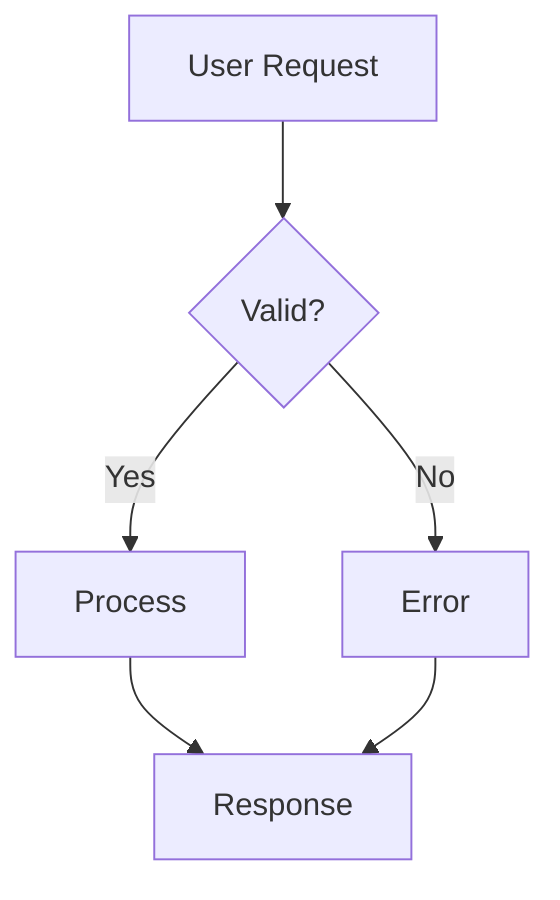
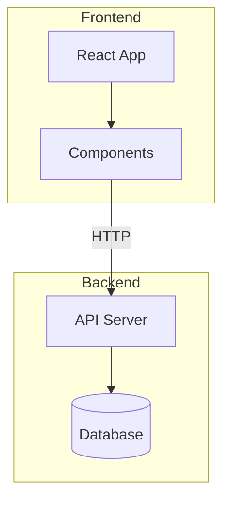
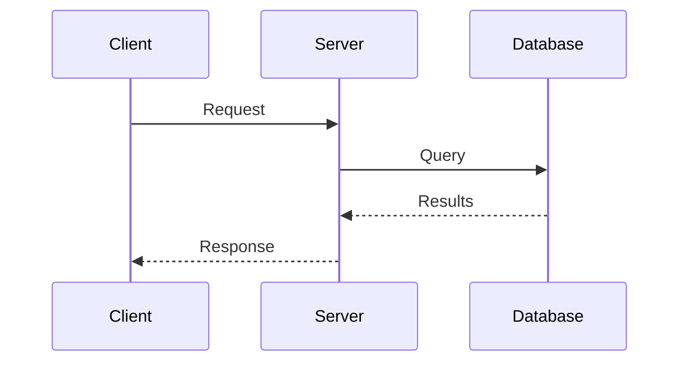
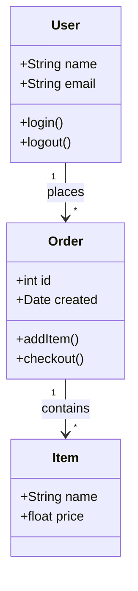
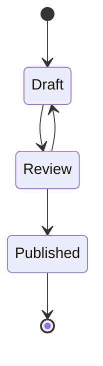
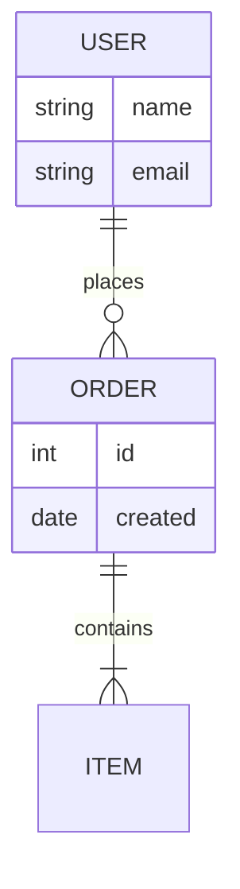
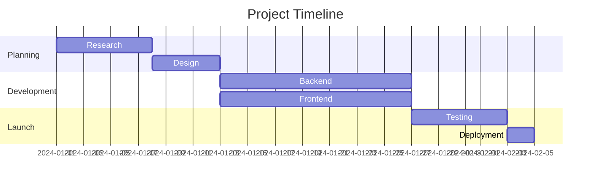
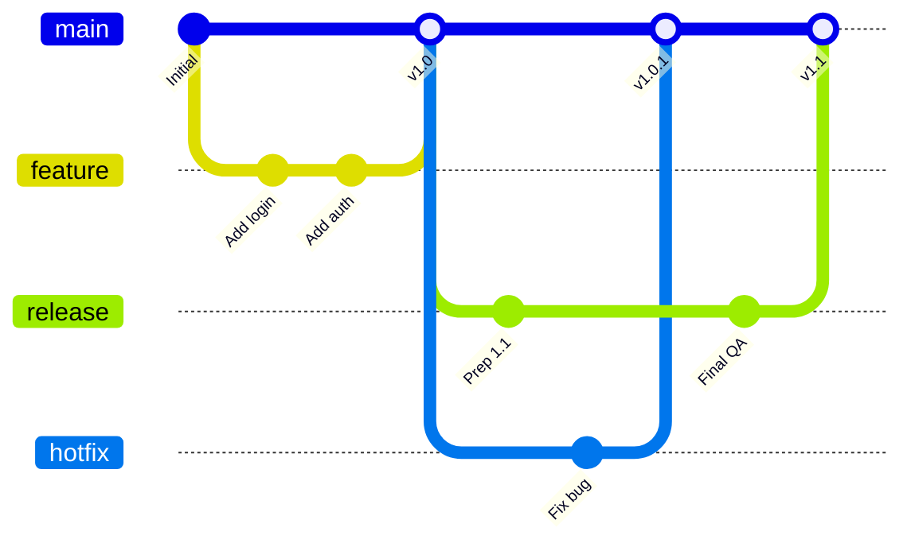
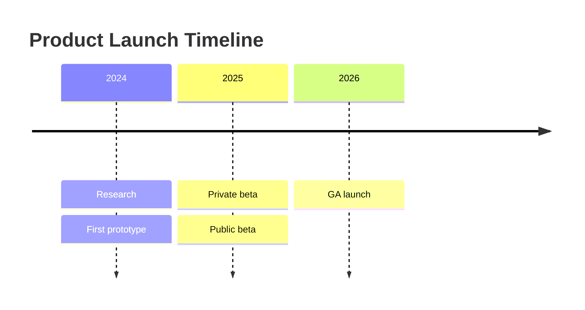

Escreva diagramas como texto em blocos de código delimitados. A Jamdesk os renderiza como SVG no momento do build.

<Tip>
  Rascunhe e visualize seu diagrama no [editor Mermaid da Jamdesk](https://jamdesk.com/utilities/mermaid-editor).
  É um editor de código aberto que roda no navegador e renderiza enquanto você digita.
  Cole o resultado em um bloco cercado por `mermaid`.
</Tip>

<Tip>
  A Jamdesk também renderiza [diagramas D2](/pt/components/d2) em blocos cercados por `d2`.
  Use D2 quando um diagrama precisar de contêineres aninhados, um esquema SQL
  com chaves primárias e estrangeiras, ou quando quiser trocar o mecanismo de layout. Os exemplos Mermaid
  desta página têm equivalentes em D2 na [página do D2](/pt/components/d2).
</Tip>

## Uso básico

Use um bloco de código delimitado com o identificador de linguagem `mermaid`:

````mdx

````


## Tipos de diagramas

### Fluxogramas

A direção pode ser de cima para baixo (`TD`), da esquerda para a direita (`LR`), de baixo para cima (`BT`) ou da direita para a esquerda (`RL`).



````mdx

````

#### Subgrafos

Agrupe nós relacionados com subgrafos. Use-os para dividir um fluxograma grande em seções como "Frontend" e "Backend", ou em etapas de um pipeline.



````mdx

````

### Diagramas de sequência

Diagramas de sequência mostram como os componentes interagem ao longo do tempo. Use um diagrama de sequência para fluxos de chamadas de API e handshakes de autenticação. Os participantes aparecem como linhas de vida verticais. As mensagens circulam entre eles.



````mdx

````

### Diagramas de classes

Diagramas de classe mostram a estrutura de sistemas orientados a objetos, como um modelo de dados ou os tipos centrais de um serviço. Eles exibem classes com seus atributos, métodos e relacionamentos.



````mdx

````

### Diagramas de estado

Diagramas de estado modelam o ciclo de vida de um objeto ou processo. Eles mostram cada estado e as transições entre eles. Status de pedidos e fluxos de aprovação de documentos são exemplos típicos.



````mdx

````

### Diagramas de entidade-relacionamento

Diagramas ER documentam esquemas de banco de dados e modelos de dados. Eles mostram entidades (tabelas), seus atributos (colunas) e os relacionamentos entre elas. Os símbolos indicam a cardinalidade: um para um, um para muitos ou muitos para muitos.



````mdx

````

### Gráficos de Gantt

Gráficos de Gantt mostram cronogramas de projetos. As tarefas aparecem como barras horizontais em uma linha do tempo, com duração, dependências e trabalho paralelo. Use um para um plano de projeto ou roadmap.



````mdx

````

### Gráficos do Git

Grafos Git mostram estratégias de branching e fluxos de controle de versão: commits, branches, merges e histórico do repositório. Cada branch recebe sua própria cor.



````mdx

````

### Diagramas de linha do tempo

Linhas do tempo mostram eventos ao longo de períodos. Comece com a palavra-chave `timeline`, um `title` opcional e depois uma linha por período, com os eventos separados por dois-pontos:



````mdx

````

### Gráficos de pizza

Gráficos de pizza mostram proporções como fatias de um círculo. Use um quando as partes compõem um todo, como participação de mercado ou resultados de pesquisa. Limite-se a 6 fatias ou menos.

```mermaid
pie title Browser Market Share
    "Chrome" : 65
    "Safari" : 19
    "Firefox" : 10
    "Edge" : 4
    "Other" : 2
```

````mdx
```mermaid
pie title Browser Market Share
    "Chrome" : 65
    "Safari" : 19
    "Firefox" : 10
    "Edge" : 4
    "Other" : 2
```
````

## Formas de fluxogramas

Cada forma tem um significado convencional em fluxogramas:

| Sintaxe    | Forma               | Use para |
| ---------- | ------------------- | -------- |
| `[text]`   | Retângulo           | Etapas de processo, ações |
| `(text)`   | Retângulo arredondado | Pontos de início/fim |
| `{text}`   | Losango             | Decisões, condições |
| `([text])` | Estádio (cápsula)   | Eventos, gatilhos |
| `[[text]]` | Sub-rotina          | Processos predefinidos |
| `[(text)]` | Cilindro            | Bancos de dados, armazenamento |

## Tipos de setas

As setas indicam direção do fluxo e tipos de relacionamento:

| Sintaxe     | Descrição        | Use para |
| ----------- | ---------------- | -------- |
| `-->`       | Seta sólida      | Fluxo normal |
| `---`       | Linha sólida     | Associações |
| `-.->`      | Seta pontilhada  | Fluxo opcional ou assíncrono |
| `==>`       | Seta grossa      | Caminhos importantes |
| `--text-->` | Seta com rótulo  | Descreva a transição |

## Ajustar o tamanho de diagramas largos

Use o componente `Mermaid` com a prop `minWidth` para evitar que um diagrama largo, como um gráfico de Gantt ou um grafo Git grande, seja comprimido:

```mdx
<Mermaid minWidth="700px">
gantt
    title Wide Project Timeline
    ...
</Mermaid>
```

## Clique para ampliar

Clique em um diagrama para abri-lo em tela cheia em telas de 768px ou mais. Com o teclado, foque o diagrama e pressione Enter. Feche com Escape, com o botão de fechar ou clicando fora do diagrama.

Desative isso em um diagrama específico com a forma de componente e `noZoom`:

```mdx
<Mermaid noZoom>
graph LR
    A[Request] --> B[Response]
</Mermaid>
```

Diagramas escritos como blocos ```` ```mermaid ```` sempre abrem em tela cheia.

## Dicas de estilo

<Tip>
  Os diagramas Mermaid mudam para o modo escuro junto com o site.
</Tip>

- Divida um fluxo grande em diagramas menores.
- Rotule suas setas para explicar as transições.
- Escolha uma direção: `TD` (de cima para baixo) para diagramas altos, `LR` (da esquerda para a direita) para os largos.
- Limite cada diagrama a 10-15 nós.

Para colorir um nó, use `style` para um nó ou `classDef` para um grupo:

```mermaid
graph LR
    A[Start] --> B[Review] --> C[Done]
    classDef good fill:#d1fae5,stroke:#059669
    style B fill:#fef3c7,stroke:#d97706
    class C good
```

A Jamdesk mantém suas cores no modo escuro. Um preenchimento sem cor de texto recebe uma cor de rótulo que a Jamdesk escolhe para ser legível sobre o preenchimento.

## Saiba mais

Consulte a [documentação oficial do Mermaid](https://mermaid.js.org/intro/) para a sintaxe completa, incluindo estilização, temas e mais tipos de diagrama.

## Próximos passos

<Columns cols={2}>
  <Card title="Diagramas D2" icon="diagram-project" href="/pt/components/d2">
    Arquitetura, contêineres e esquemas SQL com D2
  </Card>
  <Card title="Visão geral dos componentes" icon="puzzle-piece" href="/pt/components/overview">
    Veja todos os componentes disponíveis
  </Card>
  <Card title="Fundamentos de MDX" icon="file-code" href="/pt/content/mdx-basics">
    Aprenda a usar componentes em MDX
  </Card>
</Columns>