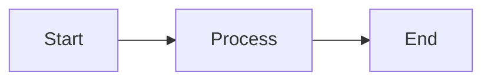
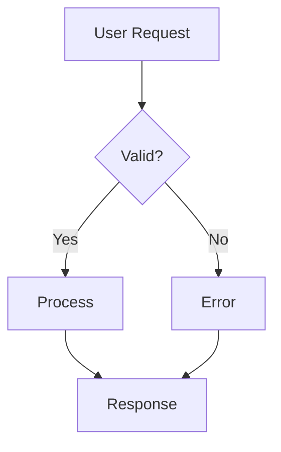
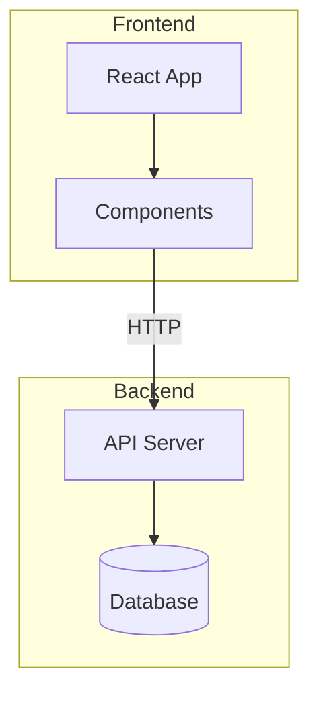
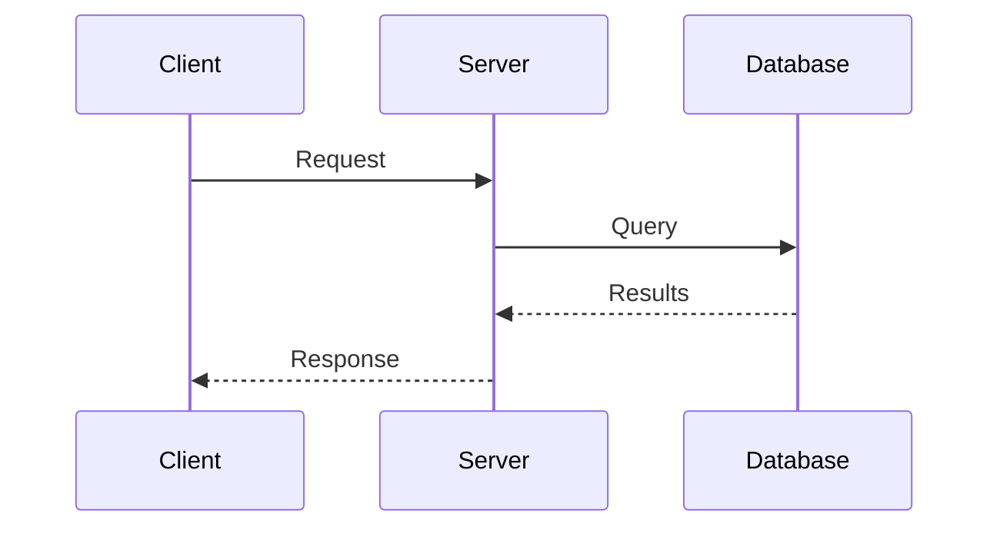
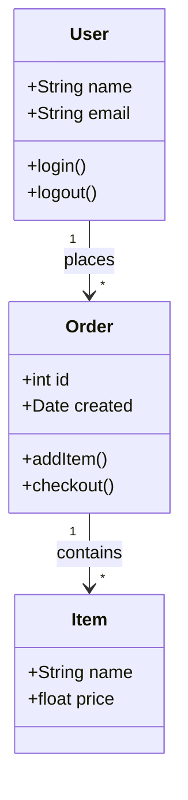
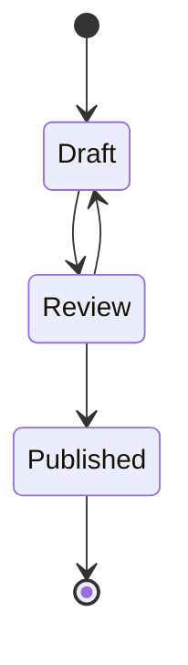
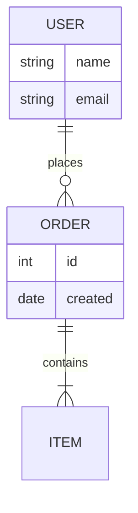
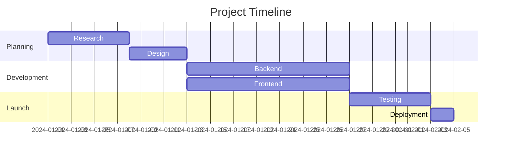
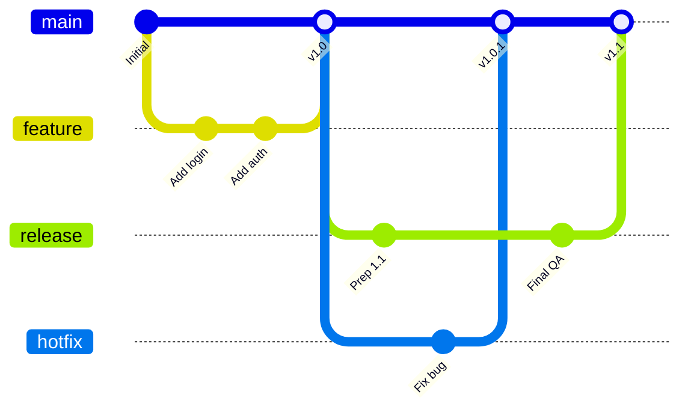
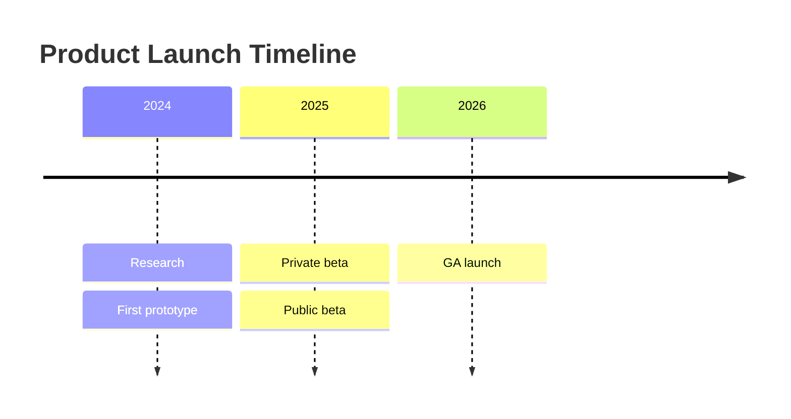

Escreva diagramas como texto em blocos de código cercados. O Jamdesk os gera como SVG durante o build.

<Tip>
  Crie e visualize seu diagrama no [editor Mermaid do Jamdesk](https://jamdesk.com/utilities/mermaid-editor),
  um editor e visualizador de código aberto que funciona no navegador. Escreva a sintaxe Mermaid, veja a
  renderização ao vivo e cole o resultado em um bloco cercado `mermaid` aqui.
</Tip>

<Tip>
  O Jamdesk também oferece suporte a [diagramas D2](/pt/components/d2) em blocos cercados `d2`.
  Use D2 quando um diagrama precisar de contêineres aninhados, um esquema SQL com
  chaves primárias e estrangeiras ou quando você quiser trocar os mecanismos de layout. Os exemplos
  Mermaid desta página têm equivalentes em D2 na [página do D2](/pt/components/d2).
</Tip>

## Uso básico

Use um bloco de código cercado com o identificador de linguagem `mermaid`:

````mdx

````


## Tipos de diagramas

### Fluxogramas

A direção pode ser de cima para baixo (`TD`), da esquerda para a direita (`LR`), de baixo para cima (`BT`) ou da direita para a esquerda (`RL`).



````mdx

````

#### Subgrafos

Agrupe nós relacionados usando subgrafos. Isso ajuda a organizar fluxogramas complexos em seções lógicas, como "Frontend" e "Backend", ou em diferentes etapas de um pipeline.



````mdx

````

### Diagramas de sequência

Os diagramas de sequência mostram como os componentes interagem ao longo do tempo. Use um diagrama de sequência para representar fluxos de chamadas de API e etapas de autenticação. Os participantes aparecem como linhas de vida verticais, com mensagens fluindo entre eles.



````mdx

````

### Diagramas de classes

Os diagramas de classes representam a estrutura de sistemas orientados a objetos, como um modelo de dados ou os principais tipos de um serviço. Eles mostram as classes com seus atributos e métodos, além das relações entre elas.



````mdx

````

### Diagramas de estado

Os diagramas de estado modelam o ciclo de vida de um objeto ou processo. Eles mostram todos os estados possíveis e as transições entre eles. Status de pedidos e fluxos de aprovação de documentos são exemplos típicos.



````mdx

````

### Diagramas de entidade-relacionamento

Os diagramas ER documentam esquemas de banco de dados e modelos de dados, mostrando entidades (tabelas), seus atributos (colunas) e as relações entre eles. Os símbolos indicam a cardinalidade: um para um, um para muitos ou muitos para muitos.



````mdx

````

### Gráficos de Gantt

Os gráficos de Gantt visualizam cronogramas e linhas do tempo de projetos. As tarefas são exibidas como barras horizontais ao longo de uma linha do tempo, mostrando duração, dependências e trabalho paralelo. Um plano de projeto ou roteiro é um uso adequado.



````mdx

````

### Gráficos do Git

Os gráficos do Git visualizam estratégias de ramificação e fluxos de trabalho de controle de versão. Eles mostram commits, branches, merges e o histórico geral de um repositório. Cada branch tem uma cor para facilitar a identificação.



````mdx

````

### Diagramas de linha do tempo

As linhas do tempo mostram eventos ao longo de períodos. Comece com a palavra-chave `timeline`, um `title` opcional e, em seguida, uma linha por período com os eventos separados por dois-pontos:



````mdx

````

### Gráficos de pizza

Os gráficos de pizza exibem dados proporcionais como fatias de um círculo. Use um quando partes formarem um todo, como em participação de mercado ou resultados de pesquisas. Para facilitar a leitura, limite o gráfico a 6 fatias.

```mermaid
pie title Browser Market Share
    "Chrome" : 65
    "Safari" : 19
    "Firefox" : 10
    "Edge" : 4
    "Other" : 2
```

````mdx
```mermaid
pie title Browser Market Share
    "Chrome" : 65
    "Safari" : 19
    "Firefox" : 10
    "Edge" : 4
    "Other" : 2
```
````

## Formas de fluxogramas

As diferentes formas transmitem significados distintos nos fluxogramas:

| Sintaxe    | Forma                 | Uso |
| ---------- | --------------------- | --- |
| `[text]`   | Retângulo             | Etapas de processo, ações |
| `(text)`   | Retângulo arredondado | Pontos de início/fim |
| `{text}`   | Losango               | Decisões, condições |
| `([text])` | Estádio                | Eventos, gatilhos |
| `[[text]]` | Sub-rotina             | Processos predefinidos |
| `[(text)]` | Cilindro               | Bancos de dados, armazenamento |

## Tipos de setas

As setas indicam a direção do fluxo e os tipos de relação:

| Sintaxe    | Descrição              | Uso |
| ---------- | ---------------------- | --- |
| `-->`      | Seta contínua          | Fluxo normal |
| `---`      | Linha contínua         | Associações |
| `-.->`     | Seta pontilhada        | Fluxo opcional ou assíncrono |
| `==>`      | Seta espessa           | Caminhos importantes |
| `--text-->` | Seta com rótulo       | Descreve a transição |

## Ajustar o tamanho de diagramas largos

Para diagramas largos, como gráficos de Gantt ou gráficos complexos do Git, você pode usar o componente `Mermaid` diretamente com a propriedade `minWidth` para evitar que o diagrama seja comprimido:

```mdx
<Mermaid minWidth="700px">
gantt
    title Wide Project Timeline
    ...
</Mermaid>
```

## Clique para ampliar

Em telas com 768 px ou mais, clicar em um diagrama o abre em tela cheia. Com o teclado, coloque o foco no diagrama e pressione Enter. Pressione Escape, clique no botão de fechar ou fora do diagrama para fechá-lo.

Para desativar esse comportamento em um diagrama, use o componente com `noZoom`:

```mdx
<Mermaid noZoom>
graph LR
    A[Request] --> B[Response]
</Mermaid>
```

Os diagramas escritos em blocos de código cercados ```` ```mermaid ```` sempre abrem em tela cheia.

## Dicas de estilo

<Tip>
  Os diagramas Mermaid se adaptam automaticamente aos modos claro e escuro. As cores são
  otimizadas para facilitar a leitura nos dois temas.
</Tip>

Para criar diagramas eficazes:

- Mantenha a simplicidade: divida fluxos complexos em vários diagramas menores.
- Adicione rótulos às setas para explicar as transições.
- Escolha uma direção: `TD` (de cima para baixo) para diagramas altos, `LR` (da esquerda para a direita) para os largos.
- Limite cada diagrama a 10–15 nós para facilitar a compreensão.

Para colorir um nó, use `style` em um nó ou `classDef` em um grupo:

```mermaid
graph LR
    A[Start] --> B[Review] --> C[Done]
    classDef good fill:#d1fae5,stroke:#059669
    style B fill:#fef3c7,stroke:#d97706
    class C good
```

As cores são mantidas nos modos claro e escuro. Quando você define uma cor de preenchimento, mas não define a cor do texto, o Jamdesk escolhe uma cor para o rótulo que contraste com o preenchimento.

## Saiba mais

Para consultar a referência completa da sintaxe Mermaid, incluindo recursos avançados como estilos, temas e tipos adicionais de diagramas, veja a [documentação oficial do Mermaid](https://mermaid.js.org/intro/).

## Próximos passos

<Columns cols={2}>
  <Card title="Diagramas D2" icon="diagram-project" href="/pt/components/d2">
    Arquitetura, contêineres e esquemas SQL com D2
  </Card>
  <Card title="Visão geral dos componentes" icon="puzzle-piece" href="/pt/components/overview">
    Consulte todos os componentes disponíveis
  </Card>
  <Card title="Fundamentos de MDX" icon="file-code" href="/pt/content/mdx-basics">
    Aprenda a usar componentes em MDX
  </Card>
</Columns>