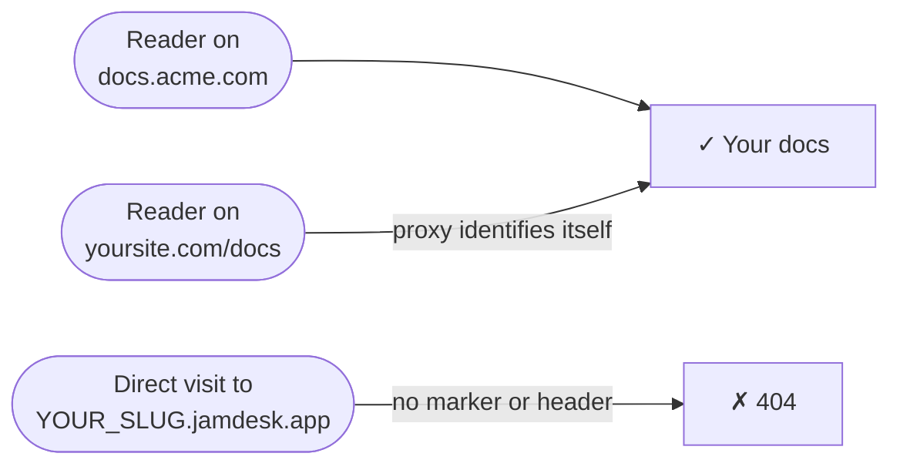

Sua documentação está hospedada em `YOUR_SLUG.jamdesk.app`. O subdomínio continua respondendo depois que você conecta um domínio personalizado. Todas as páginas servidas por ele incluem uma tag `<link rel="canonical">` que aponta para o seu domínio. Os mecanismos de busca indexam seu domínio, nunca o subdomínio.

**Custom domain only** desativa o subdomínio para visitantes diretos. Uma solicitação direta a `YOUR_SLUG.jamdesk.app` retorna um erro 404. Sua documentação só pode ser acessada pelo seu próprio domínio.

As capturas de tela mostram a interface em inglês.



<Warning>
Isso oculta seu subdomínio. Não é uma senha. Qualquer pessoa que acessar seu site pelo seu domínio continuará vendo sua documentação. Controle *quem* pode acessá-la com a [proteção por senha](/pt/setup/password-protection). Você pode ativar os dois recursos.
</Warning>

## Ativação

<Steps>
  <Step title="Verifique seu domínio personalizado">
    Adicione e verifique seu domínio no painel. Consulte [Domínios personalizados](/pt/deploy/custom-domains). O controle exige que o domínio tenha o status **Active**.
  </Step>
  <Step title="Verifique seu proxy (somente configurações com proxy reverso)">
    Se seu domínio for um CNAME simples apontado para o Jamdesk (como `docs.acme.com`), ignore esta etapa. Se você servir a documentação em `yoursite.com/docs` por meio de um proxy, ele deverá se identificar em todas as solicitações encaminhadas. Consulte [Configurações de proxy](#configurações-de-proxy) abaixo.
  </Step>
  <Step title="Ative o controle">
    Abra **Settings** do seu projeto no painel. Expanda o cartão **Custom Domain** e ative **Custom domain only**. O Jamdesk verifica primeiro seu domínio ativo. O controle permanece desativado até que a configuração seja aprovada. Se a verificação falhar, a mensagem informa o que você precisa corrigir.

    <Frame>
      
    </Frame>
  </Step>
</Steps>

As alterações chegam a todos os servidores de borda em até um minuto.

## Configurações de proxy

O Jamdesk só atende a uma solicitação para `YOUR_SLUG.jamdesk.app` se identificar que ela veio do seu proxy. Para isso, é necessário o cabeçalho `X-Jamdesk-Forwarded-Host` ou o marcador de consulta `?jd_proxy=1`. Estes guias de configuração incluem a opção adequada:

- **[Vercel](/pt/deploy/vercel)**: as reescritas em `vercel.json` incluem `?jd_proxy=1`. O Edge Middleware define o cabeçalho.
- **[Cloudflare Workers](/pt/deploy/cloudflare)**: o Worker define o cabeçalho.
- **[AWS CloudFront](/pt/deploy/aws)**: use o cabeçalho personalizado de origem.
- **[Proxy reverso](/pt/deploy/reverse-proxy)**: nginx, Apache, Caddy e HAProxy definem o cabeçalho.

Está usando [MCP](/pt/ai/mcp-server) ou o [widget de chat](/pt/ai/chat) por meio de um proxy reverso? Encaminhe `/api/mcp/:path*` e `/api/chat/:path*` da mesma forma que `/docs`. Na Vercel:

```json vercel.json
{
  "rewrites": [
    { "source": "/api/mcp/:path*", "destination": "https://YOUR_SLUG.jamdesk.app/api/mcp/:path*?jd_proxy=1" },
    { "source": "/api/chat/:path*", "destination": "https://YOUR_SLUG.jamdesk.app/api/chat/:path*?jd_proxy=1" }
  ]
}
```

O MCP e o chat não exigem alterações em domínios com CNAME apontado para o Jamdesk. Configure os clientes MCP para usar `https://docs.acme.com/_mcp`.

## Informações importantes

- **Tudo retorna erro 404 no subdomínio sem caminho**: páginas, `sitemap.xml`, `robots.txt`, `llms.txt` e exportações em Markdown. Os navegadores exibem uma página de não encontrado do Jamdesk.
- **As imagens continuam acessíveis.** Imagens, vídeos e imagens de pré-visualização para redes sociais (OG) são exceções. A pré-visualização do site no painel as carrega diretamente do subdomínio.
- **Você não pode perder o acesso.** Se o DNS do seu domínio parar de funcionar, o Jamdesk deixa de aplicar o bloqueio. O subdomínio volta a servir conteúdo até que o domínio se recupere. Se você alterar incorretamente a configuração do proxy (por exemplo, removendo o marcador de uma reescrita), desative o controle enquanto corrige o problema.
- **A [API de busca](/pt/jamdesk-api/docs-search-api) não é afetada.** A autenticação é feita por chave de API.

## O que vem a seguir?

<Columns cols={3}>
  <Card title="Vercel" icon="cloud-arrow-up" href="/pt/deploy/vercel">
    Adicione o marcador jd_proxy ou use o Edge Middleware
  </Card>
  <Card title="Domínios personalizados" icon="globe" href="/pt/deploy/custom-domains">
    Registre e verifique seu domínio
  </Card>
  <Card title="Proteção por senha" icon="lock" href="/pt/setup/password-protection">
    Controle quem pode acessar sua documentação
  </Card>
</Columns>

```