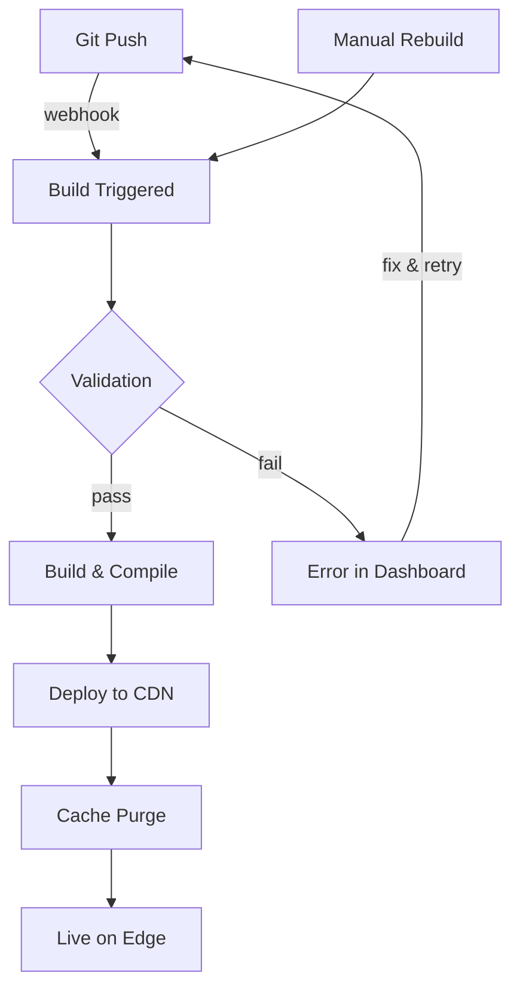

Envie para o GitHub. O Jamdesk compila e publica sua documentação em poucos minutos.

As capturas de tela mostram a interface em inglês.

## Ciclo de build

## Gatilhos de build

| Gatilho | Como funciona | Caso de uso |
|---------|--------------|----------|
| **Git Push** | O Webhook é acionado quando há um push para a branch conectada | Desenvolvimento normal |
| **Dashboard** | Clique em "Rebuild" nas configurações do projeto | Forçar atualização após mudanças na configuração |

<Note>
Os builds são agrupados. Commits feitos em um intervalo de até 10 segundos são incluídos no mesmo build.
</Note>

## O que acontece durante um build

O Jamdesk clona seu repositório e valida o `docs.json` e a sintaxe MDX. Ele compila as páginas em HTML com um índice de busca e publica o resultado no Cloudflare R2. A maioria dos sites é compilada em 30 a 90 segundos.

Consulte [Como o Jamdesk funciona](/pt/how-jamdesk-works) para ver o pipeline completo e o diagrama de arquitetura.

## Status da implantação

O dashboard mostra um destes status para cada build:

| Status | Significado |
|--------|---------|
| **Building** | Build em andamento |
| **Deployed** | Disponível no seu domínio |
| **Failed** | Erro no build — verifique os logs |
| **Queued** | Aguardando o build anterior |

A seção Build History lista as implantações recentes e seus status. Inicie um build manual por ali:

<SizedImage src="/images/dashboard/build-history.webp" alt="Histórico de builds com implantações recentes, indicadores de status Successful, informações de commit e botão Rebuild" />

## Iniciar um build manualmente

Inicie um build sem enviar alterações:

1. Acesse seu projeto no dashboard
2. Abra **Settings**
3. Clique em **Rebuild**

Use esta opção para:
- Corrigir um build travado
- Atualizar após mudanças na plataforma

## Logs do build

1. Acesse **Deployments** no seu projeto
2. Clique em uma implantação
3. Leia o log completo do build

Erros comuns nos logs:
- Sintaxe MDX inválida
- Imagens ou recursos ausentes
- Links internos quebrados
- Erros de configuração

## Reversões

1. Acesse **Deployments**
2. Encontre a implantação que deseja restaurar
3. Clique em **Rollback**

A versão anterior entra no ar imediatamente. Um novo build é iniciado ao mesmo tempo.

## Implantações de branches

<Note>
As implantações de branches estão disponíveis nos planos Pro.
</Note>

Confira as alterações antes de fazer o merge:

1. Envie as alterações para uma branch de recurso
2. O Jamdesk cria uma prévia em `branch-name.your-project.jamdesk.app`
3. Revise e faça o merge quando estiver tudo pronto

## Próximos passos

<Columns cols={2}>
  <Card title="Visão geral da implantação" icon="cloud-arrow-up" href="/pt/deploy/overview">
    Escolha entre hospedagem em subdomínio, domínio personalizado ou subcaminho
  </Card>
  <Card title="Hospedagem em subcaminho" icon="route" href="/pt/deploy/subpath-hosting">
    Hospede a documentação em example.com/docs
  </Card>
</Columns>