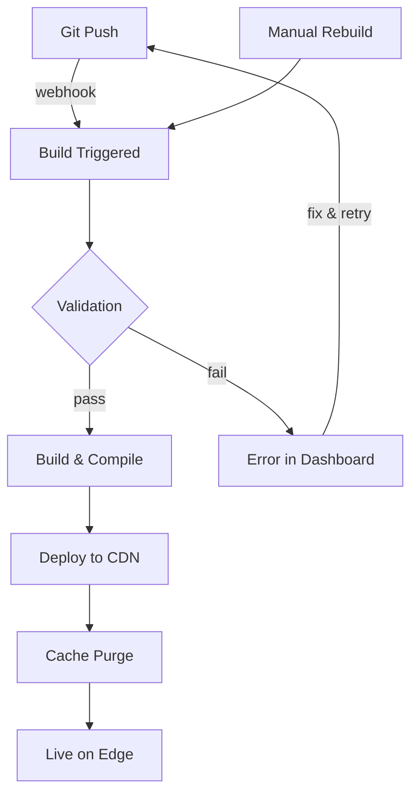

O Jamdesk gerencia automaticamente todo o ciclo de build e implantação. Envie suas alterações para o GitHub e sua documentação será publicada em poucos minutos.

As capturas de tela mostram a interface em inglês.

## Ciclo de build

## Gatilhos de build

| Gatilho | Como funciona | Caso de uso |
|---------|--------------|----------|
| **Git Push** | O Webhook é acionado ao enviar alterações para a branch conectada | Desenvolvimento normal |
| **Dashboard** | Clique em "Rebuild" nas configurações do projeto | Forçar atualização após alterações na configuração |

<Note>
Os builds são agrupados. Vários commits enviados em um intervalo de 10 segundos são reunidos em um único build.
</Note>

## O que acontece durante um build

O Jamdesk clona seu repositório, valida a sintaxe de `docs.json` e MDX, compila o conteúdo em HTML otimizado com indexação de busca e, em seguida, implanta no Cloudflare R2. A maioria dos sites é compilada em 30 a 90 segundos.

Para ver o detalhamento completo do pipeline e o diagrama de arquitetura, consulte [Como o Jamdesk funciona](/pt/how-jamdesk-works).

## Status da implantação

Confira o status do build no dashboard:

| Status | Significado |
|--------|---------|
| **Building** | Build em andamento |
| **Deployed** | Disponível no seu domínio |
| **Failed** | Erro no build — confira os logs |
| **Queued** | Aguardando o build anterior |

A seção Build History mostra as implantações recentes, seus status e a opção de iniciar builds manualmente:

<SizedImage src="/images/dashboard/build-history.webp" alt="Histórico de builds com implantações recentes, indicadores de status Successful, informações de commit e o botão Rebuild" />

## Iniciar um build manualmente

Inicie um build sem enviar alterações:

1. Acesse seu projeto no dashboard
2. Abra **Settings**
3. Clique em **Rebuild**

Use essa opção para:
- Corrigir um build travado
- Atualizar após atualizações da plataforma

## Logs do build

Consulte os logs detalhados do build para depurar problemas:

1. Acesse **Deployments** no seu projeto
2. Clique em uma implantação específica
3. Consulte o log completo do build

Os problemas comuns aparecem nos logs:
- Sintaxe MDX inválida
- Imagens ou recursos ausentes
- Links internos inválidos
- Erros de configuração

## Reversões

Volte para uma versão anterior:

1. Acesse **Deployments**
2. Encontre a implantação que deseja restaurar
3. Clique em **Rollback**

A versão anterior fica disponível imediatamente enquanto um novo build é iniciado.

## Implantações de branches

<Note>
As implantações de branches estão disponíveis nos planos Pro.
</Note>

Visualize as alterações antes de mesclá-las:

1. Envie alterações para uma branch de recurso
2. O Jamdesk cria uma prévia em `branch-name.your-project.jamdesk.app`
3. Revise e faça o merge quando estiver tudo pronto

## Próximos passos

<Columns cols={2}>
  <Card title="Visão geral da implantação" icon="cloud-arrow-up" href="/pt/deploy/overview">
    Escolha entre hospedagem em subdomínio, domínio personalizado ou subcaminho
  </Card>
  <Card title="Hospedagem em subcaminho" icon="route" href="/pt/deploy/subpath-hosting">
    Hospede a documentação em example.com/docs
  </Card>
</Columns>