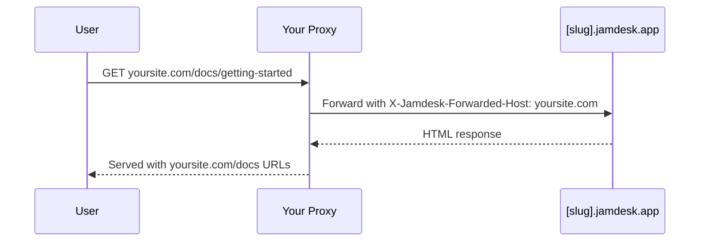

Hospede sua documentação em um subcaminho do seu domínio, em vez de um subdomínio separado. O padrão é `yoursite.com/docs`, ou você pode escolher um segmento personalizado como `yoursite.com/help`. Consulte a [Visão geral de deploy](/pt/deploy/overview) para ver todas as opções de deploy.

Screenshot note text: As capturas de tela mostram a interface em inglês.

## Por que usar um subcaminho?

Um subcaminho mantém os leitores no seu domínio principal. As páginas da sua documentação somam à autoridade de busca desse domínio. Um subdomínio como `docs.yoursite.com` divide os sinais de ranqueamento entre dois hosts.

## Como funciona

Seu servidor web ou CDN faz proxy das requisições de `/docs/*` para o seu site Jamdesk. O navegador mantém a URL original:

O proxy envia o cabeçalho `X-Jamdesk-Forwarded-Host` com o seu domínio. O Jamdesk usa esse cabeçalho para:

1. **Verificar se o seu domínio** está autorizado a servir o conteúdo
2. **Aplicar a sua configuração** feita no painel

A configuração do proxy é feita uma única vez. Alterações no painel não exigem atualização do proxy.

## Configuração por provedor

<Columns cols={2}>
  <Card title="Cloudflare" icon="cloud" href="/pt/deploy/cloudflare">
    Use Cloudflare Workers para fazer proxy do tráfego de /docs
  </Card>
  <Card title="AWS" icon="aws" href="/pt/deploy/aws">
    Configure o CloudFront com o Route 53
  </Card>
  <Card title="Vercel" icon="triangle" href="/pt/deploy/vercel">
    Adicione rewrites ao vercel.json
  </Card>
  <Card title="Reverse Proxy" icon="server" href="/pt/deploy/reverse-proxy">
    nginx, Apache ou outros servidores proxy
  </Card>
</Columns>

## Pré-requisitos

Execute estes passos antes de configurar o seu proxy:

1. **Adicione o seu domínio** no seu [painel Jamdesk](https://dashboard.jamdesk.com), em Settings → Custom Domain
2. **Ative "Host at a subpath"**
3. **Escolha o seu subcaminho** (opcional; veja [Escolhendo o seu subcaminho](#escolhendo-seu-subcaminho) abaixo) e clique em **Save**

O painel mostra o seu subdomínio Jamdesk (por exemplo, `acme.jamdesk.app`). A configuração do seu proxy precisa dele.

<Note>
Salvar uma alteração na hospedagem em subcaminho dispara uma reconstrução completa da sua documentação. Isso inclui ativar ou desativar a opção e alterar o subcaminho. A estrutura de URLs muda (por exemplo, entre `/introduction` e `/docs/introduction`).
</Note>

## Escolhendo seu subcaminho

Sua documentação é servida em `/docs` por padrão. Digite outro valor, como `/help` ou `/support`, no campo de subcaminho ao lado da opção. Um campo vazio mostra a opção como `Host at a subpath (e.g. /docs)`. Ao digitar um valor, o rótulo muda para o caminho que você está prestes a ativar (`Host at /help`, e assim por diante).

<Frame>
  
</Frame>

O campo aceita um único segmento em minúsculas: apenas letras, dígitos e hífens internos, sem hífen no início ou no fim, com no máximo 63 caracteres. O Jamdesk rejeita segmentos reservados, incluindo `api`, `jd`, caminhos administrativos comuns como `wp-admin` e qualquer código de idioma que sua documentação possa usar (`fr`, `es`, `de` e similares). Seu subcaminho nunca pode colidir com uma rota que o Jamdesk já serve.

Deixe o campo vazio para manter o padrão `/docs`.

## Renomear ou remover seu subcaminho

Alterar ou limpar o seu subcaminho não quebra links já indexados ou salvos nos favoritos:

- **`/docs` nunca deixa de ser servido.** Os caminhos originais `/docs/*` continuam respondendo depois que você muda para um subcaminho personalizado como `/help`. Eles respondem no seu subdomínio `[slug].jamdesk.app` e por qualquer proxy ainda apontado para eles. Os links canônicos passam para o novo subcaminho imediatamente. Os mecanismos de busca reindexam ali. Atualize a configuração do seu proxy no seu próprio ritmo.
- **Renomear um subcaminho personalizado encaminha o antigo, por uma renomeação.** Renomeie `/help` para `/guide`, e as requisições para `/help/*` recebem um redirecionamento 308 para o caminho correspondente `/guide/*`. Esse histórico tem um nível de profundidade. Renomeie novamente de `/guide` para `/support`, e `/guide/*` redireciona para `/support/*`. O Jamdesk não rastreia mais `/help/*` (o segmento de duas renomeações atrás). Esses links caem em uma página de "não encontrado", às vezes depois de um redirecionamento para um caminho combinado estranho. Não encadeie renomeações se você depende do redirecionamento para manter os links antigos. Atualize os links externos para o subcaminho atual.
- **Voltar para `/docs`** redireciona o seu subcaminho personalizado anterior (um nível de histórico) para `/docs/*`.

<Warning>
`/docs` **não** redireciona para o subcaminho que você escolher. `/docs` continua sendo servido diretamente, de forma permanente. O redirecionamento de um nível se aplica apenas a um subcaminho *personalizado* do qual você está se afastando.
</Warning>

Teste o seu proxy acessando `https://yoursite.com/docs` (ou o subcaminho configurado). Verifique se os recursos e os links carregam.

## Preciso ocultar o subdomínio jamdesk.app?

Não. O seu subdomínio `[slug].jamdesk.app` continua acessível. Ele é a origem upstream para a qual o seu proxy encaminha. Ele não concorre com o seu site nos resultados de busca:

- **Domínio registrado**: as páginas servidas pelo subdomínio incluem um link canônico apontando para a mesma página no seu domínio. Os mecanismos de busca atribuem os sinais de ranqueamento ao seu domínio.
- **Nenhum domínio registrado ainda**: as páginas do subdomínio em modo de subcaminho são marcadas como `noindex`. Elas nunca entram no índice.

Para bloquear também o conteúdo no subdomínio (não apenas removê-lo do índice), ative a [Proteção por senha](/pt/setup/password-protection). Assim, o subdomínio exibe uma tela de desbloqueio em vez da sua documentação.

## O que vem a seguir?

<Columns cols={2}>
  <Card title="Visão geral de deploy" icon="cloud-arrow-up" href="/pt/deploy/overview">
    Compare subdomínio, domínio personalizado e hospedagem em subcaminho
  </Card>
  <Card title="Domínios personalizados" icon="globe" href="/pt/deploy/custom-domains">
    Verifique o DNS e solucione problemas de configuração de domínio
  </Card>
</Columns>