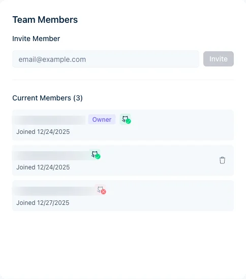

Convide colegas para acompanhar builds, revisar análises e acionar novos builds. As funções são Owner e Member.

As capturas de tela mostram a interface em inglês.

<Note>
A associação também define quais pushes do GitHub são construídos. O Jamdesk identifica quem fez o push pela conta do GitHub vinculada ou pelo e-mail. Um push de alguém que não é membro faz o build falhar. O proprietário do projeto recebe um e-mail. Convide quem fez o push usando o e-mail do commit. A pessoa precisa entrar no Jamdesk com esse e-mail para aceitar. Se ela já for membro, pode [vincular a conta do GitHub](/pt/integrations/github#conta-pessoal-do-github-nível-do-usuário).
</Note>

## Convidar membros

<Steps>
  <Step title="Abra as configurações do projeto">
    Acesse o seu projeto e clique em **Settings**.
  </Step>
  <Step title="Selecione Members">
    Acesse a aba **Members**.
  </Step>
  <Step title="Informe o e-mail">
    Digite o endereço de e-mail no campo **Invite Member**.
  </Step>
  <Step title="Envie o convite">
    Clique em **Invite**. A pessoa receberá um e-mail com um link para entrar.
  </Step>
</Steps>

<Note>
Os convidados precisam de uma conta Jamdesk. O convite pede que criem uma, caso ainda não tenham.
</Note>

<Tip>
Se a sua conta tiver [Single Sign-On](/pt/setup/sso) configurado, os membros cujo e-mail corresponda ao seu domínio verificado entram pelo seu provedor de identidade, sem criar senha. O formulário de convite indica quando um endereço usará SSO.
</Tip>

<Frame>
  
</Frame>

## Funções dos membros

| Função | Permissões |
|------|-------------|
| **Owner** | Acesso total, pode remover membros, transferir a propriedade e excluir o projeto |
| **Member** | Ver builds e análises, acionar novos builds |

Clique em **Transfer Ownership** ao lado do nome de um membro para torná-lo o proprietário. Veja [Transferência de propriedade](/pt/help/projects/ownership-transfer) para mais detalhes.

<Tip>
Para dar a alguém o controle de faturamento e de todos os projetos que você possui, torne essa pessoa um [administrador de conta](/pt/help/projects/account-admins). Administradores de conta aparecem na lista de Membros com o selo **Account admin**, e você os remove em **User Settings**, e não aqui.
</Tip>

<Note>
**Membros da equipe não são o mesmo que leitores do site de documentação.** Membros da equipe veem builds e análises no painel do Jamdesk. [Controle de acesso](/pt/setup/access-control) define quem pode _ler_ o seu site de documentação publicado: público, protegido por senha, misto ou SSO. Em um site protegido por senha, você também pode [permitir que a sua equipe entre com o Jamdesk](/pt/setup/password-protection#permita-que-sua-equipe-entre-com-o-jamdesk), para que os membros não precisem da senha compartilhada.
</Note>

## Remover membros

Apenas o proprietário do projeto pode remover membros da equipe:

1. Acesse **Settings** → **Members**
2. Encontre o membro
3. Clique em **Remove**
4. Confirme a remoção

Membros removidos perdem o acesso imediatamente. Você pode convidá-los novamente depois.

## Convites pendentes

Convites que ainda não foram aceitos aparecem na lista **Members**, marcados como pendentes. Cancele um deles com o ícone de lixeira ao lado.

Convites pendentes não expiram. Eles permanecem válidos até que a pessoa aceite ou você os cancele.

## Tamanho da equipe

Membros da equipe são ilimitados em todos os projetos, sem custo adicional.

## Artigos relacionados

<Columns cols={2}>
  <Card title="Transferência de propriedade" icon="arrow-right-arrow-left" href="/pt/help/projects/ownership-transfer">
    Transfira a propriedade do projeto
  </Card>
  <Card title="Configurações do projeto" icon="gear" href="/pt/help/projects/settings">
    Configure as opções do projeto
  </Card>
</Columns>