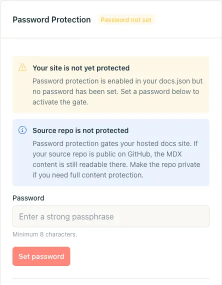
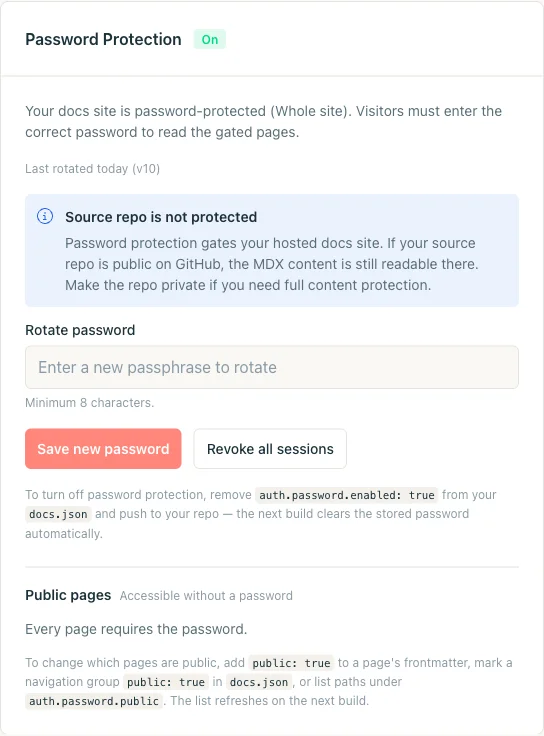
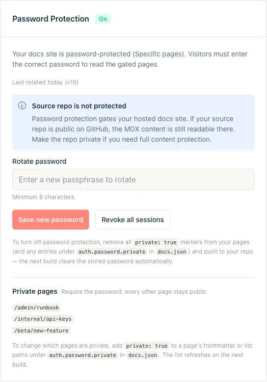
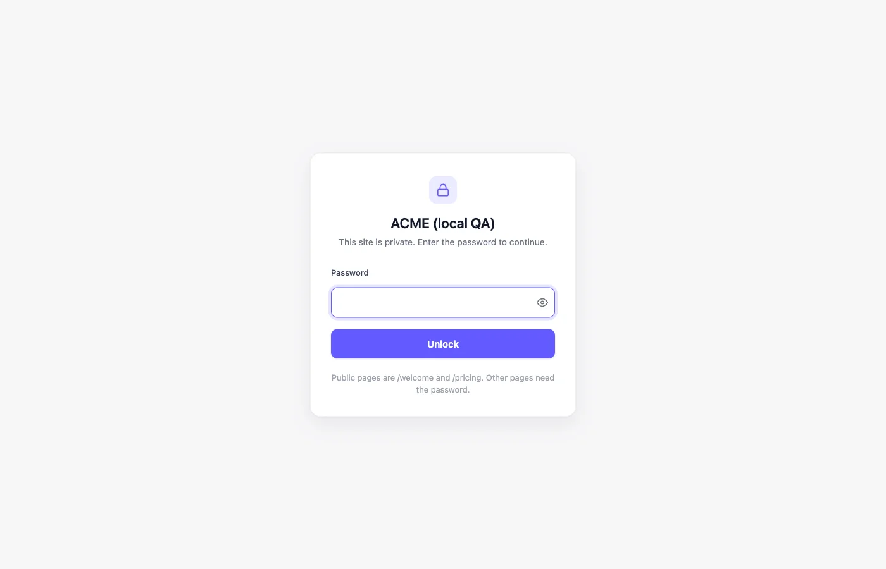
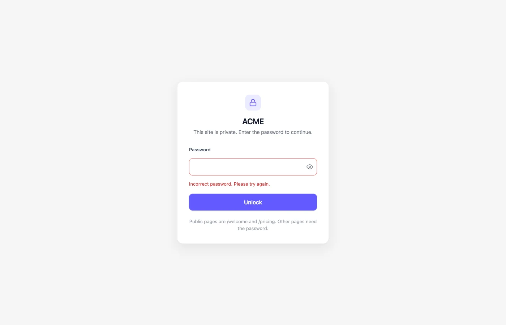

A proteção por senha restringe documentos que ficam no Git, mas não devem ser públicos: runbooks, guias de pré-lançamento, documentação exclusiva para parceiros, recursos de acesso antecipado. Uma senha compartilhada protege o site inteiro ou um conjunto de páginas. Nada sai do seu repositório.

As capturas de tela mostram a interface em inglês.

<Tip>
  Para autenticação por usuário, use [autenticação JWT](/pt/setup/jwt-authentication). Ela restringe sua documentação ao seu próprio sistema de login, com sessões por usuário e acesso às páginas baseado em grupos.
</Tip>

<Note>
  A proteção por senha requer um projeto Jamdesk [conectado a um repositório Git](/pt/setup/connecting-github). A configuração fica em `docs.json` e é aplicada no seu build normal.
</Note>

## Qual modo devo escolher?

Escolha um modo com base no que é público.

| | **Modo site inteiro** | **Modo páginas específicas** |
|---|---|---|
| **Use quando** | Tudo é privado: documentação interna de engenharia, uma cópia de homologação do seu site público, um produto não lançado. | A maior parte da documentação é pública. Você oculta algumas páginas (um runbook, um recurso beta, uma referência de API interna). |
| **Como ativar** | Defina `auth.password.enabled: true` em `docs.json`. | Marque páginas como privadas com `private: true` no frontmatter, ou liste caminhos em `auth.password.private[]`. |
| **Exceções públicas** | Sim: marque páginas individuais, grupos de navegação ou padrões glob como públicos. | N/A. Todas as páginas são públicas, a menos que você as marque como privadas. |

O card do dashboard, a tela de desbloqueio e os controles de rotação e revogação são os mesmos nos dois modos. Para trocar de modo, edite `docs.json` e envie a alteração.

## Proteja o site inteiro

<Steps>
  <Step title="Adicione auth.password.enabled ao docs.json">
    Declare a proteção do site inteiro em `docs.json`. O campo `hint` é opcional. É a única pista na tela que os leitores recebem sobre como obter a senha.

    ```json docs.json
    {
      "$schema": "https://jamdesk.com/docs.json",
      "name": "Acme Docs",
      "theme": "jam",
      "auth": {
        "password": {
          "enabled": true,
          "hint": "Ask #docs-access on Slack"
        }
      }
    }
    ```

    As dicas são texto simples, com no máximo 200 caracteres, sem HTML.

    <Tip>
      Não coloque a senha no `docs.json`. Defina-a no dashboard depois do build. Seu repositório guarda apenas o indicador de ativação e uma dica opcional.
    </Tip>
  </Step>

  <Step title="Faça commit e push">
    Envie a alteração para a branch configurada. O build ativa a proteção por senha no modo site inteiro.

    ```bash
    git add docs.json
    git commit -m "Turn on password protection"
    git push
    ```

    O card do dashboard muda de **Desativado** para **Senha não definida**. O site fica bloqueado. Cada página retorna `401` e mostra a tela de senha. Nenhuma senha funciona até que você defina uma. As páginas marcadas como públicas continuam abertas. As chaves de API do projeto continuam funcionando para a API de busca, o servidor MCP, URLs `.md` e os arquivos llms. Para tornar o site inteiro público novamente, defina `auth.password.enabled` como `false` e envie a alteração.

    
  </Step>

  <Step title="Defina a senha no dashboard">
    Abra **Configurações do projeto** no dashboard e role até o card **Proteção por senha**. Digite uma senha (mínimo de 8 caracteres). Clique em **Definir senha**.

    O card muda para **Ativado**. Visitantes sem a senha veem a tela de desbloqueio.

    

    <Warning>
      A Jamdesk nunca armazena sua senha em texto simples. Ela é transformada em hash com scrypt no banco de dados do dashboard e nunca é gravada no seu repositório ou no `docs.json`. A Jamdesk não consegue enviá-la por e-mail caso você a esqueça. Nesse caso, faça a rotação.
    </Warning>
  </Step>

  <Step title="Verifique a proteção">
    Abra seu site de documentação em uma janela privada do navegador (ou use `curl`) e confirme que aparece a tela de desbloqueio. Tente uma senha errada para verificar o estado de erro. Depois, digite a senha correta.

    ```bash
    # Should respond with HTTP/1.1 401 and the unlock HTML
    curl -I https://acme.jamdesk.app/

    # Submit the password. On success, sets the jd_auth_<slug> cookie.
    curl -i -X POST https://acme.jamdesk.app/jd/unlock \
      -d "password=your-passphrase&from=/"
    ```

    Um desbloqueio bem-sucedido retorna um redirecionamento `303` com o cabeçalho `Set-Cookie: jd_auth_acme=...; HttpOnly; Secure; SameSite=Lax; Max-Age=2592000`. Envie esse cookie na próxima requisição.
  </Step>
</Steps>

### Exceções públicas

Mantenha páginas específicas públicas enquanto o restante do site está protegido, por exemplo uma página inicial de marketing ou um formulário de cadastro.

Marque uma página como pública de três formas. O build combina todas em uma única lista de permissões.

**Frontmatter** é a opção mais granular. Adicione `public: true` a um arquivo `.mdx` para tornar essa página pública:

```yaml
---
title: Get started
public: true
---
```

**Grupos de navegação** cobrem uma seção inteira. Defina `public: true` em um `group` ou `tab` da navegação do seu `docs.json` para tornar públicas todas as páginas abaixo dele. Por exemplo, uma aba "Marketing" ao lado da documentação interna privada:

```json docs.json
{
  "navigation": {
    "tabs": [
      {
        "tab": "Marketing",
        "public": true,
        "groups": [
          {
            "group": "Overview",
            "pages": ["landing", "pricing", "changelog"]
          }
        ]
      },
      {
        "tab": "Internal",
        "groups": [
          { "group": "Runbooks", "pages": ["deploys", "oncall"] }
        ]
      }
    ]
  }
}
```

**Globs explícitos** em `auth.password.public[]` cobrem o que o frontmatter e a navegação não alcançam: páginas de entrada no nível raiz, rotas geradas dinamicamente ou uma subárvore que você preferir não reescrever.

```json docs.json
{
  "auth": {
    "password": {
      "enabled": true,
      "hint": "Ask #docs-access on Slack",
      "public": [
        "/landing",
        "/pricing",
        "/marketing/**",
        "/blog/*"
      ]
    }
  }
}
```

Os globs suportam `*` (um segmento de caminho) e `**` (qualquer profundidade). A validação rejeita um `/` isolado, que desbloquearia todo o seu site. O card do dashboard mostra a lista de permissões resolvida pelo último build.

## Proteja apenas algumas páginas

No modo páginas específicas, tudo é público por padrão. Você opta por proteger páginas individuais.

<Steps>
  <Step title="Marque uma página como privada">
    Adicione `private: true` ao frontmatter da página.

    ```yaml
    ---
    title: Incident Runbook
    description: What to do when the deploys dashboard is on fire.
    private: true
    ---
    ```

    Para manter a lista de caminhos protegidos em um único arquivo, adicione-os em `auth.password.private[]` no `docs.json`. As duas abordagens são cumulativas.

    ```json docs.json
    {
      "auth": {
        "password": {
          "hint": "Ask the on-call engineer",
          "private": ["/admin/runbook", "/internal/api-keys"]
        }
      }
    }
    ```

    Não há `enabled: true`. Definir `auth.password.private[]` sem `enabled` ativa o modo páginas específicas.
  </Step>

  <Step title="Faça commit e push">
    Envie suas alterações. O próximo build ativa a proteção no modo páginas específicas. O dashboard pede que você defina uma senha.

    ```bash
    git add content/runbook.mdx docs.json
    git commit -m "Gate the incident runbook"
    git push
    ```
  </Step>

  <Step title="Defina a senha">
    Abra **Configurações do projeto**, encontre o card **Proteção por senha** e defina uma senha. O cabeçalho do card mostra **Ativado** com **Páginas específicas** em vez de **Site inteiro**. Ele lista as páginas privadas resolvidas pelo build.

    
  </Step>

  <Step title="Verifique a proteção">
    Navegue pelo seu site de documentação. As páginas públicas carregam normalmente. As páginas privadas redirecionam para a tela de desbloqueio. A senha mantém você conectado por 30 dias nesse dispositivo.
  </Step>
</Steps>

## O que os visitantes veem

Uma página protegida mostra um card centralizado de desbloqueio com o nome do site e uma dica opcional. Não há barra lateral nem navegação.



O card usa o logotipo e a cor primária do seu site definidos no `docs.json`. O campo de senha tem um botão para revelar o texto e foco automático.

Uma senha incorreta renderiza o mesmo card com uma mensagem de erro, um campo novo e um pequeno atraso entre as tentativas. Nada na página distingue "senha errada" de "nenhuma senha digitada ainda".



A senha correta define um cookie assinado. Ele vale até a sessão expirar ou até você revogá-lo.

## Ferramentas de IA e chaves de API

Ferramentas que não conseguem digitar a senha, como um cliente MCP ou um script que busca o `llms.txt`, podem usar uma chave de API do projeto. A chave funciona para o [servidor MCP](/pt/ai/mcp-server#sites-protegidos-por-login), URLs de página `.md` e os [arquivos llms](/pt/ai/llms-txt#sites-protegidos-por-login). Ela nunca abre páginas HTML nem o chat de IA.

## Permita que sua equipe entre com o Jamdesk

Sua equipe já tem logins no Jamdesk, então não precisa também da senha compartilhada. Adicione `allowMembers` e a tela de desbloqueio mostra um botão **Entrar com o Jamdesk** ao lado do campo de senha. Leitores externos continuam usando a senha.

```json docs.json
{
  "auth": {
    "password": {
      "enabled": true,
      "allowMembers": true
    }
  }
}
```

Essa opção vem desativada por padrão. Envie a alteração e o botão aparece após o próximo build.

Quando um membro da equipe clica em **Entrar com o Jamdesk**, o dashboard do Jamdesk é aberto. Se ele já estiver conectado ali, é levado de volta diretamente para a página que estava lendo. Se não estiver, faz login primeiro e depois volta para a sua documentação.

### Quem pode entrar

O proprietário do projeto pode entrar, assim como qualquer pessoa adicionada como membro em **Configurações → Membros** no dashboard. Quem você convidar poderá ler a documentação assim que aceitar o convite.

<Warning>
  Um membro também recebe acesso completo de editor ao projeto no dashboard. Adicione apenas pessoas em quem você confiaria para isso.
</Warning>

### Como funcionam as sessões da equipe

Uma sessão de membro da equipe dura 14 dias. Depois disso, o membro clica no botão novamente.

Para desconectar alguém, remova essa pessoa do projeto. O acesso à documentação dela para em cerca de um minuto.

Trocar a senha compartilhada não desconecta os membros da equipe, e o mesmo vale para **Revogar todas as sessões**. Os logins da equipe também não afetam as sessões com senha.

Depois de conectado, um membro pode usar o chat de IA, o servidor MCP, URLs `.md` e o `llms.txt` da mesma forma que faria após digitar a senha.

### Mantenha a documentação apenas para a equipe

Ative `enabled` e `allowMembers`, e não defina nenhuma senha no dashboard. A tela de desbloqueio mostra apenas o botão de entrada, então sua equipe consegue acessar e ninguém mais consegue.

### Domínios e planos

O login da equipe funciona no seu subdomínio `<slug>.jamdesk.app` e no domínio personalizado conectado ao projeto. Isso inclui configurações de Cloudflare Worker e de subcaminho que servem sua documentação a partir do domínio personalizado. Outros aliases, como uma cópia `www.` do seu domínio, não são suportados. Cada host mantém sua própria sessão, então entrar em um não conecta você ao outro.

Assim como a proteção por senha, o login da equipe exige um plano pago. Se o plano do proprietário expirar, novos logins de equipe param de funcionar. Sessões já iniciadas continuam válidas até expirarem, no máximo 14 dias depois.

`allowMembers` se aplica apenas à proteção por senha. Sites que usam [autenticação JWT](/pt/setup/jwt-authentication) não são afetados.

## Troca e revogação de sessões

Abra o card **Proteção por senha**, digite uma nova senha no campo **Rotacionar senha** e clique em **Salvar nova senha**. A senha antiga deixa de funcionar na próxima requisição. A rotação tem efeito imediato e não exige novo build.

Para encerrar todas as sessões ativas sem trocar a senha (por exemplo, se um notebook foi perdido), clique em **Revogar todas as sessões**. Isso incrementa um contador de versão no servidor. Todos os cookies emitidos antes do incremento deixam de funcionar. Os visitantes precisam digitar a senha atual novamente.

## Desativar a proteção

Desative a proteção editando o `docs.json` e enviando a alteração.

- **Site inteiro:** remova `auth.password.enabled` (ou defina como `false`).
- **Páginas específicas:** remova todos os marcadores `private: true` e limpe `auth.password.private`.

O próximo build apaga o hash de senha armazenado e o card volta para **Desativado**. Reativar a proteção depois exige uma nova senha.

<Warning>
  Seu repositório de origem não fica protegido por senha. A proteção por senha restringe o site de documentação hospedado em `*.jamdesk.app` (ou no seu domínio personalizado). Um repositório público no GitHub ainda expõe o conteúdo MDX. Torne o repositório privado para proteção completa do conteúdo.
</Warning>

## Regras de precedência

Uma página pode corresponder a vários sinais. A ordem de resolução, do mais específico para o menos específico:

- `auth.password.enabled: true` protege o site inteiro. `private: true` nas páginas individuais se torna redundante.
- Uma página marcada com `public: true` e `private: true` é pública. **Público prevalece**.
- `public: true` no frontmatter, `public: true` em grupos de navegação e globs de `auth.password.public[]` são combinados em uma única lista de permissões. Se qualquer sinal indicar que uma página é pública, ela é pública.
- `auth.password.private[]` sem `auth.password.enabled` ativa o modo páginas específicas.

## Como funcionam as sessões e o limite de tentativas

**O cookie de sessão.** Após um desbloqueio bem-sucedido, a Jamdesk define um cookie chamado `jd_auth_<slug>` (por exemplo, `jd_auth_acme`). Ele é `HttpOnly`, `Secure`, `SameSite=Lax`, vinculado ao host e assinado com HMAC-SHA256. O payload inclui o slug do projeto, o contador de versão atual e um timestamp de expiração. Qualquer adulteração falha na validação. A duração padrão é de **30 dias**, renovada a cada desbloqueio bem-sucedido.

**Limite de requisições.** O endpoint de desbloqueio aplica dois contadores por hora: **10 tentativas por IP** e **100 tentativas por projeto**. Eles são verificados antes da checagem de hash scrypt. Uma tentativa de força bruta não consome CPU nem vaza informações de tempo. Ao atingir qualquer um dos limites, a resposta é `429 Too Many Requests` com o cabeçalho `Retry-After`.

**Armazenamento.** Sua senha é transformada em hash com scrypt e armazenada no Firestore do dashboard. Ela nunca chega ao seu repositório, ao seu `docs.json` nem a um artefato de build. Se você a perder, faça a rotação. Não existe caminho de recuperação.

## Testes durante o desenvolvimento local

O `jamdesk dev` executa sua documentação com o conteúdo do R2 e a configuração ao vivo. A proteção por senha **não é aplicada** no servidor de desenvolvimento local. Você pode visualizar páginas protegidas sem a senha.

Para testar a proteção, abra o site publicado em `<slug>.jamdesk.app` (ou no seu domínio personalizado) em uma janela do navegador sem o cookie.

## Solução de problemas

<Accordion title="O build terminou, mas a tela de desbloqueio nunca aparece">
  Provavelmente o card do dashboard está mostrando **Senha não definida**. A proteção precisa de (1) a configuração enviada no `docs.json` e (2) uma senha definida em **Configurações do projeto**. Até você definir a senha, toda requisição retorna `401` com a tela de desbloqueio como corpo da resposta.
</Accordion>

<Accordion title="Defini a senha, mas meu colega ainda vê a tela de desbloqueio">
  O navegador dele tem um cookie `jd_auth_<slug>` antigo, de antes da rotação. Aguarde 30 dias para o cookie expirar, clique em **Revogar todas as sessões** no dashboard ou peça que ele limpe os cookies do domínio da documentação. Na próxima visita, ele será solicitado a digitar a senha atual.
</Accordion>

<Accordion title="Posso compartilhar senhas diferentes com grupos diferentes?">
  Não diretamente. A Jamdesk usa uma senha compartilhada por site. Para acesso por grupo, separe sua documentação em múltiplos projetos (cada um com sua própria senha) ou use o modo páginas específicas com limites público/privado separados por público.
</Accordion>

<Accordion title="A proteção por senha funciona com domínios personalizados e proxies de subcaminho?">
  Sim. O cookie de desbloqueio é vinculado ao host. O subdomínio `*.jamdesk.app` e o seu domínio personalizado se autenticam de forma independente. Desbloquear um host não desbloqueia o outro.

  Configurações de subcaminho (documentação em `seusite.com/docs` atrás do seu próprio proxy) funcionam sem ajustes. O formulário de desbloqueio é enviado sob o prefixo de caminho `/_jd/`. Todas as configurações de proxy documentadas já encaminham esse prefixo. Ativar ou desativar a proteção por senha não exige alterações no proxy.

  Para um proxy configurado antes de o guia de configuração incluir o encaminhamento de `/_jd/`, adicione `/_jd/*` aos caminhos encaminhados.
</Accordion>

<Accordion title="Um site protegido ainda aparece em buscadores?">
  Não. Sites protegidos definem `noindex, nofollow` na tela de desbloqueio e retornam `401` para cada página protegida. Os rastreadores não conseguem indexar nada atrás do bloqueio. As páginas públicas dentro de um site protegido continuam sendo indexadas.
</Accordion>

## Próximos passos

<Columns cols={2}>
  <Card title="Visão geral de controle de acesso" icon="shield" href="/pt/setup/access-control">
    Compare a proteção por senha com SSO e o padrão de múltiplos projetos.
  </Card>
  <Card title="Autenticação JWT" icon="lock" href="/pt/setup/jwt-authentication">
    Substitua a senha compartilhada por sessões por usuário do seu próprio sistema de login.
  </Card>
  <Card title="SSO (Enterprise)" icon="key" href="/pt/setup/sso">
    Substitua senhas compartilhadas por login individual via seu provedor de identidade.
  </Card>
  <Card title="Domínios personalizados" icon="globe" href="/pt/deploy/custom-domains">
    Coloque sua documentação no seu próprio domínio antes de compartilhar o link.
  </Card>
  <Card title="Schema de auth.password" icon="book" href="/pt/config/docs-json-reference#authpassword">
    Referência completa dos campos `enabled`, `hint`, `public`, `private` e `allowMembers`.
  </Card>
</Columns>